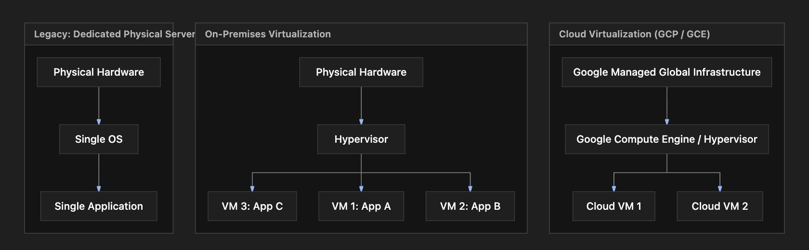

# Section Study Notes: Introduction to Virtual Machines and Virtualization

---

### 1. Overview
This section introduces the foundational concepts of **Virtual Machines (VMs)**, tracing their evolution from traditional dedicated physical servers to modern on-demand cloud infrastructure. 
- **The Problem:** Deploying single applications on dedicated physical servers leads to severe resource wastage (e.g., low CPU utilization), high costs, and slow provisioning times.
- **The Solution (Virtualization):** Using a software layer called a **hypervisor** to split a single physical server into multiple isolated virtual machines, maximizing resource efficiency.
- **The Evolution to Cloud:** Moving away from on-premises data center and hardware management (power, cooling, maintenance) to cloud-based Infrastructure as a Service (IaaS) offerings like **Google Compute Engine (GCE)** on Google Cloud Platform (GCP).

---

### 2. ACE Exam Focus & Common Exam Traps
- **Exam Importance:** **HIGH** (GCP Compute Engine is the foundational compute service; understanding the abstraction of hardware and shared tenancy is essential for scenario-based architecture questions).
- **High-Priority Topics:**
  - Core compute service on GCP: **Google Compute Engine (GCE)**.
  - Distinction between managing physical hardware (on-premises/VMware) vs. cloud IaaS (where Google manages physical servers, power, cooling, and hypervisors).
  - Pay-as-you-go billing model and global region/zone selection flexibility.
- **Common Exam Traps:** 
  - Confusing what the cloud provider manages versus what the customer manages in a standard IaaS (GCE) deployment. (Google manages physical infrastructure and hypervisor; the customer manages the Guest OS, network configuration, security updates, and applications).

---

### 3. Detailed Concept Explanation

#### A. Traditional Dedicated Servers vs. Virtualization
*   **Dedicated Servers (Legacy Model):** Each application runs on its own physical server. 
    * *Challenges:* Massive resource wastage (often utilizing only 10–20% of CPU/RAM), expensive hardware acquisition costs, and long procurement/setup delays.
*   **Virtualization:** Running multiple virtual servers (VMs) on a single physical machine.
    * *Benefits:* Higher hardware utilization, cost reduction, rapid provisioning, and resource isolation.

#### B. The Hypervisor
*   **Definition & Purpose:** A hypervisor is the core software layer that sits directly on top of the physical hardware (or inside an operating system) to create, manage, and execute virtual machines.
*   **Key Functions:**
    * **Resource Sharing:** Allocates CPU, memory, and storage from the physical host to individual VMs.
    * **Isolation:** Ensures that a failure, crash, or security breach in one VM does not impact other VMs running on the same physical server.
    * **Centralized Management:** Allows administrators to control multiple VMs across multiple physical servers from a unified dashboard (historically pioneered by companies like VMware).

#### C. Evolution to Cloud Virtualization (IaaS)
*   **The Remaining On-Premises Challenge:** Even with virtualization, enterprises still had to purchase, house, power, cool, and maintain physical data centers and hardware infrastructure.
*   **Cloud Virtualization Solution:** Cloud providers abstract away physical infrastructure entirely.
    * **AWS:** Amazon Elastic Compute Cloud (EC2)
    * **Microsoft Azure:** Azure Virtual Machines
    * **Google Cloud:** **Google Compute Engine (GCE)**
*   **Customer Responsibilities in the Cloud:** You no longer manage physical servers or hypervisors. Instead, you focus purely on:
    1. **Region & Zone Selection:** Where geographically your VM runs.
    2. **Operating System (OS):** Linux, Windows, or custom images.
    3. **Hardware Configuration:** vCPU count, memory (RAM), and storage sizing.
    4. **Application & Runtime:** Software layers installed on top of the Guest OS.
*   **Commercial Benefits:** **Pay-as-you-go billing** (billed by the second or minute depending on the cloud provider) and global reach (launching a VM globally across regions within minutes).

---

### 4. Visual Representations

#### Evolution of Compute Architecture

---

### 5. Mental Models & Analogies

| Concept | Real-World Analogy | GCP / Technical Mapping |
| :--- | :--- | :--- |
| **Physical Server** | An entire apartment building owned by you. | Physical hardware racked in a data center. |
| **Virtualization / Hypervisor** | Subdividing the apartment building into distinct, locked apartments with shared utilities. | Software dividing physical server resources into multiple isolated VMs. |
| **Cloud VM (Google Compute Engine)** | Renting a fully furnished, managed hotel suite where maintenance, plumbing, and building security are handled by the hotel staff. | Launching a GCE instance where Google manages the physical data center, hardware, and hypervisor layer. |

---

### 6. Step-by-Step Workflows / Comparison Tables

#### Comparison Table: On-Premises Dedicated Servers vs. On-Premises Virtualization vs. Cloud VMs (GCE)

| Feature | Dedicated Physical Servers | On-Premises Virtualization (VMware) | Cloud VMs (Google Compute Engine) |
| :--- | :--- | :--- | :--- |
| **Hardware Management** | Customer | Customer | Google |
| **Data Center (Power/Cooling)** | Customer | Customer | Google |
| **Hypervisor Management** | N/A (No hypervisor) | Customer | Google |
| **Provisioning Speed** | Weeks / Months (Hardware ordering) | Hours / Days | Minutes |
| **Billing Model** | CapEx (Capital Expenditure - Upfront purchase) | CapEx + Software Licensing | OpEx (Operational Expenditure - Pay-as-you-go) |
| **Scalability** | Hard to scale (Limited by physical capacity) | Limited by local data center capacity | Virtually limitless, global scale |

---

### 7. Common Mistakes & Exam Traps

- **Trap 1:** Assuming cloud users manage the hypervisor configuration when deploying a standard Google Compute Engine virtual machine.
  - *Correction:* In IaaS models like GCE, the cloud provider (Google) manages the underlying physical infrastructure and hypervisor layers completely. The customer's responsibility starts at the Guest OS level.
- **Trap 2:** Confusing CapEx and OpEx models in cloud financial questions.
  - *Correction:* Moving from dedicated physical servers (CapEx) to cloud VMs like GCE shifts the financial model to OpEx (pay-as-you-go, utility-style pricing).

---

### 8. Certification Practice Questions

#### Q1: Which of the following best describes the primary purpose of a hypervisor in a virtualized environment?
- A) To manage global network routing tables across multiple cloud regions.
- B) To sit on top of physical infrastructure and enable the creation, isolation, and management of multiple virtual machines.
- C) To provide a managed relational database service without managing underlying servers.
- D) To automatically write application code based on natural language prompts.
- **Correct Answer:** B
- **Explanation:** A hypervisor is the foundational software layer that abstracts physical server hardware to allow multiple isolated virtual machines to run concurrently on the same physical host.
- **Why others are incorrect:** Option A relates to networking services (like VPCs or Cloud Routers). Option C describes managed databases (like Cloud SQL). Option D is unrelated to virtualization.
- **Exam Takeaway:** Always associate hypervisors with hardware abstraction, resource partitioning, and VM isolation.

#### Q2: Your company currently runs applications on dedicated physical servers in an on-premises data center. Management complains about high hardware costs and long lead times when procuring servers for new applications. What is the primary architectural benefit of migrating these workloads to Google Compute Engine (GCE)?
- A) Elimination of the need to write application code.
- B) Shifting from an OpEx model to a rigid CapEx hardware purchasing model.
- C) Eliminating physical data center management overhead and enabling rapid, on-demand provisioning.
- D) Guaranteeing that underlying virtual machines never experience hardware failures.
- **Correct Answer:** C
- **Explanation:** Cloud migration to GCE frees organizations from managing physical infrastructure (hardware, data centers, power, cooling) and allows provisioning VMs in minutes rather than waiting weeks for physical hardware delivery.
- **Why others are incorrect:** Option A is false; you still manage application code. Option B is backward; cloud shifts CapEx to OpEx. Option D is false; underlying hardware can fail, which is why architecture must account for high availability (though live migration helps in GCP).
- **Exam Takeaway:** Cloud IaaS value propositions center on agility, speed of provisioning, and shifting infrastructure overhead to the cloud provider.

#### Q3: In a standard Google Compute Engine (GCE) virtual machine deployment, which of the following components is managed entirely by Google rather than the customer?
- A) Operating system security patches
- B) Application runtime environment
- C) Physical server hardware and hypervisor layer
- D) Firewall rules restricting inbound application traffic
- **Correct Answer:** C
- **Explanation:** In an Infrastructure as a Service (IaaS) model like GCE, Google is responsible for the physical data centers, servers, networking hardware, and the virtualization hypervisor layer.
- **Why others are incorrect:** Options A, B, and D are part of the customer's shared responsibility domain (Guest OS maintenance, application logic, and user-defined VPC firewall rules).
- **Exam Takeaway:** Understand the split in responsibility: Google owns down-to-the-hypervisor; customer owns OS up-to-the-application.

#### Q4: Which financial advantage is most directly realized by shifting workloads from dedicated physical servers to cloud-based virtual machines?
- A) Transitioning from Capital Expenditure (CapEx) to Operational Expenditure (OpEx) with pay-as-you-go pricing.
- B) Permanent elimination of all software licensing costs.
- C) Fixed monthly billing regardless of resource consumption or uptime.
- D) Elimination of network egress fees.
- **Correct Answer:** A
- **Explanation:** Cloud services operate on a utility model where you pay only for what you consume (OpEx), avoiding large upfront hardware purchases (CapEx).
- **Why others are incorrect:** Option B is false; OS and third-party software licenses may still apply. Option C describes fixed pricing, whereas cloud is usage-based. Option D is false; network egress fees still apply depending on data transfer destinations.
- **Exam Takeaway:** OpEx and pay-as-you-go flexibility are core cloud economic advantages.

#### Q5: An enterprise wants to run three distinct applications on a single physical server securely, ensuring that if Application A crashes or exhausts its local memory loop, Applications B and C remain completely unaffected. What core hypervisor capability provides this guarantee?
- A) Global load balancing
- B) Automated database scaling
- C) Virtual machine isolation
- D) Live data replication
- **Correct Answer:** C
- **Explanation:** Hypervisor-level isolation ensures that virtual machines operate in secure, sandboxed partitions so that faults or crashes in one VM do not cascade to neighboring VMs.
- **Why others are incorrect:** Options A, B, and D describe scaling, load distribution, or storage strategies, not the security/fault isolation provided by a hypervisor.
- **Exam Takeaway:** Isolation is a key keyword associated with hypervisors and VMs preventing cross-application interference.

#### Q6: When launching a virtual machine instance in Google Compute Engine, which of the following parameters must a user typically configure? (Choose the most appropriate foundational set)
- A) Region/Zone, machine type (vCPU/RAM), and operating system image.
- B) Physical rack location number and data center floor tile ID.
- C) Google corporate employee access badge levels.
- D) Physical cooling fan speed thresholds.
- **Correct Answer:** A
- **Explanation:** To launch a GCE VM, you configure basic properties including geographic location (region/zone), hardware capacity (machine type), and the base software image (OS).
- **Why others are incorrect:** Options B, C, and D involve physical data center management tasks that are entirely abstracted and managed by Google.
- **Exam Takeaway:** Know the core user inputs required to spin up a compute instance in the cloud console or CLI.

#### Q7: Which of the following best defines Google Compute Engine (GCE) within the spectrum of cloud computing models?
- A) Software as a Service (SaaS)
- B) Infrastructure as a Service (IaaS)
- C) Function as a Service (FaaS)
- D) Platform as a Service (PaaS)
- **Correct Answer:** B
- **Explanation:** GCE provides raw, virtualized computing resources over the internet, placing it squarely in the Infrastructure as a Service (IaaS) category.
- **Why others are incorrect:** Option A is end-user software (like Google Workspace). Option C refers to serverless functions (Cloud Functions). Option D refers to managed application runtimes (App Engine).
- **Exam Takeaway:** GCE = IaaS. Match core GCP compute services to their correct cloud computing models for the exam.

#### Q8: What was a major limitation of running applications on dedicated physical servers prior to the widespread adoption of virtualization?
- A) Excessive hardware resource wastage due to low average CPU and memory utilization per server.
- B) Inability to write object-oriented code languages.
- C) Complete lack of any operating system software.
- D) Instantaneous hardware provisioning times.
- **Correct Answer:** A
- **Explanation:** Dedicated servers typically ran a single app, resulting in low resource utilization (often 10–20% capacity used), wasting money and compute potential.
- **Why others are incorrect:** Options B and C are factually incorrect. Option D describes the opposite of physical procurement realities (which took weeks or months).
- **Exam Takeaway:** Resource wastage and slow deployment cycles drove the industry from dedicated servers to virtualization.

#### Q9: If an administrator wants to globally deploy virtual machines close to customers in multiple continents within minutes, which cloud capability makes this possible?
- A) On-premises tape backup rotation
- B) Global cloud infrastructure with worldwide regions and zones
- C) Manual physical server shipping logistics
- D) Local desktop virtualization software
- **Correct Answer:** B
- **Explanation:** Cloud providers maintain data centers globally across multiple regions and zones, allowing users to deploy compute resources anywhere in the world instantly via software APIs or consoles.
- **Why others are incorrect:** Options A, C, and D either relate to legacy data center practices or local desktop tools rather than global cloud infrastructure agility.
- **Exam Takeaway:** Global footprint and rapid multi-region deployment are hallmark advantages of cloud computing.

#### Q10: Which of the following statements accurately contrasts on-premises VMware environments with public cloud IaaS (like Google Compute Engine)?
- A) In an on-premises VMware environment, the enterprise must manage the physical servers and hypervisors, whereas in GCE, Google manages them.
- B) Public cloud providers require customers to build and cool their own physical data center cages.
- C) VMware virtualization does not support resource isolation between virtual machines.
- D) GCE restricts users to running only Windows operating systems.
- **Correct Answer:** A
- **Explanation:** The fundamental difference is responsibility: on-premises virtualization still leaves physical infrastructure and hypervisor management to the enterprise, whereas public cloud IaaS abstracts that hardware layer entirely.
- **Why others are incorrect:** Option B describes physical data center ownership, which cloud eliminates. Option C is false; VMware heavily supports isolation. Option D is false; GCE supports a wide range of Linux distributions as well as Windows Server.
- **Exam Takeaway:** Understand the boundary of responsibilities between traditional on-prem virtualization and public cloud IaaS platforms.