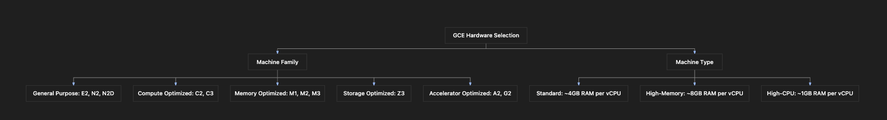

# Section Study Notes: Google Compute Engine (GCE) Core Concepts, Hardware Configuration, and Images

---

### 1. Overview
This section covers the core fundamentals and practical mechanics of **Google Compute Engine (GCE)**, the foundational Infrastructure as a Service (IaaS) offering on Google Cloud Platform. 
- **The Problem:** Enterprises want to leverage virtual machines with high elasticity and global reach without handling physical infrastructure, power, or hypervisors.
- **The Solution (GCE):** GCE allows users to provision, manage, lifecycle-track, and scale virtual machines globally on demand with pay-as-you-go billing.
- **Hardware & Software Configuration:** To optimize performance-to-cost ratios, users must correctly select **Machine Families**, specific **Machine Types** (balancing CPU, memory, and disk types), and **Images** (Public vs. Custom) that determine the OS and base software layer.

---

### 2. ACE Exam Focus & Common Exam Traps
- **Exam Importance:** **HIGH** (GCE is core to almost every architectural scenario on the exam; expect configuration, sizing, and service selection questions).
- **High-Priority Topics:**
  - **Machine Families & Workload Mapping:** Knowing when to choose General Purpose, Compute-optimized, Memory-optimized, Storage-optimized, or Accelerator-optimized (GPU/TPU) families.
  - **Machine Type Nomenclature & Ratios:** Understanding how vCPUs map to RAM configurations in standard, high-memory, and high-CPU types (e.g., standard = ~4GB RAM per vCPU).
  - **Images:** Public images (Debian, Ubuntu, Windows Server) vs. custom images (pre-configured/baked application environments).
  - **Networking fundamentals:** External vs. Internal IP addresses and connecting securely via **SSH**.
  - **Lifecycle Management:** Start, stop, suspend, restart, and delete operations (and cost implications).
- **Common Exam Traps:**
  - Choosing a high-memory machine family when an application is heavily compute-bound (or vice versa), which violates the best performance-to-cost rule.
  - Forgetting that stopped or suspended VMs may still incur storage/disk costs depending on configuration, or leaving free trial / paid resources active unnecessarily.

---

### 3. Detailed Concept Explanation

#### A. Google Compute Engine (GCE) Overview
*   **Definition & Purpose:** GCE is a secure and customizable compute service that lets you create and run virtual machines on Google’s innovative global infrastructure.
*   **Key Features:**
    *   **Lifecycle Management:** Create, start, stop, suspend, resize, and delete VMs.
    *   **Global Reach:** Deploy VMs across multiple regions and zones worldwide.
    *   **Pay-As-You-Go Billing:** Billed by usage time (granular sub-hour tracking).
    *   **Scalability & Grouping:** Scale individual instances or group them using **Managed Instance Groups (MIGs)** with automated scaling and load balancing.

#### B. Connecting to GCE Instances
*   **Internal IP:** Used for private communication inside the Google Cloud Virtual Private Cloud (VPC) network.
*   **External IP:** Used for public communication from the internet.
*   **SSH Integration:** Google Cloud provides browser-based SSH access directly from the Cloud Console, automatically managing SSH keys for users.

#### C. Hardware Selection: Machine Families and Machine Types
To achieve the optimal **performance-to-cost ratio**, hardware selection is divided into two steps: selecting a **machine family** and choosing a specific **machine type**.

1. **Machine Families:**
   * **General Purpose (e.g., E-series, N-series):** Balanced CPU and memory. Ideal for everyday workloads, web servers, dev environments, and small databases.
   * **Compute-optimized (e.g., C-series, H-series):** High performance-per-core for compute-intensive tasks, batch processing, gaming servers, and high-performance computing (HPC).
   * **Memory-optimized (e.g., M-series, X-series):** Massive RAM allocations for in-memory databases (like SAP HANA) and large-scale analytics.
   * **Storage-optimized (e.g., Z-series):** High disk I/O throughput and low latency for heavy big data and data warehouse workloads.
   * **Accelerator-optimized (e.g., A-series, G-series):** Equipped with GPUs or TPUs for Machine Learning (ML), AI, data processing, and heavy graphics rendering.

2. **Machine Types & RAM-to-vCPU Ratios:**
   * Machine types define exact quantities of vCPUs and memory. 
   * Example: `e2-standard-4` 
     * `e2` = Machine family / generation
     * `standard` = Configuration type ratio
     * `4` = Number of virtual CPUs (vCPUs)
   * **Configuration Ratios (General Guide):**
     * **Standard:** Balanced ratio (~4 GB of RAM per vCPU). Example: 4 vCPUs $\rightarrow$ 16 GB RAM.
     * **High-memory (`highmem`):** Higher RAM per vCPU (~8 GB of RAM per vCPU). Example: 4 vCPUs $\rightarrow$ 32 GB RAM.
     * **High-CPU (`highcpu`):** Lower RAM per vCPU (~1 GB of RAM per vCPU).

#### D. Operating System and Software Selection (Images)
An **image** defines the boot disk's operating system and pre-installed software state.
* **Public Images:** Ready-to-use, vendor-maintained or open-source images provided by Google or communities (e.g., Debian, Ubuntu, CentOS, Windows Server).
* **Custom Images:** User-created images containing a specific OS, custom pre-installed software, hardened security policies, and application dependencies. Used for rapid, standardized deployments at scale.

---

### 4. Visual Representations

#### Hardware Selection Hierarchy in Google Compute Engine

---

### 5. Mental Models & Analogies

| Concept | Real-World Analogy | GCP / Technical Mapping |
| :--- | :--- | :--- |
| **Machine Family** | Choosing a vehicle class (e.g., moving truck vs. sports car vs. heavy excavator) based on what you need to move. | Choosing a workload-optimized family (Compute-optimized vs. Memory-optimized vs. General purpose). |
| **Machine Type** | Selecting engine size and passenger capacity within that vehicle class (e.g., 4-cylinder vs. 8-cylinder engine). | Selecting exact vCPU counts and RAM proportions (`e2-standard-4` vs `e2-highmem-4`). |
| **Public vs Custom Image** | Buying an empty house vs. moving into a fully custom-renovated, furnished smart home. | Using a generic base OS public image vs. deploying an internal pre-baked custom image with enterprise software. |

---

### 6. Step-by-Step Workflows / Comparison Tables

#### Workflow: Launching and Deleting a GCE Virtual Machine via Console
1. **Prerequisites:** Active Google Cloud Account, valid project selected.
2. **Navigation:** Go to the Google Cloud Console (`console.cloud.google.com`), search for **Compute Engine**, and click **VM Instances**.
3. **Initiation:** Click **Create Instance**.
4. **Configuration:**
   - **Name:** Enter a unique lowercase name (e.g., `my-first-vm`).
   - **Region & Zone:** Select the target geographic area (e.g., `us-central1` and `us-central1-c`).
   - **Machine Configuration:** Choose a Machine Family (e.g., General Purpose, `E2`) and Machine Type (e.g., `e2-medium` or `e2-standard-4`).
   - **OS and Storage:** Click *Change* to select a Public Image (e.g., Debian) or custom image, along with boot disk parameters.
5. **Execution:** Click **Create**. Wait 2–3 minutes for provisioning.
6. **Interaction:** Click the **SSH** button next to the running instance to open a browser-based shell terminal. Execute diagnostic commands (`whoami`, `pwd`, `ls`).
7. **Cleanup (Cost Control):** Exit the terminal and select **Delete** from the instance dropdown menu to terminate resources and prevent ongoing billing/credit drain.

#### Comparison Table: GCE Machine Configuration Types

| Machine Configuration Type | RAM-to-vCPU Ratio | Primary Use Case | Example |
| :--- | :--- | :--- | :--- |
| **Standard** | Balanced (~4 GB RAM per vCPU) | General web apps, small databases, developer environments | `e2-standard-4` (4 vCPUs, 16 GB RAM) |
| **High-Memory (`highmem`)** | High RAM (~8 GB RAM per vCPU) | In-memory databases, large-scale data analytics, caching servers | `e2-highmem-4` (4 vCPUs, 32 GB RAM) |
| **High-CPU (`highcpu`)** | Low RAM (~1 GB RAM per vCPU) | High-throughput batch processing, heavy computational tasks without large RAM needs | `e2-highcpu-16` (16 vCPUs, 16 GB RAM) |

---

### 7. Common Mistakes & Exam Traps

- **Trap 1:** Choosing a Compute-optimized machine family for a memory-bound in-memory database application.
  - *Correction:* In-memory databases require high volumes of RAM; a Memory-optimized (`M` or `X` series) family is required.
- **Trap 2:** Confusing internal and external IP addresses.
  - *Correction:* Internal IPs are used for secure communication *within* the private GCP Virtual Private Cloud (VPC) network. External IPs are required to reach the VM over the public internet.
- **Trap 3:** Assuming public images contain pre-installed custom business applications.
  - *Correction:* Public images provide clean, base operating systems (Debian, Ubuntu, Windows). Custom business applications or unique configurations require either post-deployment provisioning scripts (startup scripts) or custom-baked images.

---

### 8. Certification Practice Questions

#### Q1: An administrator needs to deploy a high-performance in-memory database that requires massive amounts of RAM relative to its CPU footprint. Which GCE machine family should be selected?
- A) General-purpose machine family
- B) Compute-optimized machine family
- C) Memory-optimized machine family
- D) Storage-optimized machine family
- **Correct Answer:** C
- **Explanation:** Memory-optimized machine families provide high memory-to-vCPU ratios tailored specifically for memory-intensive workloads like in-memory databases and large-scale analytics.
- **Why others are incorrect:** General-purpose offers balanced ratios; compute-optimized focuses on high CPU performance; storage-optimized focuses on disk I/O throughput.
- **Exam Takeaway:** Match workload resource requirements directly to the corresponding GCE machine family category.

#### Q2: You are analyzing a GCE machine type named `e2-standard-4`. Based on standard Google Cloud naming conventions, what does the number `4` designate?
- A) The amount of persistent disk storage in terabytes
- B) The number of virtual CPUs (vCPUs) allocated to the instance
- C) The zone identifier within the region
- D) The number of external network interfaces attached
- **Correct Answer:** B
- **Explanation:** In GCE naming conventions (`family-type-count`), the trailing number specifies the quantity of virtual CPUs (vCPUs).
- **Why others are incorrect:** Storage, zones, and network interfaces are configured independently and are not denoted by the trailing machine type integer.
- **Exam Takeaway:** Memorize GCE machine type nomenclature (`family-configuration-vCPUs`).

#### Q3: Which of the following best describes the difference between public images and custom images in Google Compute Engine?
- A) Public images can only be used on Windows, while custom images can only be used on Linux.
- B) Public images are ready-to-use base operating system images provided by Google or open-source communities, whereas custom images are user-created images tailored with specific configurations and software.
- C) Custom images are free to store, whereas public images incur heavy monthly storage licensing charges.
- D) Public images require a physical activation key, while custom images do not.
- **Correct Answer:** B
- **Explanation:** Public images are standardized templates provided by Google or communities (e.g., Debian, Ubuntu), whereas custom images are built by users to preserve a specific pre-configured application environment.
- **Why others are incorrect:** Both public and custom images can run Linux or Windows (subject to licensing). Custom images consume storage space and incur minor storage costs.
- **Exam Takeaway:** Use public images for standard baseline OS deployments and custom images when pre-packaged software configurations are required across multiple scaling units.

#### Q4: A developer is running batch-processing simulations that require heavy computational power with minimal RAM overhead. Which machine configuration type should they pick within a machine family?
- A) `highmem`
- B) `standard`
- C) `highcpu`
- D) `storage-optimized`
- **Correct Answer:** C
- **Explanation:** The `highcpu` configuration provides a lower RAM-to-vCPU ratio (~1 GB RAM per vCPU), optimizing costs for CPU-bound computational tasks.
- **Why others are incorrect:** `highmem` allocates excessive, costly RAM; `standard` allocates a balanced amount that may over-provision memory; storage-optimized focuses on disk throughput.
- **Exam Takeaway:** Match CPU vs memory configuration types (`standard`, `highmem`, `highcpu`) accurately to workload traits.

#### Q5: You have successfully created a GCE virtual machine instance. What is the primary function of the external IP address assigned to this instance?
- A) To communicate securely with other resources inside the same private Google Cloud VPC network.
- B) To allow direct management and traffic traversal from the public internet.
- C) To handle internal hypervisor resource allocation checks.
- D) To authenticate Google Cloud IAM user service accounts.
- **Correct Answer:** B
- **Explanation:** An external IP address provides public routing capabilities, enabling the VM to communicate with and be accessed from the public internet.
- **Why others are incorrect:** Internal IP addresses handle intra-VPC communication. Hypervisor allocations and IAM authentication use separate control planes.
- **Exam Takeaway:** Internal IP = private VPC network communication; External IP = public internet access.

#### Q6: When exploring cost-saving measures for development environments on Google Compute Engine, which practice is heavily recommended after completing testing?
- A) Changing the machine type to a memory-optimized tier
- B) Deleting or stopping the virtual machine instance immediately to prevent unnecessary charges or credit drainage
- C) Attaching multiple heavy GPUs to keep the state active
- D) Upgrading the OS image to a commercial Windows Server license
- **Correct Answer:** B
- **Explanation:** Leaving unused VMs running consumes compute billing or free trial credits. Terminating or stopping them immediately stops compute billing.
- **Why others are incorrect:** Upgrading tiers or adding GPUs increases costs rather than reducing them.
- **Exam Takeaway:** Always clean up cloud lab resources promptly to conserve free trial credits or operational budgets.

#### Q7: An enterprise needs to run a machine learning model requiring specialized hardware acceleration. Which machine family category should they select?
- A) General-purpose machine family
- B) Compute-optimized machine family
- C) Accelerator-optimized machine family
- D) Memory-optimized machine family
- **Correct Answer:** C
- **Explanation:** Accelerator-optimized machine families (such as A-series or G-series) include dedicated hardware units like GPUs and TPUs designed for AI, ML, and graphics rendering workloads.
- **Why others are incorrect:** The other families do not feature integrated graphics/ML accelerators as a primary design focus.
- **Exam Takeaway:** Machine learning and AI workloads demand accelerator-optimized configurations with GPUs/TPUs.

#### Q8: How does Google Compute Engine handle secure command-line access to Linux virtual machine instances directly from the browser Cloud Console?
- A) By requiring manual generation, downloading, and local command-line configuration of SSH RSA private key files for every connection.
- B) Through automated browser-based SSH integration that handles temporary key generation and injection seamlessly.
- C) By forcing plain-text Telnet connections across public ports.
- D) By utilizing FTP file transfer protocols.
- **Correct Answer:** B
- **Explanation:** The GCP Console provides a built-in browser-based SSH feature that automatically provisions and injects temporary SSH keys, allowing instant secure terminal access.
- **Why others are incorrect:** While manual SSH keys *can* be added to metadata, the web console abstracts this away for rapid troubleshooting. Telnet and FTP are insecure/irrelevant.
- **Exam Takeaway:** Understand that GCE supports convenient browser-based SSH access out of the box.

#### Q9: Which of the following metrics defines the standard RAM-to-vCPU ratio for an `e2-standard` machine type configuration?
- A) Approximately 1 GB of RAM per vCPU
- B) Approximately 4 GB of RAM per vCPU
- C) Approximately 8 GB of RAM per vCPU
- D) Exactly 32 GB of RAM per vCPU regardless of core count
- **Correct Answer:** B
- **Explanation:** Standard machine configurations typically provide a balanced baseline ratio of approximately 4 GB of RAM per vCPU.
- **Why others are incorrect:** 1 GB corresponds to `highcpu` configurations; 8 GB corresponds to `highmem` configurations.
- **Exam Takeaway:** Know the baseline ratio multipliers: High-CPU = 1:1, Standard = 1:4, High-Memory = 1:8 (approximate general rules of thumb).

#### Q10: What is the primary role of Managed Instance Groups (MIGs) when dealing with multiple GCE virtual machine instances?
- A) To provision single, isolated physical bare-metal servers manually.
- B) To manage a collection of identical VM instances with automated scaling, auto-healing, and load-balancing capabilities.
- C) To permanently block all external internet traffic across all project subnets.
- D) To convert Linux instances into Windows Server containers automatically.
- **Correct Answer:** B
- **Explanation:** Managed Instance Groups (MIGs) template identical VMs together, allowing automated elasticity, healing of failed instances, and uniform updates.
- **Why others are incorrect:** MIGs automate groups rather than manual single bare-metal setups, and they do not handle firewall security blocking or cross-OS conversion.
- **Exam Takeaway:** MIGs = template-based group management, auto-scaling, and auto-healing for GCE VMs.