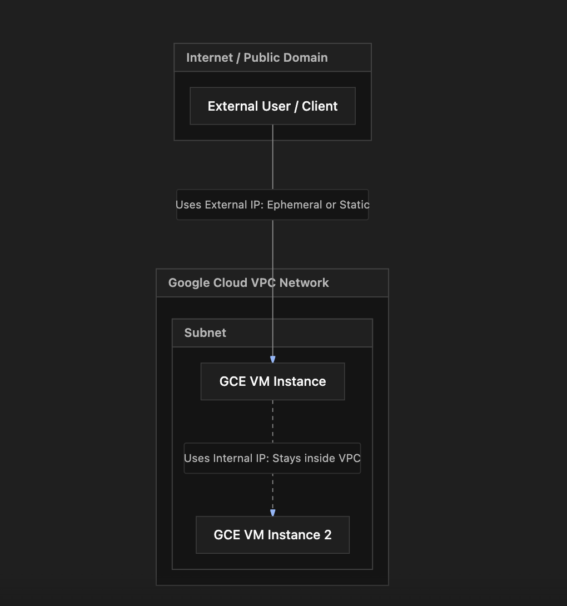

# Section Study Notes: GCE IP Address Types, Configurations, and Scenarios

---

### 1. Overview
This section covers the types of IP addresses available for Google Compute Engine (GCE) virtual machine instances. It explains the differences between internal IP addresses, external ephemeral IP addresses, and external static IP addresses, along with best practices for handling them and avoiding unnecessary cloud costs.

---

### 2. ACE Exam Focus & Common Exam Traps
- **Exam Importance:** **HIGH** (IP addressing, networking boundaries, VPC communication, and cost optimization questions frequently appear on the exam).
- **High-Priority Topics:**
  - **Internal IPs:** Permanent within the instance's lifetime, free of charge, used exclusively inside the private VPC network.
  - **External Ephemeral IPs:** Temporary public IPs assigned by default; they can change if a VM is stopped and restarted.
  - **External Static IPs:** Permanent public IPs that persist across stops, restarts, and reassignments.
  - **Unassigned Static IP Cost Trap:** Reserving an external static IP address *without* attaching it to an active resource (like a running VM) incurs a higher billing rate.
- **Common Exam Traps:**
  - Assuming external ephemeral IPs never change when restarting a VM (they *can* change, whereas static IPs remain fixed).
  - Forgetting to release or assign a reserved static IP address, leading to unexpected resource charges.

---

### 3. Detailed Concept Explanation

#### A. Internal IP Addresses
*   **Definition & Purpose:** Every GCE VM is assigned an internal IP address by default. This address is drawn from the subnet range of the Virtual Private Cloud (VPC).
*   **Behavior:** Permanent for the lifetime of that instance. It never changes while the VM exists.
*   **Scope & Cost:** Restricted strictly to internal communication within the private Google Cloud VPC network. **Google does not charge for internal IP addresses.**
*   **Best Practice:** When resources inside the same private network communicate with each other, they should use internal IP addresses to ensure traffic stays internal and does not traverse the public internet.

#### B. External Ephemeral IP Addresses
*   **Definition & Purpose:** Publicly routable IP addresses assigned by default to allow internet communication, unless explicitly disabled (`none`).
*   **Behavior ("Ephemeral"):** Temporary. If a VM is stopped and later restarted, the ephemeral IP address can be released and replaced with a different one.
*   **Use Case:** Good for basic testing or short-lived workloads where fixed inbound public routing is not strictly required.

#### C. External Static IP Addresses
*   **Definition & Purpose:** Permanent public IP addresses that can be requested, reserved, and attached to a VM instance.
*   **Behavior:** Remains bound to your project and persists across VM stops, restarts, and even intentional reassignments to other VMs. An ephemeral IP can be "promoted" to a static IP.
*   **Cost Trap (Crucial Exam Concept):** 
    * When a static external IP address is **attached** to a running VM instance, it is billed at a very low rate (or free depending on configuration rules).
    * When a static external IP address is **reserved but *not* attached** to any active resource, **it is billed at a higher rate**. 
    * *Best Practice:* Always attach a reserved static IP to a VM immediately or release it (`Release static IP address`) when no longer needed.

---

### 4. Visual Representations

#### IP Address Scope and Communication Paths

---

### 5. Mental Models & Analogies

| Concept | Real-World Analogy | GCP / Technical Mapping |
| :--- | :--- | :--- |
| **Internal IP** | An internal office extension number (e.g., Ext. 104) used to call coworkers within the same building. | Used for private communication between resources inside the same VPC. Free of charge. |
| **External Ephemeral IP** | A temporary visitor badge number assigned to you each time you enter a facility. | A default public IP that can change if you leave and check back in later (stop/restart). |
| **External Static IP** | A permanent custom vanity phone number or designated reserved parking space with your name on it. | A persistent public IP that stays identical across reboots and can be reassigned. Costs more if left empty. |

---

### 6. Step-by-Step Workflows / Comparison Tables

#### Comparison Table: GCE IP Address Types

| IP Type | Scope | Permanence | Cost / Billing | Primary Use Case |
| :--- | :--- | :--- | :--- | :--- |
| **Internal IP** | Private VPC Network | Permanent for VM lifetime | **Free** | Secure intra-VPC communication between resources. |
| **External Ephemeral IP** | Public Internet | Temporary (may change on stop/restart) | Free (associated with the instance) | Basic public internet access where a fixed address is not required. |
| **External Static IP** | Public Internet | Permanent until manually released | Billed (higher rate if *unassigned*) | Production applications requiring a consistent public-facing address. |

---

### 7. Common Mistakes & Exam Traps

- **Trap 1:** Assuming that stopping and restarting a VM with an external ephemeral IP will always retain the exact same public IP address.
  - *Correction:* Ephemeral means temporary; Google can reassign the IP when the instance lifecycle changes. A *static* IP is required to guarantee permanence.
- **Trap 2:** Leaving a reserved static external IP address sitting unassigned in the VPC configuration to "save it for later."
  - *Correction:* Unassigned static external IPs incur a financial penalty (billed at a higher rate than attached ones). They should be released immediately when unused.

---

### 8. Certification Practice Questions

#### Q1: An administrator wants to ensure that a GCE virtual machine's external IP address never changes, even if the instance is stopped, restarted, or deleted and reassigned to a new instance. What type of IP address should be utilized?
- A) Internal IP address
- B) External ephemeral IP address
- C) External static IP address
- D) Loopback local IP address
- **Correct Answer:** C
- **Explanation:** External static IP addresses are permanent public addresses that remain constant across stops, restarts, and reassignments until explicitly released.
- **Why others are incorrect:** Internal IPs are private-only; ephemeral IPs are temporary and can change on restart; loopback addresses are local interface software loops (`127.0.0.1`).
- **Exam Takeaway:** Use external static IPs when public address persistence is an application requirement.

#### Q2: What is the primary billing implication of reserving an external static IP address in Google Cloud and leaving it unassigned to any active virtual machine or resource?
- A) It is completely free as long as no data passes through it.
- B) It is billed at a higher rate than when it is attached to an active virtual machine instance.
- C) Google automatically deletes the IP address after 24 hours of inactivity.
- D) It automatically converts into an internal dynamic IP address.
- **Correct Answer:** B
- **Explanation:** Unassigned static external IP addresses incur a higher financial penalty cost to discourage hoarding public IP space.
- **Why others are incorrect:** They are not free when unassigned, Google does not auto-delete them without user action, and they do not convert to internal IPs.
- **Exam Takeaway:** Unassigned static public IPs cost more; always release them when not in use.

#### Q3: Two virtual machine instances are running within the same private Google Cloud VPC network. To ensure communication traffic remains private and does not traverse the public internet, which IP address type should VM A use to communicate with VM B?
- A) External ephemeral IP address
- B) External static IP address
- C) Internal IP address
- D) Public DNS loop address
- **Correct Answer:** C
- **Explanation:** Communication between resources inside the same VPC network using internal IP addresses ensures that traffic stays entirely within Google's private network infrastructure.
- **Why others are incorrect:** Using external IP addresses forces traffic out through public internet paths, which is inefficient, less secure, and unnecessary.
- **Exam Takeaway:** Intra-VPC traffic should always route over internal IP addresses.

#### Q4: Are Google Cloud users charged an additional fee for standard internal IP addresses assigned to virtual machine instances?
- A) Yes, billed hourly based on vCPU proportions.
- B) Yes, billed per gigabyte of internal data transferred.
- C) No, internal IP addresses are provided at no additional charge.
- D) Only if the internal IP address is promoted to a static type.
- **Correct Answer:** C
- **Explanation:** Google Cloud does not charge users for internal IP addresses assigned to their compute instances.
- **Why others are incorrect:** Internal IPs are free; data transfer fees apply in certain cross-zone/cross-region scenarios, but the IP address itself has no base cost.
- **Exam Takeaway:** Internal IPs are free of charge in GCP.

#### Q5: A developer creates a new GCE instance and opts to configure the external network interface setting to **None**. What will be the direct network impact on this virtual machine?
- A) The VM will be completely unreachable from any other resource, even inside the same private VPC.
- B) The VM will have an internal IP address for VPC communication, but no external IP address and no direct access to the public internet.
- C) The VM will automatically be assigned an external static IP address.
- D) The VM will shut down immediately upon creation due to a configuration failure.
- **Correct Answer:** B
- **Explanation:** Selecting "None" for the external IP removes public internet connectivity, but the VM still retains its mandatory internal IP address for local VPC communication.
- **Why others are incorrect:** It remains reachable from within its VPC network via its internal IP, it does not get a static IP, and it does not shut down.
- **Exam Takeaway:** Setting external IP to "None" secures a VM by isolating it from the public internet while keeping internal VPC networking intact.

#### Q6: What happens to a default external ephemeral IP address assigned to a GCE instance when the instance goes through a stop and restart cycle?
- A) It is strictly guaranteed to stay identical.
- B) It is released, and there is a possibility that a different external IP address will be assigned upon restart.
- C) It automatically turns into a billable unassigned static IP.
- D) The instance loses its internal IP address as well.
- **Correct Answer:** B
- **Explanation:** Ephemeral means temporary. Stopping and restarting an instance can release the dynamic external IP, resulting in a new IP upon startup.
- **Why others are incorrect:** Persistence is not guaranteed (unlike static IPs), it doesn't automatically convert to static types, and internal IPs remain unaffected.
- **Exam Takeaway:** Ephemeral = temporary; do not rely on ephemeral public IPs to survive restarts.

#### Q7: An engineer has an ephemeral external IP address attached to a running development VM. They want to prevent this IP address from changing if the VM is restarted. What administrative action should they perform in the Google Cloud Console?
- A) Delete the VPC network and create a new subnet.
- B) Promote the ephemeral external IP address to a static external IP address.
- C) Change the machine family to memory-optimized.
- D) Disable all internal networking interfaces.
- **Correct Answer:** B
- **Explanation:** Promoting an existing ephemeral external IP address converts it into a permanent static external IP address bound to that instance.
- **Why others are incorrect:** Rebuilding networks, changing machine types, or disabling interfaces do not convert ephemeral IPs to static ones.
- **Exam Takeaway:** Ephemeral IPs can be promoted directly to static IPs to prevent address changes during lifecycles.

#### Q8: When managing IP addresses under the **VPC Network** section of the Google Cloud Console, which of the following actions represents a best practice for cost optimization?
- A) Leaving unassigned static external IP addresses reserved indefinitely for future projects.
- B) Releasing reserved static external IP addresses immediately when they are no longer attached to active instances.
- C) Assigning external static IPs to every single internal database test instance.
- D) Deleting all internal IP addresses to avoid base charges.
- **Correct Answer:** B
- **Explanation:** Because unassigned static external IPs incur a higher billing rate, releasing them immediately when unused is a critical cost-optimization best practice.
- **Why others are incorrect:** Hoarding unassigned static IPs increases costs; internal IPs are free and shouldn't be deleted; databases generally don't need public static IPs for security reasons.
- **Exam Takeaway:** Release unassigned static IPs to avoid penalty billing.

#### Q9: Which statement accurately describes the lifespan of an internal IP address assigned to a GCE virtual machine?
- A) It changes every time the instance is rebooted.
- B) It remains permanent throughout the entire lifecycle of that specific virtual machine instance.
- C) It expires automatically after 30 days of creation.
- D) It can only be accessed while an external static IP is active.
- **Correct Answer:** B
- **Explanation:** Internal IP addresses are permanent and remain tied to the VM instance for its entire operational lifecycle until the VM is deleted.
- **Why others are incorrect:** They do not change on reboot, they do not expire on timers, and they do not depend on external static IPs.
- **Exam Takeaway:** Internal IPs are fixed and permanent for the life of the VM instance.

#### Q10: A company deploys a multi-tier application where database VMs communicate with application backend VMs. For security and optimal routing, how should these backend VMs reference each other?
- A) By using their public external static IP addresses routed through the internet.
- B) By using their private internal IP addresses entirely within the VPC network.
- C) By utilizing external ephemeral IPs across public gateway nodes.
- D) By hardcoding loopback IP addresses.
- **Correct Answer:** B
- **Explanation:** Backend and database tiers should communicate strictly via internal IP addresses within the private VPC network to maximize security and avoid public internet exposure or data transfer charges.
- **Why others are incorrect:** Routing internal tiers over public external IPs exposes backend data to the internet and violates fundamental security best practices.
- **Exam Takeaway:** Multi-tier architectures should use internal IPs for intra-cloud communication.s