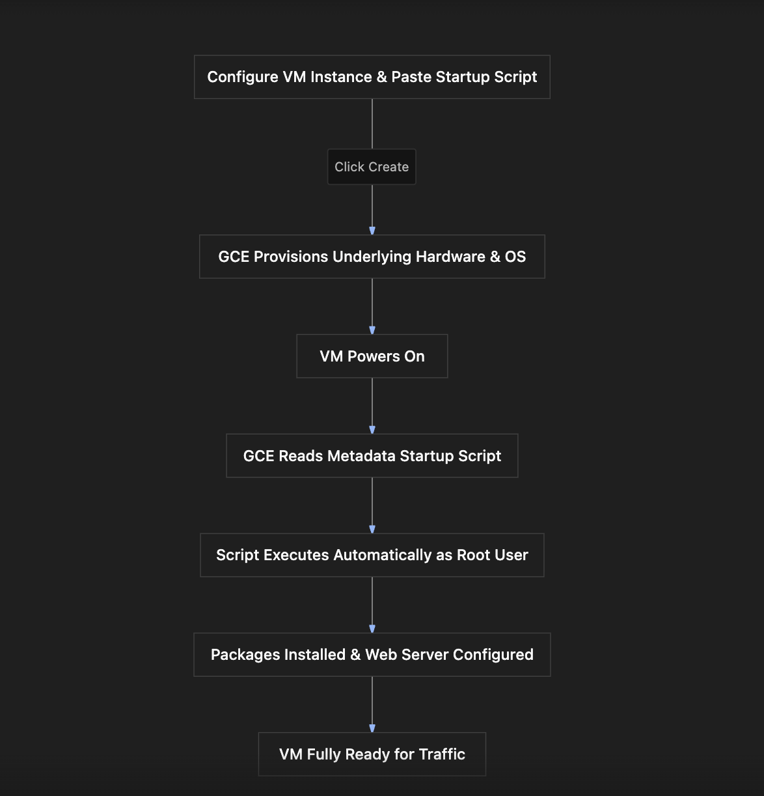

# Section Study Notes: GCE Startup Scripts and Automated Bootstrapping

---

### 1. Overview
This section focuses on automating software installation and configuration on Google Compute Engine (GCE) virtual machines to avoid manual, multi-step provisioning processes.
- **The Problem:** Manually spinning up a VM, logging in via SSH, updating packages, installing software, and modifying configurations for multiple instances is slow and repetitive.
- **The Solution (Bootstrapping via Startup Scripts):** Automatically executing configuration and installation scripts the moment a GCE virtual machine boots up or restarts.
- **Key Takeaway:** Startup scripts execute automatically with root administrative privileges, making them ideal for installing packages like Apache web servers, pulling code repositories, or applying baseline updates at launch.

---

### 2. ACE Exam Focus & Common Exam Traps
- **Exam Importance:** **HIGH** (Automation and deployment configuration via metadata/startup scripts are common topics in scenario-based ACE questions).
- **High-Priority Topics:**
  - **Concept of Bootstrapping:** Automating initial VM configuration on startup.
  - **Privilege Level:** Startup scripts execute automatically as the **root** user (no `sudo su` command required inside the script).
  - **Configuration Location:** Configured during VM creation under **Advanced settings** $\rightarrow$ **Management / Automation** (Metadata).
  - **Timing/Latency Consideration:** VMs using startup scripts may take slightly longer to reach a fully ready state because they must complete script execution during the boot sequence.
- **Common Exam Traps:**
  - Expecting a startup script to be executable by a non-root standard user by default (remember: they run with root permissions).
  - Assuming the web page will be available instantly upon the "green running" status (startup scripts run *after* boot initiation, meaning it might take a minute or two longer for services like Apache to finish installing and rendering).

---

### 3. Detailed Concept Explanation

#### A. The Need for Bootstrapping
*   If you need to deploy multiple identical virtual machines (e.g., 10 web servers), performing manual SSH configuration on each one is inefficient and prone to human error.
*   **Bootstrapping** solves this by embedding setup instructions directly into the VM provisioning request so that the machine configures itself automatically upon launch.

#### B. Startup Scripts in Google Compute Engine
*   **Definition:** A startup script is a set of instructions (shell commands or scripts) that GCE passes to the instance metadata and automatically executes when the instance boots up or restarts.
*   **How it Works:**
    1.  When creating a GCE instance, you paste or upload your script into the **Automation** section.
    2.  GCE injects this script into the instance metadata service.
    3.  During OS initialization, the system reads the metadata, executes the script sequentially with **root privileges**, and completes tasks (like `apt update`, `apt install apache2`, and writing index files).
*   **Typical Content of an Apache Startup Script:**
    ```bash
    #!/bin/bash
    apt-get update
    apt-get install -y apache2
    echo "Hello World from Startup Script!" > /var/www/html/index.html
    ```

#### C. Troubleshooting and Behavioral Nuances
*   **Execution Delay:** Because the startup script executes *during* and *after* the initial boot sequence, there is a short delay between the VM status showing "running" in the console and the web server actually responding to HTTP requests.
*   **Troubleshooting Steps if it Fails:**
    1. Check that **Allow HTTP traffic** is enabled in the firewall/networking configuration.
    2. Verify the exact syntax of the script matches required Linux command structures.
    3. Review serial console output logs for the instance in the GCE console to inspect script execution errors.

---

### 4. Visual Representations

#### Startup Script Execution Flow


---

### 5. Mental Models & Analogies

| Concept | Real-World Analogy | GCP / Technical Mapping |
| :--- | :--- | :--- |
| **Startup Script** | A checklist of instructions left on a new employee's desk on day one so they automatically set up their own computer, printer, and workspace without manager intervention. | A script passed via instance metadata that automatically runs and provisions software packages the moment a VM boots. |
| **Root Privileges in Startup** | Hiring an IT technician with a master key who can unlock any cabinet and install system-wide programs. | Startup scripts executing automatically with root-level system permissions. |

---

### 6. Step-by-Step Workflows / Comparison Tables

#### Workflow: Configuring a Startup Script during GCE VM Creation
1.  **Navigation:** Go to the Google Cloud Console $\rightarrow$ **Compute Engine** $\rightarrow$ **VM Instances** $\rightarrow$ **Create Instance**.
2.  **Basic Settings:** Name the instance (e.g., `my-vm-with-startup-script`) and choose your region/zone.
3.  **Networking:** Expand networking settings and check **Allow HTTP traffic** (Port 80).
4.  **Automation (Startup Script):**
    - Expand **Advanced settings**.
    - Scroll down to the **Management** or **Automation** section.
    - Locate the **Startup script** text box.
    - Paste your deployment shell commands (e.g., updating package index, installing Apache2, and writing custom HTML content).
5.  **Creation:** Click **Create**.
6.  **Verification:** Wait a few moments for the instance to boot and the script to finish executing. Copy the External IP, open a browser tab using `http://<External-IP>`, and verify the rendered page.

---

### 7. Common Mistakes & Exam Traps

- **Trap 1:** Assuming startup scripts run as a restricted regular user account.
  - *Correction:* Startup scripts always run with full root administrative privileges, meaning commands like `sudo` are unnecessary inside the script.
- **Trap 2:** Expecting the web page to load instantly the second the green "running" status appears in the console.
  - *Correction:* The "running" status indicates the OS has booted, but the startup script may still be actively running packages and configurations in the background. Allow a minute or two for completion.

---

### 8. Certification Practice Questions

#### Q1: What is the primary purpose of using a startup script when provisioning a Google Compute Engine virtual machine?
- A) To manually prompt the administrator for password credentials every time a user logs in.
- B) To automate bootstrapping tasks, such as installing software, updating packages, and configuring services automatically at launch.
- C) To permanently lock down all networking ports against outbound traffic.
- D) To convert the virtual machine into a serverless cloud function automatically.
- **Correct Answer:** B
- **Explanation:** Startup scripts automate bootstrapping processes so that configuration and software installations happen automatically when the VM boots up.
- **Why others are incorrect:** They do not prompt for manual passwords, block outbound traffic, or convert VMs into serverless functions.
- **Exam Takeaway:** Startup script = automated bootstrapping and configuration on boot.

#### Q2: Under what user privilege level do startup scripts execute by default when a GCE virtual machine boots up?
- A) A restricted guest user account with no write permissions
- B) The root administrative user
- C) A temporary billing auditor account
- D) A standard user account requiring manual `sudo` escalation
- **Correct Answer:** B
- **Explanation:** Startup scripts automatically execute with root administrative privileges, eliminating the need to explicitly call `sudo` inside the script commands.
- **Why others are incorrect:** They do not run under restricted guest or unprivileged accounts.
- **Exam Takeaway:** Startup scripts run automatically as root.

#### Q3: Where are startup scripts typically configured within the Google Cloud Console during the creation of a new virtual machine instance?
- A) Under the Billing and Budget alerts configuration menu
- B) Under Advanced settings / Management or Automation metadata sections
- C) Inside the IAM and Admin permissions dashboard
- D) Inside the Cloud DNS zone mapping page
- **Correct Answer:** B
- **Explanation:** Startup scripts are passed as metadata configurations found under the advanced settings (Management or Automation) section during VM creation.
- **Why others are incorrect:** Billing, IAM, and Cloud DNS serve completely different administrative functions.
- **Exam Takeaway:** Know where startup script metadata is injected in the GCE creation console.

#### Q4: An administrator creates a GCE instance with a startup script designed to install an Apache web server. Immediately after the instance status turns green (running) in the console, the administrator clicks the external IP address, but the browser displays a connection error. What is the most likely reason?
- A) The VM has been permanently deleted by Google.
- B) The startup script is still executing package downloads and installations in the background; a brief wait is required.
- C) The external IP address is static and requires manual activation codes.
- D) Apache web servers cannot run on Debian-based virtual machines.
- **Correct Answer:** B
- **Explanation:** While the OS has booted (turning status green), the startup script takes a minute or two to finish running installations. Immediate access attempts can time out before Apache is fully active.
- **Why others are incorrect:** VMs are not deleted, static IPs don't need codes, and Apache runs fine on Debian.
- **Exam Takeaway:** Account for execution delays when testing functionality deployed via startup scripts.

#### Q5: If a startup script contains the command `apt install -y apache2`, why is the `-y` flag included in the command string?
- A) To force the installation to download files from a yellow-coded regional server.
- B) To automatically answer "yes" to confirmation prompts, ensuring the script completes without hanging for manual input.
- C) To encrypt the log files using yellow cryptography keys.
- D) To restrict access to authorized youth accounts.
- **Correct Answer:** B
- **Explanation:** The `-y` flag suppresses interactive prompts during package installation, allowing scripts to execute fully unattended.
- **Why others are incorrect:** The other options are fictional distractions.
- **Exam Takeaway:** The `-y` flag is vital for non-interactive automated script execution.

#### Q6: Which of the following tools or mechanisms does GCE use internally to pass startup script instructions to a virtual machine instance during boot?
- A) Instance metadata service
- B) Cloud Storage SQL buckets
- C) Physical USB drives
- D) Local desktop clipboard sharing
- **Correct Answer:** A
- **Explanation:** GCE passes startup scripts and custom configurations to the instance through the instance metadata service during initialization.
- **Why others are incorrect:** SQL buckets, physical USBs, and local clipboards are not used by the hypervisor to inject boot startup scripts.
- **Exam Takeaway:** Startup scripts are handled and transmitted via instance metadata.

#### Q7: True or False: If a GCE instance is restarted after initial creation, will its configured startup script run again automatically?
- A) False. Startup scripts only run once on the very first initial boot and are permanently deleted afterwards.
- B) True. Startup scripts are designed to execute when an instance boots up or restarts.
- C) False. Restarting a VM wipes out all metadata configurations entirely.
- D) True, but only if the administrator manually re-copies the script after every reboot.
- **Correct Answer:** B
- **Explanation:** Startup scripts are triggered during instance boot sequences, which includes both initial creation boots and subsequent system restarts.
- **Why others are incorrect:** They are stored in metadata and persist across reboots, executing upon restart events.
- **Exam Takeaway:** Startup scripts run on boots and restarts.

#### Q8: What is a major disadvantage of relying exclusively on startup scripts for provisioning large fleets of software packages across multiple production VMs?
- A) Startup scripts are completely unsupported on Linux operating systems.
- B) Boot times can increase because every VM must download and compile packages from scratch every time it starts up.
- C) Startup scripts can only be written in Java.
- D) Startup scripts prevent VMs from ever obtaining internal IP addresses.
- **Correct Answer:** B
- **Explanation:** Because startup scripts fetch and install packages on every boot, startup times can be slower, and external repository outages could impact boot reliability.
- **Why others are incorrect:** They support Linux, can be written in bash/scripts, and do not impact internal IP assignments.
- **Exam Takeaway:** While flexible, heavy startup scripts can increase instance boot times and depend on external repository availability.

#### Q9: How can an administrator verify if a startup script encountered errors during its execution on a running GCE instance?
- A) By checking the instance's serial port console output logs in the GCP Console.
- B) By calling Google Cloud Billing support.
- C) By checking the physical data center power supply units.
- D) By inspecting the project's external DNS mapping records.
- **Correct Answer:** A
- **Explanation:** GCE logs serial console output, which captures system startup events, kernel logs, and startup script stdout/stderr outputs for debugging.
- **Why others are incorrect:** Billing support, physical power units, and DNS records do not provide OS-level startup script execution logs.
- **Exam Takeaway:** Use serial console output logs to troubleshoot failed startup scripts.

#### Q10: Which of the following tasks is an ideal use case for a GCE startup script?
- A) Manually configuring custom firewall rules inside a corporate on-premises router.
- B) Installing a standardized monitoring agent and web server packages automatically upon VM initialization.
- C) Generating monthly credit card invoices for customers.
- D) Provisioning new physical server racks in a remote data center.
- **Correct Answer:** B
- **Explanation:** Installing monitoring agents, web servers, or bootstrapping code packages are ideal, standard use cases for startup scripts.
- **Why others are incorrect:** Firewall rules, invoicing, and physical hardware racks are handled by VPC/IAM/Google management planes, not VM startup scripts.
- **Exam Takeaway:** Startup scripts are best for OS-level bootstrapping, package installs, and configuration initialization.