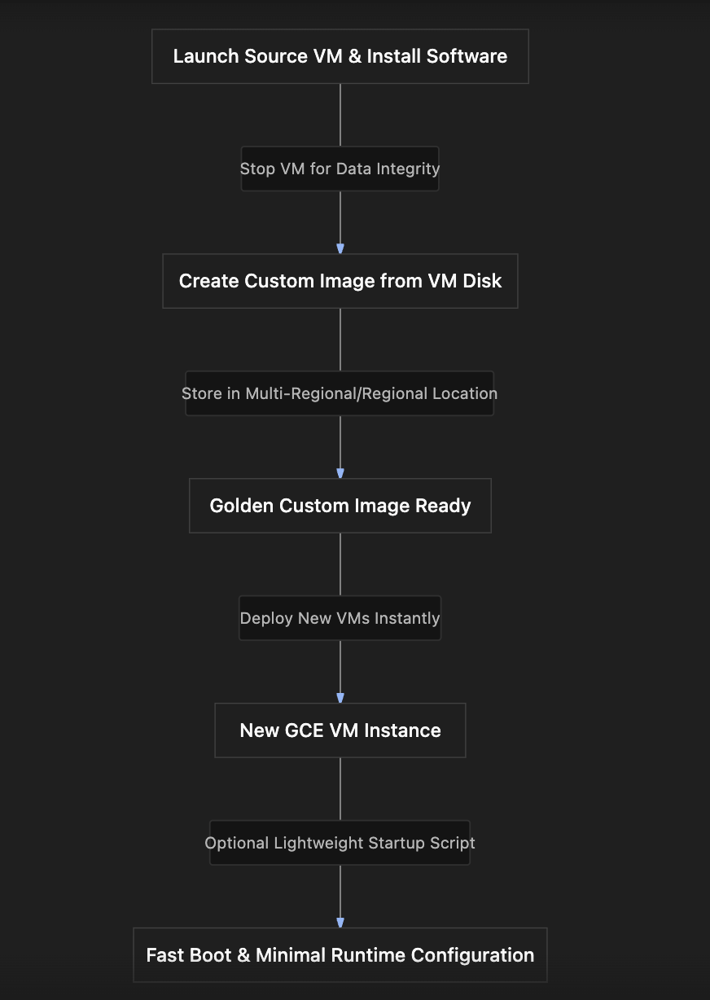

# Section Study Notes: GCE Custom Images, Creation Workflows, and Comparison with Startup Scripts

---

### 1. Overview
This section introduces **Custom Images** in Google Compute Engine as an optimization strategy to overcome the slow boot times associated with heavy startup scripts.
- **The Problem:** Relying entirely on startup scripts to fetch, download, and install large application packages every time a VM boots increases startup latency and exposes the deployment to external package repository failures.
- **The Solution (Custom Images):** Creating a pre-configured, "baked" boot disk image containing the operating system, installed software, dependencies, and hardened security settings. VMs booted from custom images start faster because software installation happens ahead of time.
- **Sources for Custom Images:** Existing VM disks, disk snapshots, other images, or virtual disk files stored in Google Cloud Storage (GCS).

---

### 2. ACE Exam Focus & Common Exam Traps
- **Exam Importance:** **HIGH** (Custom images, snapshot strategies, and lifecycle optimization are frequent scenarios on the ACE exam).
- **High-Priority Topics:**
  - **Image Creation Best Practice:** Stopping the VM *before* creating a custom image from its disk to ensure data integrity and prevent file corruption.
  - **Storage Costs:** Custom images, snapshots, and persistent disks consume storage space and incur ongoing costs even when the associated VMs are stopped or deleted.
  - **Lifecycle Management:** Deprecating outdated images and pointing users toward updated replacement images.
  - **Custom Image vs. Startup Script Preference:** Prefer custom images over heavy startup scripts to reduce boot times and increase architectural reliability.
- **Custom Image Sources for the Exam:**
  1. An existing VM instance disk.
  2. A persistent disk snapshot.
  3. An existing image.
  4. A raw virtual disk file (tar.gz) stored in **Cloud Storage (GCS)**.

---

### 3. Detailed Concept Explanation

#### A. Custom Images vs. Startup Scripts
*   **Startup Scripts:** Run dynamically at every boot. Good for minor bootstrapping (like writing local IPs, pulling small configuration files, or launching services), but inefficient for heavy software installations because they slow down boot times.
*   **Custom Images:** Static templates containing pre-installed software and configurations. They ensure rapid, repeatable, and consistent instance deployments across projects and teams.

#### B. Best Practices for Custom Images
1.  **Stop the VM First:** Always stop a source VM before creating a custom image from its root disk to ensure all write buffers are flushed and file system integrity is maintained.
2.  **Hardening & Standardization:** Bake organizational security standards, patches, and monitoring agents directly into the golden image to maintain enterprise compliance.
3.  **Deprecation Policies:** When an image version becomes obsolete, mark it as *deprecated* and designate a modern *replacement image* so teams migrate automatically.
4.  **Resource Cleanup:** Remember that custom images consume storage. When they are no longer needed, they must be explicitly deleted to avoid ongoing storage costs.

---

### 4. Visual Representations

#### Custom Image Creation and Deployment Workflow

---

### 5. Mental Models & Analogies

| Concept | Real-Wall Analogy | GCP / Technical Mapping |
| :--- | :--- | :--- |
| **Startup Script** | Building a house from scratch using a blueprint every single time a tenant moves in (cutting wood, painting walls on day one). | Installing packages from remote repositories dynamically on every VM boot. |
| **Custom Image** | Taking a modular prefab house model that is already fully constructed and painted, then stamping out duplicates instantly. | Booting a VM from a custom golden image where all dependencies are pre-baked. |

---

### 6. Step-by-Step Workflows / Comparison Tables

#### Workflow: Creating and Using a Custom Image from a GCE Disk
1.  **Prepare Source VM:** Deploy a VM, install necessary software (e.g., Apache), and test it.
2.  **Stop VM (Best Practice):** Stop the source VM instance via the console or CLI to protect file system consistency.
3.  **Create Image:** 
    - Navigate to **Compute Engine** $\rightarrow$ **Images** (or go via Disks $\rightarrow$ click target disk $\rightarrow$ **Create Image**).
    - Provide an image name (e.g., `in28minutes-custom-image`).
    - Choose source type: *Disk* (or Snapshot / Cloud Storage file).
    - Select location scope (e.g., Multi-regional for broader availability).
    - Click **Create** (takes a few minutes).
4.  **Deploy New VM from Custom Image:**
    - Click **Create Instance**.
    - Under **OS and Storage**, click **Change**, select **Custom Images**, and choose your created image.
    - Configure networking (allow HTTP traffic) and add a lightweight startup script (e.g., only starting services or updating index content, since installation is already done).
5.  **Verify & Cleanup:** Launch the instance, verify fast boot times and correct webpage rendering, then delete test instances when finished.

---

### 7. Common Mistakes & Exam Traps

- **Trap 1:** Creating a custom image from a running VM disk without stopping it first.
  - *Correction:* While technically possible, it risks file system corruption or incomplete writes. Stopping the VM first is the official best practice.
- **Trap 2:** Assuming that deleting a GCE VM instance automatically deletes the custom images or persistent snapshots created from its disks.
  - *Correction:* Custom images and snapshots exist independently of the source VM. They must be explicitly deleted to stop ongoing storage billing charges.

---

### 8. Certification Practice Questions

#### Q1: An administrator wants to minimize the boot time of new virtual machine instances while ensuring that standard enterprise software and security patches are pre-installed. Which approach is recommended?
- A) Rely exclusively on heavy startup scripts that install all software packages from scratch on every single boot.
- B) Create and use a custom image with the software and configurations pre-baked.
- C) Manually SSH into every newly launched instance and install packages by hand.
- D) Disable all operating system boot files.
- **Correct Answer:** B
- **Explanation:** Custom images allow applications and configurations to be pre-installed ("baked"), drastically reducing VM startup times compared to running heavy package installations via startup scripts on every boot.
- **Why others are incorrect:** Heavy startup scripts increase boot times; manual installations defeat automation; disabling boot files breaks instances.
- **Exam Takeaway:** Choose custom images over heavy startup scripts to optimize boot speed and reliability.

#### Q2: What is the recommended operational best practice before creating a custom disk image from an existing GCE virtual machine instance?
- A) Upgrade the instance to an accelerator-optimized machine type with attached GPUs.
- B) Stop the virtual machine instance to ensure file system consistency and prevent incomplete write states.
- C) Delete all internal IP addresses attached to the VPC.
- D) Change the project billing account ID.
- **Correct Answer:** B
- **Explanation:** Stopping the source VM before capturing its disk ensures all write caches are flushed to disk, avoiding potential file corruption in the resulting custom image.
- **Why others are incorrect:** GPU upgrades, IP changes, and billing updates are completely unrelated to image capture integrity.
- **Exam Takeaway:** Always stop the source VM prior to creating a custom image from its disk.

#### Q3: Which of the following is a valid source option when creating a custom image in Google Compute Engine? (Choose the most comprehensive answer)
- A) An existing VM disk, a persistent disk snapshot, an existing image, or a virtual disk file stored in Google Cloud Storage.
- B) Only raw text files stored locally on a user's personal laptop.
- C) Only active Cloud SQL database instances.
- D) Only container registries hosted outside Google Cloud.
- **Correct Answer:** A
- **Explanation:** GCE supports multiple sources for custom images, including VM disks, snapshots, existing images, and virtual disk files (such as `.tar.gz`) stored in GCS object storage.
- **Why others are incorrect:** Local laptop files, Cloud SQL instances, and external container registries are not direct sources for GCE boot disk image creation.
- **Exam Takeaway:** Memorize the valid sources for GCE custom images (Disks, Snapshots, Images, GCS files).

#### Q4: True or False: If a GCE virtual machine instance is deleted, are any custom images or snapshots created from that instance's disks automatically deleted along with it?
- A) True. All dependent images and snapshots are purged automatically to save storage.
- B) False. Custom images and snapshots exist as independent resources and must be manually deleted to avoid ongoing storage costs.
- C) True, but only if the project is marked for closure within 24 hours.
- D) False, because custom images are automatically converted to free serverless cloud functions.
- **Correct Answer:** B
- **Explanation:** Custom images and snapshots persist independently of the source VM instance from which they were derived. They must be explicitly deleted to halt storage billing charges.
- **Why others are incorrect:** GCP does not automatically delete custom images or snapshots when a source VM is terminated.
- **Exam Takeaway:** Custom images and snapshots are independent resources with separate lifecycles and storage billing.

#### Q5: An enterprise has created a golden custom image that has now become obsolete due to newer security standards and OS patches. What is the best practice lifecycle action to take regarding this outdated image?
- A) Leave it active indefinitely so older teams continue using it without warning.
- B) Deprecate the old image and specify a replacement image path pointing to the updated version.
- C) Format the entire Google Cloud region hosting the image.
- D) Convert the image into a public community marketplace listing.
- **Correct Answer:** B
- **Explanation:** Deprecating outdated images and associating them with designated replacement images guides users cleanly toward secure, current templates.
- **Why others are incorrect:** Leaving insecure images active is a security risk; formatting regions or pushing to marketplaces are inappropriate workflows.
- **Exam Takeaway:** Deprecate outdated custom images and provide replacement pointers.

#### Q6: Which GCP storage service is commonly used to store raw virtual disk files (such as `.tar.gz` files) when importing custom images from on-premises environments?
- A) BigQuery data warehouses
- B) Google Cloud Storage (GCS)
- C) Cloud SQL persistent instances
- D) Memorystore in-memory caches
- **Correct Answer:** B
- **Explanation:** Google Cloud Storage (GCS) is GCP's object storage service, used to store raw files, virtual disk images, and backups.
- **Why others are incorrect:** BigQuery is for analytics, Cloud SQL for relational databases, and Memorystore for caching.
- **Exam Takeaway:** GCS object storage serves as a repository source for importing external custom images into GCE.

#### Q7: When using a custom image that already has an Apache web server pre-installed, what is the ideal scope of any lightweight startup script executed upon launching a new VM from that image?
- A) Re-downloading and compiling the entire Linux kernel and Apache source code from scratch.
- B) Performing quick, instance-specific runtime configurations, such as updating the `index.html` file with the new instance's internal IP address and starting the service.
- C) Reformatting the root persistent disk.
- D) Configuring external VPC firewall rules.
- **Correct Answer:** B
- **Explanation:** Since the heavy software installation is already baked into the custom image, startup scripts should be lightweight, handling only instance-specific configurations like dynamic text injection or service activation.
- **Why others are incorrect:** Re-downloading software defeats the purpose of a custom image; reformatting disks destroys the image; firewall rules belong to VPC configurations.
- **Exam Takeaway:** Combine custom images with minimal startup scripts for rapid and dynamic provisioning.

#### Q8: Why do custom images help enforce organizational security compliance within an enterprise?
- A) Because they automatically encrypt all local laptop screens.
- B) Because security hardening, corporate patches, and compliance agents can be pre-configured and baked directly into a single golden image used company-wide.
- C) Because they prevent virtual machines from ever connecting to the internet.
- D) Because they eliminate the need for Google Cloud IAM role policies.
- **Correct Answer:** B
- **Explanation:** Golden custom images allow security teams to pre-bake necessary compliance baselines, agents, and patches, ensuring every deployed VM meets corporate security standards from birth.
- **Why others are incorrect:** They don't control laptop screens or replace IAM policies, and they don't block internet connectivity automatically.
- **Exam Takeaway:** Golden images are primary tools for enforcing security compliance and baseline standardization.

#### Q9: What happens to the storage cost of a project if an administrator creates multiple custom images and snapshots and forgets about them after deleting the original source VMs?
- A) Storage costs drop to zero because snapshots are entirely free.
- B) Storage costs will continue to accumulate because custom images and snapshots consume persistent storage space.
- C) Google automatically refunds all storage charges after 7 days.
- D) The storage automatically migrates into free tier archival buckets.
- **Correct Answer:** B
- **Explanation:** Custom images and snapshots consume storage capacity and generate continuous storage billing until explicitly deleted.
- **Why others are incorrect:** Snapshots and images are never free or automatically refunded based on VM deletion.
- **Exam Takeaway:** Always audit and delete orphaned custom images and snapshots to optimize cloud spend.

#### Q10: Which of the following commands or features is typically used to ensure an Apache web server daemon starts up automatically on boot inside a custom image where the software is already installed?
- A) A lightweight startup script running `service apache2 start`
- B) Buying a physical server rack expansion
- C) Changing the zone location from `us-central1-c` to `europe-west1-b`
- D) Deleting the default VPC network interface
- **Correct Answer:** A
- **Explanation:** Invoking service startup commands (`service apache2 start` or via systemctl) in a lightweight startup script ensures the pre-installed daemon runs immediately upon boot.
- **Why others are incorrect:** Hardware expansions, zone changes, and VPC deletions are completely unrelated to starting a pre-installed software service.
- **Exam Takeaway:** Use lightweight startup scripts for service startup commands when leveraging custom pre-baked images.