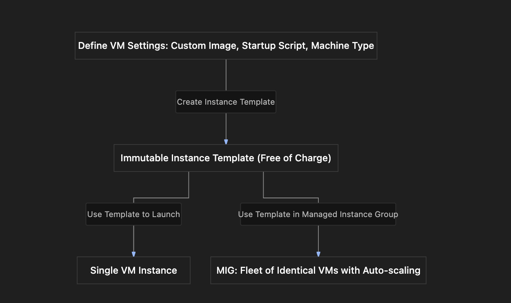

# Section Study Notes: GCE Instance Templates

---

### 1. Overview
This section introduces **Instance Templates** in Google Compute Engine as a powerful mechanism to package complete virtual machine configurations into a reusable blueprint.
- **The Problem:** Manually redefining machine types, custom images, startup scripts, network tags, and firewall permissions every time a new VM is needed is repetitive and prone to human error.
- **The Solution (Instance Templates):** Creating a global or regional definition of a VM blueprint once, which can then be used to rapidly launch single instances or large fleets of identical VMs.
- **Key Characteristics:** Instance templates are **immutable** (cannot be modified after creation; you must copy and create a new version) and **free of charge** themselves (you only pay for the actual resources—VMs, disks—launched *from* them).

---

### 2. ACE Exam Focus & Common Exam Traps
- **Exam Importance:** **HIGH** (Instance templates are a core prerequisite for Managed Instance Groups, auto-scaling, and load balancing, which are heavily tested on the ACE exam).
- **High-Priority Topics:**
  - **Immutability:** You cannot edit an existing instance template. To change configurations, you must clone/copy the template and create a new one.
  - **Pricing Rule:** Instance templates themselves are **free**. You are billed exclusively for the resources instantiated from them.
  - **Image Families Best Practice:** Specifying an image family (e.g., `debian-13`) ensures that VMs always fetch the latest secure image version from that family rather than a static snapshot pointer.
  - **Use Cases:** Launching individual identical VMs quickly or acting as the baseline configuration blueprint for Managed Instance Groups (MIGs).
- **Common Exam Traps:**
  - Expecting an "Edit" button to modify parameters on an existing instance template. (Trap: Templates are immutable; you must copy or create a new version).
  - Confusing the cost of an instance template with the cost of running instances. (Templates cost nothing; running VMs cost money).

---

### 3. Detailed Concept Explanation

#### A. What is an Instance Template?
*   An instance template is a API resource that defines the complete specifications of a GCE virtual machine, including:
    * Machine family and machine type (vCPU/RAM).
    * Boot disk configurations (Public or Custom Images).
    * Networking settings, firewalls, and tags.
    * Startup scripts and automation metadata.
    * Service accounts and access scopes.

#### B. Core Properties & Best Practices
*   **Immutability:** Once saved, an instance template's configuration cannot be altered. If a parameter needs changing, administrators must create a new template (often by copying the old one and modifying fields).
*   **Global vs. Regional Scope:** Instance templates can be created as either global resources (usable across all regions) or regional resources (restricted to a specific region).
*   **Image Families:** Instead of locking a template to a precise, static image version, best practice involves pointing to an *image family* (e.g., `debian-12`), ensuring newly spun-up instances always pull the most up-to-date patched version of that OS.

---

### 4. Visual Representations

#### Instance Template Architecture & Deployment Flow

---

### 5. Mental Models & Analogies

| Concept | Real-World Analogy | GCP / Technical Mapping |
| :--- | :--- | :--- |
| **Instance Template** | A master architectural blueprint or a cookie cutter. | A saved, immutable blueprint containing all specs required to stamp out identical VMs. |
| **Immutability of Templates** | A printed architectural blueprint. Once printed, you cannot erase lines with a pencil; if you need changes, you must draft a new version. | You cannot edit an existing instance template; you must copy it to create a new version. |
| **Template Cost** | The cost of the blueprint paper itself is free; you only pay for the concrete, bricks, and labor used to build the actual houses. | Instance templates are free; you only pay for the running VMs and disks created from them. |

---

### 6. Step-by-Step Workflows / Comparison Tables

#### Workflow: Creating and Using an Instance Template
1.  **Navigation:** Search for **Instance Templates** in the Google Cloud Console and click **Create Instance Template**.
2.  **Basic Details:** Name the template (e.g., `my-first-instance-template`) and choose regional or global scope.
3.  **Hardware & Storage:**
    - Choose machine configuration (family and type).
    - Under **OS and storage**, select your custom image or standard image family.
4.  **Networking & Automation:**
    - Enable **Allow HTTP traffic** under firewall settings.
    - Expand **Advanced settings** $\rightarrow$ **Management/Automation** to add your startup script (e.g., startup script V2 for custom images).
5.  **Save Template:** Click **Create**. (Note: The cost estimator shows projected VM costs, not template fees, because templates are free).
6.  **Deploy from Template:** Click the *Actions* menu next to your saved template and select **Create VM** (or use it later inside a Managed Instance Group). Verify settings and click **Create**.

---

### 7. Common Mistakes & Exam Traps

- **Trap 1:** Trying to modify an existing instance template to update a startup script URL or change a machine type.
  - *Correction:* Instance templates are immutable. You must copy the existing template, make changes to the copy, and save it as a new template version.
- **Trap 2:** Assuming instance templates incur hourly storage or maintenance fees because they sit in the console list.
  - *Correction:* Instance templates are metadata definitions and cost **zero**. Charges apply exclusively when instances or disks are provisioned *from* them.

---

### 8. Certification Practice Questions

#### Q1: An administrator creates a GCE instance template containing a custom image and a startup script. A week later, business requirements change, and the startup script URL needs to be updated. What is the correct procedure?
- A) Open the existing instance template, click Edit, modify the script URL, and save.
- B) Copy the existing instance template, modify the copy with the new script URL, and save it as a new template.
- C) Delete the Google Cloud project and recreate it from scratch.
- D) Change the project billing level to force-update immutable metadata.
- **Correct Answer:** B
- **Explanation:** Instance templates are immutable and cannot be edited after creation. To update parameters, administrators must copy the template, make modifications, and create a new template.
- **Why others are incorrect:** Option A fails because templates lack an editable state after creation. Options C and D are unnecessary and disruptive.
- **Exam Takeaway:** Remember that instance templates are immutable; modifications require copying and creating a new template version.

#### Q2: What is the direct financial cost of storing an immutable instance template in a Google Cloud project when no virtual machine instances are currently running from it?
- A) Billed hourly per gigabyte based on template text length.
- B) Free of charge (instance templates do not incur storage or rental fees).
- C) Billed at the same rate as a high-memory persistent disk.
- D) Billed as an active external static IP address.
- **Correct Answer:** B
- **Explanation:** Instance templates are metadata definitions and are completely free. You are only billed for actual instantiated resources (VMs, disks, IPs) created from them.
- **Why others are incorrect:** Templates do not generate storage, disk, or IP fees on their own.
- **Exam Takeaway:** Instance templates are free; actual provisioned compute resources cost money.

#### Q3: Which of the following is a primary use case for utilizing an instance template in Google Compute Engine?
- A) Storing static binary files like user images and movie archives.
- B) Acting as a foundational configuration blueprint to launch individual VMs or scale fleets of identical instances within Managed Instance Groups (MIGs).
- C) Acting as an external DNS nameserver resolver.
- D) Managing raw IAM user role bindings and passwords.
- **Correct Answer:** B
- **Explanation:** Instance templates serve as blueprints used to spin up individual VMs or power Managed Instance Groups (MIGs) for auto-scaling and load balancing.
- **Why others are incorrect:** Object storage is for static files, Cloud DNS handles nameservers, and IAM manages user permissions.
- **Exam Takeaway:** Instance templates = blueprints for single VMs or Managed Instance Groups.

#### Q4: An architect wants to ensure that templates using a Debian operating system automatically fetch the most recently patched software version without manually updating version numbers every time a patch is released. What should be specified in the template?
- A) A static, hardcoded snapshot image version hash.
- B) An image family reference (e.g., `debian-12`).
- C) An obsolete public image link from three years ago.
- D) A local machine desktop shortcut.
- **Correct Answer:** B
- **Explanation:** Specifying an image family automatically points to the latest, most up-to-date image version released within that family sequence.
- **Why others are incorrect:** Hardcoding static hashes locks you to old unpatched versions; obsolete links cause deployment failures.
- **Exam Takeaway:** Use image families in templates to automatically pull the latest security-patched OS versions.

#### Q5: True or False: Can an instance template be configured to include startup scripts, firewall rules (like allowing HTTP traffic), and custom machine types all in a single blueprint?
- A) False. Instance templates can only contain machine type data and nothing else.
- B) True. Instance templates capture comprehensive VM configurations including machine types, disk images, firewall rules, and startup scripts.
- C) False. Startup scripts must always be added manually after a VM boots, never via templates.
- D) True, but only if the project is running Windows Server.
- **Correct Answer:** B
- **Explanation:** Instance templates bundle almost all configuration parameters of a VM, including machine types, disks, networking tags, metadata startup scripts, and service accounts.
- **Why others are incorrect:** Templates support comprehensive multi-parameter configurations across all operating systems.
- **Exam Takeaway:** Instance templates bundle comprehensive VM configurations into a single reusable object.

#### Q6: When creating an instance template in the Google Cloud Console, the cost estimate panel displays numbers. What do these estimated costs actually represent?
- A) The monthly licensing fee charged by Google just for storing the template metadata.
- B) The estimated running cost of a virtual machine instance if one were to be created using that template configuration.
- C) The penalty fee for keeping a template unassigned.
- D) The global network egress tax across all regions.
- **Correct Answer:** B
- **Explanation:** Because templates themselves are free, the cost estimator displays the projected cost of running a VM instance configured according to that template's parameters.
- **Why others are incorrect:** Templates have no storage or metadata fees; network taxes and penalties do not apply to template definitions.
- **Exam Takeaway:** Cost estimates on template pages reflect potential runtime VM costs, not template costs.

#### Q7: Which of the following features relies directly on instance templates as an architectural prerequisite for scaling compute capacity?
- A) Google Cloud Billing export tables
- B) Managed Instance Groups (MIGs)
- C) Cloud Storage bucket lifecycle rules
- D) Cloud SQL database replicas
- **Correct Answer:** B
- **Explanation:** Managed Instance Groups (MIGs) require an instance template to define the uniform configuration of every instance managed within the group.
- **Why others are incorrect:** Billing, GCS buckets, and Cloud SQL operate independently of GCE instance templates.
- **Exam Takeaway:** Managed Instance Groups (MIGs) require an instance template as their configuration blueprint.

#### Q8: An administrator needs to deploy two identical web servers quickly using an existing instance template. Which of the following actions can be taken directly from the GCP Console?
- A) Click the actions menu next to the instance template and select the option to create a VM instance based on that template.
- B) Convert the template into a relational database file.
- C) Download the template as a physical USB ISO file.
- D) Manually rewrite all startup scripts from scratch inside a new text file.
- **Correct Answer:** A
- **Explanation:** The GCP Console provides a direct "Create VM" action link on instance templates, allowing rapid deployment without re-entering parameters.
- **Why others are incorrect:** Templates do not convert to databases, cannot be booted from physical USB ISOs, and eliminate the need to rewrite scripts from scratch.
- **Exam Takeaway:** Instance templates simplify rapid individual or group VM deployments.

#### Q9: True or False: Can instance templates be scoped regionally or globally within Google Cloud?
- A) False. Instance templates are restricted strictly to local laptop hard drives.
- B) True. Instance templates can be defined as either regional or global resources depending on deployment requirements.
- C) False. They are forced to be global and cannot be restricted to regions.
- D) True, but regional templates cost money while global templates are free.
- **Correct Answer:** B
- **Explanation:** GCE instance templates support both regional and global scopes when configured.
- **Why others are incorrect:** They are cloud-native resources, not local files, and regional templates do not carry separate storage fees.
- **Exam Takeaway:** Instance templates can be scoped globally or regionally.

#### Q10: Why is it considered an architectural risk to rely on a static, exact image version pointer in a long-lived instance template rather than an image family?
- A) Because static image pointers automatically delete themselves after 48 hours.
- B) Because over time, the static image version will miss critical security updates and patches released for the operating system.
- C) Because static images require physical backup tapes.
- D) Because static images prohibit internal IP address assignments.
- **Correct Answer:** B
- **Explanation:** Pointing to an exact static image version means instances deployed months later will run outdated, unpatched software, introducing security vulnerabilities.
- **Why others are incorrect:** Images do not auto-delete, require tapes, or affect internal IP allocations.
- **Exam Takeaway:** Image families prevent security drift by ensuring templates reference current, patched OS versions.