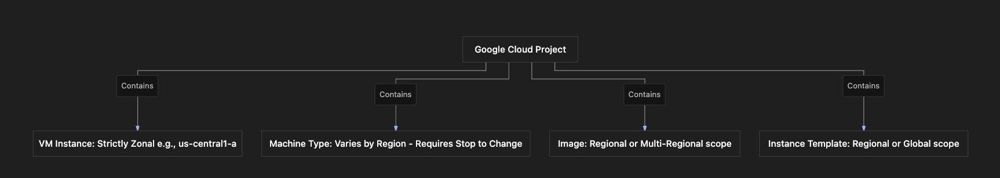

### 1. Overview
This section outlines the architectural scopes of core Google Compute Engine (GCE) resources: **machine types**, **images**, **instance templates**, and **VM instances**.
- **The Problem:** Deploying Google Cloud resources without understanding their regional, zonal, or global boundaries can lead to deployment failures, availability mismatches, or architectural inflexibility.
- **The Solution:** Reviewing the precise scope of each GCE resource to ensure correct placement, high availability, and compliance with operational requirements.

---

### 2. ACE Exam Focus & Common Exam Traps
- **Exam Importance:** **HIGH** (Resource scoping rules are a staple of scenario-based ACE questions, particularly regarding VM modification restrictions and image/template scopes).
- **High-Priority Topics:**
  - **Machine Type Scope:** Regional availability and pricing. You **cannot** change the machine type of a *running* VM; you must **stop** the VM first.
  - **Image Scope:** Can be **regional** (usable only in that specific region) or **multi-regional** (usable across multiple regions within that geography).
  - **Instance Template Scope:** Can be **regional** or **global**.
  - **VM Instance Scope:** Strictly **zonal** (resides in a specific zone within a region) and scoped to a **project**.
- **Common Exam Traps:**
  - Attempting to change a VM's machine type while its state is `RUNNING`. (Trap: The VM must be stopped first).
  - Assuming custom images are automatically global. (Trap: Images can be regional or multi-regional).

---

### 3. Detailed Concept Explanation

#### A. Machine Types Scope & Modification Rules
*   **Availability & Pricing:** Machine types (e.g., `e2-medium`, `n2-standard-4`) are not universally priced or available; both availability and pricing vary across different GCP regions.
*   **Modification Rule:** To resize or change the machine type of an existing VM, the instance must first be transitioned from a **RUNNING** state to a **STOPPED** state. Once stopped, the configuration can be edited and the VM restarted.

#### B. Images Scope
*   **Regional Images:** Tied to a single region. Can only be used to instantiate VMs located in that specific region.
*   **Multi-Regional Images:** Stored across multiple regions within a geographic area (e.g., US), allowing VMs to be provisioned from that image in any of those supported regions.

#### C. Instance Templates Scope
*   **Regional Instance Templates:** Restricted to resource deployment within a designated region.
*   **Global Instance Templates:** Can be referenced to deploy resources across any region globally.

#### D. VM Instances Scope
*   **Zonal Scope:** Every individual VM instance lives in a specific **zone** (e.g., `us-central1-a`) inside a parent **region** (`us-central1`).
*   **Project Scope:** VMs belong to a specific Google Cloud **project**, which acts as the boundary for billing, IAM permissions, and resource ownership.

---

### 4. Visual Representations

#### GCE Resource Scope Summary

---

### 5. Mental Models & Analogies

| Concept | Real-World Analogy | GCP / Technical Mapping |
| :--- | :--- | :--- |
| **Changing a Running VM's Machine Type** | Upgrading a car's engine. You cannot safely swap out a V6 for a V8 while speeding down the highway; you must pull over, park (stop), and perform the engine swap. | You must stop a GCE VM before modifying its machine type configuration. |
| **Regional vs. Multi-Regional Images** | A local warehouse holding car parts for one city versus a national distribution network supplying parts across multiple states. | Regional images serve one region; multi-regional images serve multiple regions within a geographic area. |
| **VM Zonal Scope** | An apartment unit address, which belongs to a specific building floor (zone) inside a specific city (region). | Every VM instance is bound to a specific zone within a region. |

---

### 6. Step-by-Step Workflows / Comparison Tables

#### Comparison Table: GCE Resource Scopes

| Resource Type | Scope Options | Key Operational Constraint / Rule |
| :--- | :--- | :--- |
| **Machine Types** | Regional availability & pricing | Cannot be modified while the VM is **RUNNING** (must stop first). |
| **Images** | Regional or Multi-Regional | Regional images are locked to one region; multi-regional span multiple regions. |
| **Instance Templates** | Regional or Global | Can be constrained to a single region or available globally. |
| **VM Instances** | Zonal (belongs to a Zone & Region) | Strictly bound to a single zone; scoped inside a GCP Project. |

---

### 7. Common Mistakes & Exam Traps

- **Trap 1:** An administrator tries to change a VM's machine type from `e2-medium` to `n2-standard-2` via the GCP Console while the VM status is running, but the option is grayed out or throws an error.
  - *Correction:* The VM state must be **STOPPED** before machine type modifications are permitted.
- **Trap 2:** Assuming that a regional image created in `us-central1` can be used to deploy a VM in `europe-west1`.
  - *Correction:* Regional images are constrained to their creation region. For multi-region deployments, a multi-regional image must be used.

---

### 8. Certification Practice Questions (Continued Integration)

#### Q1: An administrator wants to modify the machine type of an existing production virtual machine instance from `e2-medium` to `e2-standard-2`. The instance is currently in a `RUNNING` state. What is the required first step?
- A) Export the VPC firewall rules to JSON.
- B) Stop the virtual machine instance.
- C) Delete the associated regional persistent disk.
- D) Upgrade the project billing tier to enterprise.
- **Correct Answer:** B
- **Explanation:** You cannot change the machine type of a running VM. The instance must be transitioned to a stopped state before modifying its machine specifications.
- **Why others are incorrect:** Firewall rules, persistent disks, and billing tiers are unrelated to changing a VM's machine type.
- **Exam Takeaway:** Always stop a VM before changing its machine type.

#### Q2: Which of the following resource scopes accurately describes a Google Compute Engine virtual machine instance?
- A) Global scope across all worldwide projects
- B) Zonal scope (belongs to a specific zone within a region)
- C) Multi-cloud container scope
- D) Edge-only cache scope
- **Correct Answer:** B
- **Explanation:** Every GCE VM instance is deployed to a specific zone (e.g., `us-central1-a`) inside a region.
- **Why others are incorrect:** VMs are not global, multi-cloud, or edge cache objects.
- **Exam Takeaway:** VM instances are strictly zonal resources.

#### Q3: A developer creates a custom disk image configured with a **regional** scope in the `us-east1` region. Where can this specific image be used to deploy new virtual machine instances?
- A) Anywhere globally across any region
- B) Only within the `us-east1` region
- C) Exclusively inside on-premises data centers
- D) Only inside European data centers
- **Correct Answer:** B
- **Explanation:** A regional image is restricted to the specific region where it was created and cannot be used to launch VMs in other regions.
- **Why others are incorrect:** Regional images cannot be used outside their designated region.
- **Exam Takeaway:** Regional images are locked to their deployment region.

#### Q4: True or False: Are pricing and availability for specific GCE machine types identical across all Google Cloud regions worldwide?
- A) True. Pricing and availability are uniform everywhere.
- B) False. Both availability and pricing for machine types can vary from one region to another.
- C) True, but only for custom memory machine families.
- D) False, because machine types are free everywhere.
- **Correct Answer:** B
- **Explanation:** Machine type availability and pricing fluctuate across different GCP regions depending on data center infrastructure and local operating costs.
- **Why others are incorrect:** Uniform pricing across regions does not exist in GCP.
- **Exam Takeaway:** Machine type pricing and availability vary by region.

#### Q5: What are the two valid scoping options available when creating a custom image in Google Compute Engine?
- A) Zonal or Project-wide
- B) Regional or Multi-regional
- C) Public or Private-only
- D) Static or Dynamic
- **Correct Answer:** B
- **Explanation:** Custom images can be created as either regional images or multi-regional images spanning multiple regions within a geography.
- **Why others are incorrect:** Images are not scoped zonally or dynamically in this manner.
- **Exam Takeaway:** Custom images have regional or multi-regional scopes.

#### Q6: Which of the following scopes can be assigned to an instance template when it is created?
- A) Regional or Global
- B) Zonal only
- C) Project-restricted single-host scope
- D) Subnet-exclusive boundary scope
- **Correct Answer:** A
- **Explanation:** Instance templates can be created with either a regional scope or a global scope.
- **Why others are incorrect:** They are not limited strictly to single zones or subnets.
- **Exam Takeaway:** Instance templates can be regional or global.

#### Q7: Within which administrative container boundary does a newly created Google Compute Engine virtual machine instance reside?
- A) A Google Cloud Project
- B) An individual IAM user folder
- C) A public DNS registrar zone
- D) A Cloud Storage bucket root directory
- **Correct Answer:** A
- **Explanation:** All GCE VM instances are created and housed within a specific Google Cloud project.
- **Why others are incorrect:** IAM folders, DNS zones, and storage buckets do not contain VM instances directly as administrative infrastructure containers.
- **Exam Takeaway:** All GCE resources, including VMs, belong to a Google Cloud project.

#### Q8: If an architect needs to deploy virtual machines using a single custom image across three different regions within the United States, what type of image scope should be configured?
- A) Regional image restricted to `us-central1`
- B) Multi-regional image covering the US
- C) Local machine loopback image
- D) Ephemeral scratch image
- **Correct Answer:** B
- **Explanation:** A multi-regional image allows VMs to be deployed across multiple regions within that multi-region geography.
- **Why others are incorrect:** A regional image would prevent deployment in the other two regions.
- **Exam Takeaway:** Use multi-regional images when deploying across multiple regions within a geographic area.

#### Q9: True or False: Can a global instance template be used to deploy virtual machine instances across different regions?
- A) False. Global templates can only deploy instances in a single predefined zone.
- B) True. Global instance templates can be used to deploy resources anywhere across supported regions.
- C) False, because templates are locked to single projects.
- D) True, but only if running obsolete operating systems.
- **Correct Answer:** B
- **Explanation:** Global instance templates are not restricted by region and can be utilized to provision instances globally.
- **Why others are incorrect:** Global templates provide cross-region flexibility.
- **Exam Takeaway:** Global instance templates can be used across multiple regions.

#### Q10: What happens to a VM's configuration data when it is placed in a **STOPPED** state to change its machine type?
- A) All persistent disks and configurations are automatically purged.
- B) The instance configuration is preserved, allowing modifications like machine type changes before restarting.
- C) The VM is migrated to a different project automatically.
- D) The internal private IP address is permanently deleted and never recovered.
- **Correct Answer:** B
- **Explanation:** Stopping a VM preserves its persistent disks and configuration settings while halting compute charges, allowing administrators to modify attributes like machine type before restarting.
- **Why others are incorrect:** Data is not purged, projects do not change, and standard internal IPs remain bound unless explicitly reconfigured.
- **Exam Takeaway:** Stopping a VM safely preserves its disk data while enabling configuration updates.