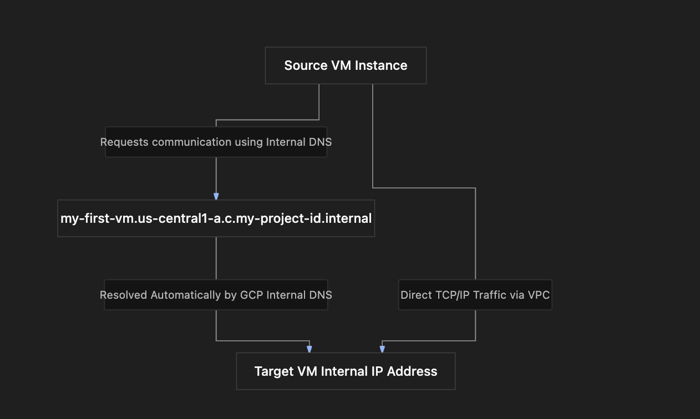

# Section Study Notes: GCE Internal DNS and Operating System Licensing

---

### 1. Overview
This section covers two key operational aspects of Google Compute Engine (GCE): **internal DNS naming** for seamless intra-VPC communication and **operating system licensing models** for both open-source and premium commercial OS distributions.
- **The Problem:** 
  1. Relying strictly on raw internal IP addresses for service-to-service communication within a VPC can be cumbersome and fragile if IPs change.
  2. Running enterprise commercial operating systems involves software licensing costs that must be managed properly.
- **The Solution:** 
  1. GCP automatically assigns an internal DNS name to every VM, allowing resources within the same VPC to communicate using standard hostname formats.
  2. GCP supports both **Pay-as-you-go (On-Demand)** billing and **Bring Your Own License (BYOL) / Bring Your Own Subscription (BYOS)** options for premium OS platforms.

---

### 2. ACE Exam Focus & Common Exam Traps
- **Exam Importance:** **MEDIUM TO HIGH** (Internal DNS syntax patterns and OS licensing options frequently appear in architectural scoping and cost-optimization questions).
- **High-Priority Topics:**
  - **Internal DNS Structure:** Memorize the exact format: `[VM_NAME].[ZONE].c.[PROJECT_ID].internal`.
  - **DNS Resolution Scope:** Internal DNS names work only for resources within the **same VPC** (private network).
  - **OS Licensing Models:** 
    - *Free/Open Source:* Debian, Ubuntu, etc. (No license surcharge).
    - *Paid (Pay-as-you-go):* Windows Server, Red Hat Enterprise Linux (RHEL), SUSE Linux (billed alongside VM hardware).
    - *Bring Your Own License (BYOL / BYOS):* Reusing existing vendor licenses or agreements within Google Cloud.
- **Common Exam Traps:**
  - Assuming internal DNS names can be resolved globally across *different* VPCs or over the public internet without custom Cloud DNS configurations. (Trap: They are internal to the same VPC out of the box).
  - Assuming all operating systems on GCE are free. (Trap: Commercial OS distributions like Windows or RHEL carry licensing surcharges unless BYOL is used).

---

### 3. Detailed Concept Explanation

#### A. GCE Internal DNS Naming
*   **Purpose:** Allows virtual machines inside the same Virtual Private Cloud (VPC) network to communicate using predictable hostnames instead of hardcoded internal IP addresses.
*   **Automatic Assignment:** Every time a GCE VM is created, Google Cloud automatically registers an internal DNS record for it.
*   **DNS Name Structure Syntax:**
    $$\text{VM\_NAME}.\text{ZONE}.\text{c}.\text{PROJECT\_ID}.\text{internal}$$
    *   `VM_NAME`: The user-defined name of the virtual machine instance.
    *   `ZONE`: The zone where the VM resides (e.g., `us-central1-a`).
    *   `.c.`: Constant routing specifier used in GCE internal DNS paths.
    *   `PROJECT_ID`: The unique string identifier of the Google Cloud project.
    *   `.internal`: Standard internal domain suffix managed by Google Cloud DNS.
*   **Practical Example:**
    *   VM Name: `my-first-vm`
    *   Zone: `us-central1-a`
    *   Project ID: `my-project-id`
    *   **Resulting Internal DNS Name:** `my-first-vm.us-central1-a.c.my-project-id.internal`

#### B. Operating System Licensing Models
*   **Open-Source / Free Operating Systems:** 
    *   Distributions like Debian, CentOS, or standard Ubuntu come with no software licensing fees; you pay solely for the underlying compute hardware and storage.
*   **Paid / Commercial Operating Systems:**
    *   Distributions like Windows Server, Red Hat Enterprise Linux (RHEL), and SUSE Linux require software licenses.
    *   **Option 1: Pay-as-you-go (On-Demand):** Google includes the software licensing fee directly in the hourly VM billing rate. No prior agreements or license keys are required.
    *   **Option 2: Bring Your Own License (BYOL) / Bring Your Own Subscription (BYOS):** If your organization already holds active license agreements or enterprise contracts directly with vendors (like Microsoft or Red Hat), you can bring those existing licenses/subscriptions into GCP to avoid paying double licensing fees. Once expired, workloads can transition to pay-as-you-go models.

---

### 4. Visual Representations

#### Internal DNS Resolution Flow Within a VPC

---

### 5. Mental Models & Analogies

| Concept | Real-World Analogy | GCP / Technical Mapping |
| :--- | :--- | :--- |
| **Internal DNS Name** | Saving a friend's phone number under a contact name in your phone's address book instead of memorizing their 10-digit number. | Using an intuitive internal hostname (`VM_NAME.ZONE.c.PROJECT_ID.internal`) instead of a dynamic internal IP address. |
| **Pay-as-you-go OS Licensing** | Renting a fully furnished apartment where furniture rental fees are bundled into your monthly rent. | Google bundles commercial OS license fees directly into your hourly on-demand VM compute bill. |
| **Bring Your Own License (BYOL)** | Bringing your own custom living room sofa and dining set into a rental property you moved into, so you aren't charged furniture rental fees. | Reusing pre-existing enterprise vendor licenses inside GCP to avoid paying extra OS license fees. |

---

### 6. Step-by-Step Workflows / Comparison Tables

#### Comparison Table: OS Licensing Models in GCE

| Licensing Model | Description | Cost Structure | Best Use Case |
| :--- | :--- | :--- | :--- |
| **Free / Open Source** | Community-driven OS images (e.g., Debian). | Pay only for compute hardware & disk storage ($0 OS fee). | Standard Linux workloads, web servers, open-source stacks. |
| **Pay-as-you-go (On-Demand)** | Commercial OS provided directly by Google. | Billed hourly for hardware *plus* bundled OS license surcharges. | Teams without pre-existing enterprise agreements or software contracts. |
| **Bring Your Own License (BYOL / BYOS)** | Reusing pre-existing software agreements or subscription rights. | Pay only for compute hardware; license fee is handled via the vendor. | Enterprises with existing Microsoft/Red Hat license agreements. |

---

### 7. Common Mistakes & Exam Traps

- **Trap 1:** Assuming internal DNS names can be used to reach a VM from *outside* the VPC (e.g., from an external public internet browser).
  - *Correction:* Internal DNS names (`.internal`) resolve exclusively *within* the private VPC network. External access requires public IP addresses or Cloud DNS public zones.
- **Trap 2:** Forgetting the exact order of segments in the internal DNS naming convention for an exam question.
  - *Correction:* Memorize the pattern: `[VM_NAME].[ZONE].c.[PROJECT_ID].internal`.

---

### 8. Certification Practice Questions

#### Q1: Which of the following represents the correct standard internal DNS naming structure automatically assigned to a GCE virtual machine instance?
- A) `[PROJECT_ID].[ZONE].internal.[VM_NAME]`
- B) `[VM_NAME].[ZONE].c.[PROJECT_ID].internal`
- C) `internal.[PROJECT_ID].[VM_NAME].zone`
- D) `[ZONE].[VM_NAME].internal.cloud.google`
- **Correct Answer:** B
- **Explanation:** GCE internal DNS follows the strict structural format: `[VM_NAME].[ZONE].c.[PROJECT_ID].internal`.
- **Why others are incorrect:** The other formats invert parameters or introduce invalid domain tags.
- **Exam Takeaway:** Memorize the exact syntax for internal GCE DNS names: `[VM_NAME].[ZONE].c.[PROJECT_ID].internal`.

#### Q2: An administrator attempts to resolve a GCE internal DNS name (`my-vm.us-central1-a.c.my-proj.internal`) from a corporate laptop connected over the public internet. What will happen?
- A) The DNS name will resolve instantly to the VM's private IP.
- B) The DNS name will fail to resolve because internal `.internal` DNS records are private and restricted to the internal VPC network.
- C) Google Cloud will automatically prompt for root administrator credentials.
- D) The DNS name will route through Cloud CDN caching nodes.
- **Correct Answer:** B
- **Explanation:** Internal DNS names (`.internal`) are private resources scoped strictly to resolve within the VM's specific VPC network. They are not exposed to the public internet.
- **Why others are incorrect:** Public internet resolvers cannot parse internal VPC DNS scopes.
- **Exam Takeaway:** Internal DNS names only resolve from resources inside the same VPC.

#### Q3: A company wants to run Windows Server virtual machines on Google Compute Engine. They already own active, valid Microsoft enterprise software licenses that permit cloud deployment. What option should they choose to avoid paying extra licensing fees to Google?
- A) Pay-as-you-go On-Demand licensing
- B) Bring Your Own License (BYOL) / Bring Your Own Subscription (BYOS)
- C) Spot VM preemption mode
- D) Free open-source licensing conversion
- **Correct Answer:** B
- **Explanation:** Bring Your Own License (BYOL) / Bring Your Own Subscription (BYOS) allows organizations to reuse existing valid vendor agreements inside Google Cloud.
- **Why others are incorrect:** Pay-as-you-go incurs extra surcharges; Spot VMs affect hardware pricing, not OS licensing rights; Windows is not open-source.
- **Exam Takeaway:** Use BYOL/BYOS when clients want to reuse pre-existing commercial software licenses.

#### Q4: If an engineer launches a GCE virtual machine running Debian Linux, how is the operating system licensed and billed?
- A) Billed at a premium hourly software rate alongside hardware costs.
- B) Debian is an open-source free operating system; there is no OS licensing fee, and you pay only for compute hardware and storage.
- C) Requires an active Microsoft enterprise contract.
- D) Requires a mandatory 3-year upfront commitment.
- **Correct Answer:** B
- **Explanation:** Open-source operating systems like Debian carry no software licensing fees; customers pay exclusively for the underlying hardware resources (vCPU, RAM, disk).
- **Why others are incorrect:** Free operating systems do not trigger software surcharges or require enterprise contracts.
- **Exam Takeaway:** Open-source OS distributions incur no software license fees on GCE.

#### Q5: What is the primary benefit of using internal DNS names instead of internal IP addresses for application communication between VMs inside the same VPC?
- A) Internal DNS names encrypt all payload data using quantum keys automatically.
- B) Internal DNS names provide an intuitive, stable hostname reference even if underlying internal IP addresses change.
- C) Internal DNS names bypass all VPC firewall rules.
- D) Internal DNS names eliminate compute billing charges entirely.
- **Correct Answer:** B
- **Explanation:** Hostnames provide stability and readability, decoupling application configurations from dynamic internal IP assignments.
- **Why others are incorrect:** DNS does not handle encryption, bypass firewalls, or eliminate compute costs.
- **Exam Takeaway:** Use internal DNS for stable, readable intra-VPC communication.

#### Q6: A virtual machine named `db-server` is deployed in the `europe-west1-b` zone within a project whose ID is `fintech-core-2026`. What is its complete internal DNS name?
- A) `fintech-core-2026.europe-west1-b.db-server.internal`
- B) `db-server.europe-west1-b.c.fintech-core-2026.internal`
- C) `internal.db-server.fintech-core-2026.europe-west1-b`
- D) `db-server.c.internal.europe-west1-b.fintech-core-2026`
- **Correct Answer:** B
- **Explanation:** Plugging the parameters into the syntax `[VM_NAME].[ZONE].c.[PROJECT_ID].internal` yields `db-server.europe-west1-b.c.fintech-core-2026.internal`.
- **Why others are incorrect:** The other options mix up sequence markers or omit the `.c.` routing segment.
- **Exam Takeaway:** Practice substituting naming variables into the exact internal DNS formula.

#### Q7: When a commercial operating system like Red Hat Enterprise Linux (RHEL) is deployed using the default Pay-as-you-go model on GCE, how does billing function?
- A) Google bills hourly for both the underlying virtual machine hardware and the operating system license fee combined.
- B) The operating system is completely free for the first 10 years.
- C) Licensing fees are paid directly to Google via physical cash check mail-ins.
- D) The OS license is billed as a flat one-time lifetime fee regardless of VM runtime.
- **Correct Answer:** A
- **Explanation:** Under the pay-as-you-go model, Google bills hourly for both hardware utilization and the OS license bundle combined.
- **Why others are incorrect:** Commercial operating systems are never free; billing is integrated into hourly cloud invoices, not lifetime flat fees.
- **Exam Takeaway:** Pay-as-you-go bundles OS licensing fees directly into hourly GCE bills.

#### Q8: True or False: Can internal DNS names be utilized by virtual machines located across two completely separate, unpeered VPC networks?
- A) True. Internal DNS resolves across all global projects and unpeered VPCs automatically.
- B) False. Internal DNS resolution is scoped strictly to resources within the same VPC network.
- C) True, provided that public DNS forwarding is disabled.
- D) False, unless Cloud Storage buckets are attached.
- **Correct Answer:** B
- **Explanation:** Internal DNS scopes are bounded by the VPC network; unpeered VPC networks cannot resolve each other's internal `.internal` DNS records out of the box.
- **Why others are incorrect:** Unpeered VPCs are isolated network boundaries.
- **Exam Takeaway:** Internal DNS resolution is restricted to the same VPC network.

#### Q9: What happens to a Bring Your Own License (BYOL) software subscription when the license term officially expires with the software vendor?
- A) The virtual machine deletes itself instantly to prevent non-compliance.
- B) The administrator can transition the workload to the pay-as-you-go billing model.
- C) Google Cloud automatically renews the third-party license for free.
- D) The VM converts into an immutable instance template.
- **Correct Answer:** B
- **Explanation:** As noted in best practices, once an existing vendor license expires, administrators can shift the workload over to Google's pay-as-you-go model.
- **Why others are incorrect:** VMs do not auto-delete or auto-renew third-party commercial contracts; templates are unrelated.
- **Exam Takeaway:** Expired BYOL licenses can be transitioned to pay-as-you-go billing.

#### Q10: Which of the following components in the internal DNS string format acts as a constant routing specifier between the zone and the project ID?
- A) `.c.`
- B) `.internal`
- C) `www.`
- D) `zone-id`
- **Correct Answer:** A
- **Explanation:** The `.c.` segment serves as a fixed routing component within the GCE internal DNS schema separating the zone from the project ID.
- **Why others are incorrect:** `.internal` is the top-level suffix; `www.` and `zone-id` are invalid tags.
- **Exam Takeaway:** Remember that `.c.` separates the zone and project ID in GCE internal DNS names.