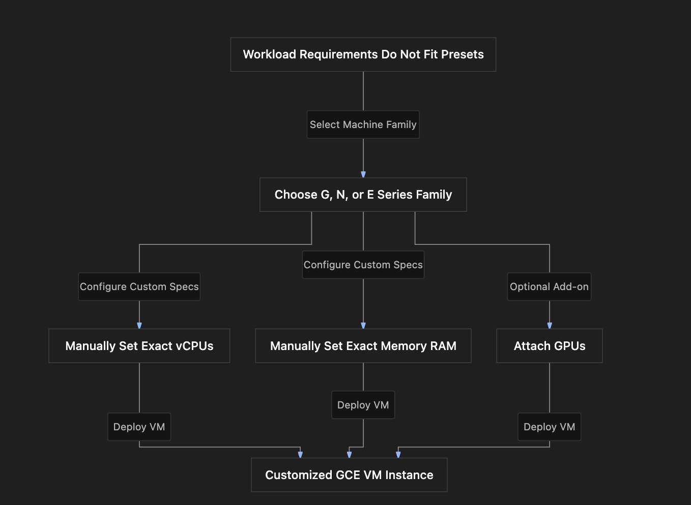

# Section Study Notes: GCE Custom Machine Types

---

### 1. Overview
This section covers **Custom Machine Types** in Google Compute Engine (GCE). 
- **The Problem:** Standard, predefined GCE machine types (like `e2-medium` or `n2-standard-4`) couple specific vCPU counts with fixed amounts of RAM. If your application requires a unique ratio (e.g., high memory with low CPU, or vice versa), predefined presets may force you to over-provision and overpay.
- **The Solution:** Custom machine types allow you to precisely define your own virtual machine specifications by manually selecting the exact number of **vCPUs**, amount of **memory (RAM)**, and optional **GPUs** to match your workload's exact resource profile.

---

### 2. ACE Exam Focus & Common Exam Traps
- **Exam Importance:** **HIGH** (Custom machine types and their eligibility rules are frequently tested in ACE resource-configuration scenarios).
- **High-Priority Topics:**
  - **Supported Machine Families:** Custom machine types are **not** supported across all families. They are supported specifically in families starting with **G**, **N**, and **E** (e.g., N1, N2, N2D, E2, G4/G2 depending on generation rules). *Flag for verification:* Always double-check exact family prefixes against current GCP documentation, as machine families evolve.
  - **Customization Parameters:** You can adjust **vCPUs**, **memory (RAM)**, and attach **GPUs**.
  - **Billing:** You are billed based on the precise custom amount of vCPUs and memory provisioned.
- **Common Exam Traps:**
  - Assuming custom machine types can be built using *any* machine family (e.g., trying to use compute-optimized C-series or memory-optimized M-series for custom sizing). (Trap: Custom machine types are restricted primarily to G, N, and E families).

---

### 3. Detailed Concept Explanation

#### A. What is a Custom Machine Type?
*   Instead of being restricted to fixed presets like 2 vCPUs with 8 GB RAM, custom machine types let you mix and match resource ratios.
*   **Use Case:** Ideal for applications with non-standard performance profiles, such as legacy databases that require high memory allocations relative to their CPU load, or heavy computational tasks needing custom vCPU sizing.

#### B. Supported Families & Capabilities
*   **Eligible Families:** Restricted to specific machine families—predominantly those starting with **G**, **N**, and **E**.
*   **Adjustable Components:**
    *   **vCPUs:** Number of virtual processors.
    *   **Memory:** RAM capacity (subject to specific ratios and minimum/maximum constraints per vCPU).
    *   **GPUs:** Graphics Processing Units can be attached for specialized workloads (like machine learning or rendering).
*   **OS Support:** Supported across major operating systems including Ubuntu, Debian, Red Hat Enterprise Linux (RHEL), and Windows.

---

### 4. Visual Representations

#### Custom Machine Type Sizing Workflow

---

### 5. Mental Models & Analogies

| Concept | Real-World Analogy | GCP / Technical Mapping |
| :--- | :--- | :--- |
| **Predefined Machine Type** | Buying a pre-assembled desktop computer off the retail shelf with fixed RAM and processor specs. | Choosing a standard GCE preset like `n2-standard-4`. |
| **Custom Machine Type** | Ordering a custom-built PC component by component, selecting an exact processor speed and custom RAM sticks to fit your precise video editing needs. | Manually defining custom vCPU and memory quantities using an N, E, or G family series. |

---

### 6. Step-by-Step Workflows / Comparison Tables

#### Comparison Table: Predefined vs. Custom Machine Types

| Feature | Predefined Machine Types | Custom Machine Types |
| :--- | :--- | :--- |
| **Configuration** | Fixed ratios of vCPU to RAM set by Google. | Fully customizable vCPU and memory amounts. |
| **Supported Families** | Available across all GCE machine families (C, M, N, E, G, etc.). | Restricted to specific families (primarily **G**, **N**, and **E** series). |
| **Use Case** | Standard web apps, general microservices, standard workloads. | Workloads with unique ratios (e.g., high-memory, low-CPU). |
| **Add-ons** | Supports standard disks, IPs, and optional GPUs. | Supports standard disks, IPs, and optional GPUs. |

---

### 7. Common Mistakes & Exam Traps

- **Trap 1:** An architect tries to build a custom machine type using a compute-optimized C-series family to squeeze maximum performance out of a custom core count.
  - *Correction:* Custom machine types are limited to specific families (G, N, and E series). C-series and M-series typically require using predefined presets.
- **Trap 2:** Assuming custom machine types incur an extra flat platform surcharge just for being custom.
  - *Correction:* You pay purely for the underlying resources (the specific number of vCPUs and amount of RAM provisioned) at standard rates.

---

### 8. Certification Practice Questions (Consolidated Chapter Review)

#### Q1: An administrator needs to deploy a specialized database workload that requires an unconventional ratio of 6 vCPUs and 45 GB of RAM, which does not match any standard predefined preset. What feature should they use in Google Compute Engine?
- A) Spot VM instance preemption
- B) Custom machine types
- C) Global instance templates
- D) VPC Flow Logging rules
- **Correct Answer:** B
- **Explanation:** Custom machine types allow administrators to manually define custom vCPU and memory (RAM) quantities to fit non-standard workload profiles.
- **Why others are incorrect:** Spot VMs handle pricing/preemption; templates are blueprints; VPC flow logs handle network metadata.
- **Exam Takeaway:** Use custom machine types when predefined presets do not match your resource requirements.

#### Q2: Which machine families support the creation of custom machine types in Google Compute Engine?
- A) C-series (Compute-optimized) only
- B) M-series (Memory-optimized) only
- C) G, N, and E series machine families
- D) Storage-only archived disk series
- **Correct Answer:** C
- **Explanation:** Custom machine types are supported specifically across machine families starting with **G**, **N**, and **E**.
- **Why others are incorrect:** C-series and M-series families use strict predefined presets and generally do not support arbitrary custom sizing.
- **Exam Takeaway:** Custom machine types are supported on G, N, and E machine families.

#### Q3: An administrator creates a custom machine type instance. Which core components are factored directly into the compute billing calculation for this custom VM?
- A) Number of custom vCPUs and amount of provisioned memory (RAM)
- B) The color scheme of the GCP Console dashboard
- C) The total number of VPC subnets in the project
- D) The number of historical instance templates created
- **Correct Answer:** A
- **Explanation:** Billing for custom machine types is calculated dynamically based on the exact number of vCPUs and amount of RAM provisioned.
- **Why others are incorrect:** Console dashboards, subnets, and templates do not dictate compute execution billing.
- **Exam Takeaway:** Custom machine type billing is based strictly on provisioned vCPUs and RAM.

#### Q4: True or False: Can specialized hardware components like GPUs be attached to a custom machine type configuration?
- A) False. GPUs can only be attached to default predefined presets.
- B) True. GPUs can be attached to custom machine types alongside custom vCPUs and memory configurations.
- C) False. GPUs are completely prohibited on Google Compute Engine.
- D) True, but only if the VM runs an obsolete operating system.
- **Correct Answer:** B
- **Explanation:** Administrators can attach GPUs to custom machine types (within supported families) for intensive tasks like machine learning and rendering.
- **Why others are incorrect:** GPUs are fully compatible with custom machine configurations.
- **Exam Takeaway:** Custom machine types support custom vCPUs, RAM, and optional attached GPUs.

#### Q5: A developer wants to build a custom machine type running Windows Server. Which major operating systems are compatible with custom machine type instances?
- A) Only custom internal shell scripts
- B) Popular operating systems including Ubuntu, Debian, Red Hat, and Windows
- C) MS-DOS 6.22 exclusively
- D) No operating systems are allowed on custom VMs
- **Correct Answer:** B
- **Explanation:** Custom machine types support a wide variety of popular operating systems, including Ubuntu, Debian, Red Hat Enterprise Linux (RHEL), and Windows.
- **Why others are incorrect:** Custom VMs are fully featured virtual machines that support all standard GCE-compatible operating systems.
- **Exam Takeaway:** Custom machine types support all major commercial and open-source operating systems.

#### Q6: What happens when an engineer tries to select a custom machine type configuration while using an unsupported machine family on GCE?
- A) The Console automatically converts the project into a billing admin tier.
- B) The custom sizing options will be unavailable or restricted, requiring the selection of a supported family (G, N, or E) or a predefined preset.
- C) The VM will launch with zero vCPUs.
- D) GCP will automatically purchase a 3-year CUD.
- **Correct Answer:** B
- **Explanation:** If an unsupported family is chosen, the custom sizing option is disabled, requiring a shift to a supported family (G, N, E) or standard presets.
- **Why others are incorrect:** GCP will not auto-convert projects, launch empty VMs, or buy CUDs.
- **Exam Takeaway:** Custom sizing options depend strictly on choosing a compatible machine family.

#### Q7: Why might an enterprise choose a custom machine type instead of forcing a workload into the closest available predefined preset?
- A) To avoid over-provisioning resources, thereby optimizing costs by paying only for the exact vCPU and RAM ratio required.
- B) Because predefined presets are illegal in corporate environments.
- C) Because custom machine types are always 100% free of charge.
- D) To bypass VPC firewall restrictions automatically.
- **Correct Answer:** A
- **Explanation:** Custom machine types prevent resource waste and overspending by matching precise workload ratios instead of buying oversized predefined presets.
- **Why others are incorrect:** Presets are standard; custom types are not free; firewalls are unaffected.
- **Exam Takeaway:** Custom machine types prevent over-provisioning and optimize cloud spend.

#### Q8: True or False: Are custom machine types limited to Linux distributions, or can they run Windows workloads?
- A) Limited strictly to Linux distributions; Windows is unsupported.
- B) Fully compatible with Windows workloads alongside Linux distributions.
- C) Restricted to Windows 95 only.
- D) Prohibited on all cloud environments.
- **Correct Answer:** B
- **Explanation:** Custom machine types support commercial Windows Server workloads alongside open-source Linux distributions.
- **Why others are incorrect:** Windows is fully supported on GCE custom machine configurations.
- **Exam Takeaway:** Custom machine types support both Windows and Linux operating systems.

#### Q9: When configuring a custom machine type, what parameters must an administrator define manually in the GCP Console?
- A) Exact number of vCPUs and amount of memory (RAM)
- B) The physical serial number of the rack hardware
- C) The exact geographic street address of the data center building
- D) The local zip code of the project owner
- **Correct Answer:** A
- **Explanation:** Configuring a custom machine type requires manually specifying the exact vCPU count and RAM capacity.
- **Why others are incorrect:** Google abstracts physical data center hardware details away from users.
- **Exam Takeaway:** Custom machine configuration requires manually setting vCPU and RAM values.

#### Q10: Which of the following best summarizes the relationship between machine families and custom machine type flexibility?
- A) All GCE machine families offer total custom sizing freedom.
- B) Custom machine type flexibility is restricted to specific family lines (such as G, N, and E series), while other families require predefined presets.
- C) No GCE machine family allows custom sizing under any circumstance.
- D) Custom machine types can only be built using ephemeral storage blocks.
- **Correct Answer:** B
- **Explanation:** Flexibility is bounded; custom machine types are supported specifically on G, N, and E series families, whereas other specialized families rely on predefined presets.
- **Why others are incorrect:** Total freedom does not exist across all families, and custom sizing is fully supported on eligible families.
- **Exam Takeaway:** Custom machine flexibility is supported exclusively on designated families like G, N, and E series.