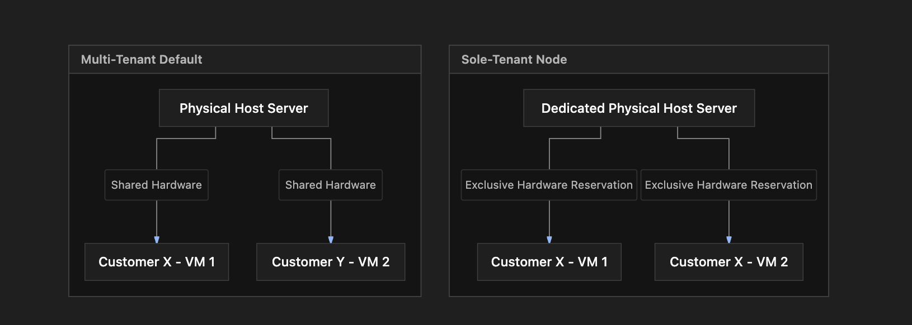

# Section Study Notes: GCE Sole-Tenant Nodes

---

### 1. Overview
This section introduces **Sole-Tenant Nodes** in Google Compute Engine (GCE), which provide physical hardware isolation for workloads that have strict compliance, security, or licensing requirements.
- **The Problem:** By default, multi-tenant GCE virtual machines share underlying physical servers (hosts) with VMs belonging to other Google Cloud customers. This multi-tenant architecture can conflict with strict corporate compliance regulations or license validation models tied to physical sockets/cores.
- **The Solution (Sole-Tenant Nodes):** Reserving an entire physical server (node) exclusively for a single customer. No other customer's VMs can run on that dedicated hardware.

---

### 2. ACE Exam Focus & Common Exam Traps
- **Exam Importance:** **HIGH** (Sole-tenant nodes and multi-tenancy distinctions are heavily tested in enterprise security, compliance, and licensing scenarios).
- **High-PriorityTopics:**
  - **Definition:** Sole-tenant nodes dedicate an entire physical server to a single customer, ensuring host-level hardware isolation.
  - **Use Cases:** 
    - **Compliance & Security:** Meeting strict regulatory standards (e.g., HIPAA, PCI-DSS, FedRAMP) that forbid hardware sharing.
    - **Bring Your Own License (BYOL):** Software licenses (like Microsoft Windows Server or SQL Server) mapped per physical core/socket.
  - **Core Configuration Flow:**
    1. Create a **node template** (defines the machine type and node configuration).
    2. Create a **node group** (a collection of nodes with optional **affinity labels**).
    3. Deploy **VM instances** to the node group using **affinity rules** (e.g., `group:IN:node-group-name` or `group:NOT_IN:...`).
- **Common Exam Traps:**
  - Assuming sole-tenant nodes require entirely different machine types or images. (Trap: Sole-tenant nodes are fully integrated with Compute Engine; you use the exact same standard machine types and images, just on isolated hardware).
  - Confusing multi-tenancy default isolation with sole-tenancy physical host reservation.

---

### 3. Detailed Concept Explanation

#### A. Multi-Tenancy vs. Sole-Tenancy
*   **Default Multi-Tenancy:** Multiple customer VMs share the same physical server (host). Google manages hypervisor isolation securely, but the physical hardware is shared.
*   **Sole-Tenant Nodes:** An entire physical host is dedicated exclusively to one customer account, preventing any other tenant from running workloads on that physical machine.

#### B. Architectural Setup Workflow
To provision and target workloads onto sole-tenant nodes, administrators follow a structured setup hierarchy:
1.  **Node Template:** Defines the underlying physical server specifications (node type, CPU family).
2.  **Node Group:** A collection of one or more sole-tenant nodes configured with optional **affinity labels** (e.g., environment tags like `group: production` or `environment: pci`).
3.  **VM Affinity Rules:** When creating or migrating VMs, administrators assign affinity or anti-affinity rules to control placement:
    *   `group:IN:[LABEL_OR_GROUP_NAME]`: Forces the VM to land on a node belonging to the specified group.
    *   `group:NOT_IN:[LABEL_OR_GROUP_NAME]`: Restricts the VM from landing on a specific node group (useful for high availability and spreading redundancy across separate physical hosts).

#### C. Primary Use Cases
*   **Strict Regulatory Compliance:** Meeting requirements for frameworks like PCI-DSS, HIPAA, or FedRAMP that mandate isolated hardware execution.
*   **Per-Core/Per-Socket Software Licensing:** Optimizing costs for third-party enterprise applications (like Oracle or Microsoft SQL Server) that license by physical core counts.
*   **Co-location and Dispersion:** Managing precise placement—either keeping related VMs together on the same physical server or separating high-availability VMs across distinct physical hosts.

---

### 4. Visual Representations

#### Multi-Tenancy vs. Sole-Tenant Architecture

---

### 5. Mental Models & Analogies

| Concept | Real-World Analogy | GCP / Technical Mapping |
| :--- | :--- | :--- |
| **Default Multi-Tenant VM** | Renting an apartment in a multi-family building. You share the physical structure and utility infrastructure with other tenants, though your unit is locked and private. | Multiple customer VMs run on the same physical server host, partitioned securely by the hypervisor. |
| **Sole-Tenant Node** | Renting a standalone single-family house where you are the sole occupant and control the entire building structure. | Reserving an entire physical server host exclusively for your organization's workloads. |
| **Affinity Rules / Labels** | Assigning specific moving boxes to designated rooms in a house using color-coded category labels. | Tagging node groups with affinity labels and using rules like `group:IN` to direct VM placement. |

---

### 6. Step-by-Step Workflows / Comparison Tables

#### Workflow: Configuring and Deploying Sole-Tenant Nodes
1.  **Create a Node Template:** Define the physical server node type (specifying CPU family and constraints).
2.  **Create a Node Group:** Instantiate a node group using the template, defining the initial node count and assigning **affinity labels** (e.g., `environment: production`).
3.  **Define VM Affinity Rules:** When launching your virtual machine instances, configure node affinity metadata rules (e.g., `group:IN:production`) to ensure the VM lands on the dedicated physical hardware group.
4.  **Verification:** Confirm instance placement via the GCP Console or `gcloud` to verify the VM is running on the designated sole-tenant node.

#### Comparison Table: Standard VMs vs. Sole-Tenant Nodes

| Feature | Standard Multi-Tenant VMs | Sole-Tenant Nodes |
| :--- | :--- | :--- |
| **Physical Hardware** | Shared across multiple GCP customers. | Dedicated exclusively to a single customer. |
| **Compliance Suitability** | Standard workloads. | Meets strict regulatory frameworks (HIPAA, PCI-DSS, FedRAMP). |
| **Licensing Support** | Standard OS billing. | Ideal for complex per-core/per-socket enterprise software licensing (BYOL). |
| **Configuration Complexity** | Simple out-of-the-box deployment. | Requires node templates, node groups, and VM affinity rules. |

---

### 7. Common Mistakes & Exam Traps

- **Trap 1:** Assuming that sole-tenant nodes require entirely separate, specialized machine types or custom disk images.
  - *Correction:* Sole-tenant nodes use the exact same standard machine types, custom sizes, and disk images as multi-tenant VMs; only the underlying physical host allocation changes.
- **Trap 2:** Placing multiple high-availability instances intended for redundancy onto the *same* sole-tenant node group without configuring anti-affinity rules.
  - *Correction:* For high availability, instances should be distributed across multiple node groups or separate physical nodes using anti-affinity rules (`group:NOT_IN`) to prevent single-host hardware failure outages.

---

### 8. Certification Practice Questions

#### Q1: An enterprise customer has strict internal compliance policies requiring that their virtual machines run on physical hardware that is never shared with other tenants. Which GCE feature should they use?
- A) Spot VMs
- B) Sole-tenant nodes
- C) Ephemeral standard disks
- D) Regional instance templates
- **Correct Answer:** B
- **Explanation:** Sole-tenant nodes dedicate entire physical server hosts exclusively to a single customer, satisfying strict single-tenant hardware isolation requirements.
- **Why others are incorrect:** Spot VMs share spare capacity; persistent disks and templates do not dictate physical host isolation.
- **Exam Takeaway:** Use sole-tenant nodes when physical host hardware isolation is required.

#### Q2: What is the correct sequence of configuration steps required to deploy a virtual machine onto a sole-tenant node?
- A) Create a VPC subnetwork $\rightarrow$ Attach a public IP $\rightarrow$ Delete project.
- B) Create a node template $\rightarrow$ Create a node group with affinity labels $\rightarrow$ Deploy a VM with matching affinity rules.
- C) Create an instance group $\rightarrow$ Enable Cloud Billing $\rightarrow$ Install Cloud Trace.
- D) Create a firewall rule $\rightarrow$ Purchase a 3-year CUD $\rightarrow$ Format boot disk.
- **Correct Answer:** B
- **Explanation:** Setting up sole-tenant nodes requires first creating a node template, provisioning a node group with affinity labels, and then deploying VMs referencing those affinity rules.
- **Why others are incorrect:** The other sequences omit node templates and groups entirely.
- **Exam Takeaway:** Remember the setup flow: Node Template $\rightarrow$ Node Group $\rightarrow$ VM with Affinity Rules.

#### Q3: A database administrator needs to optimize licensing costs for an enterprise software application whose license is calculated strictly based on the physical core count of the underlying server. Which GCP infrastructure option best accommodates this?
- A) Standard multi-tenant shared VMs
- B) Sole-tenant nodes
- C) Public shared-core micro-instances
- D) Preemptible Spot VMs
- **Correct Answer:** B
- **Explanation:** Sole-tenant nodes allow enterprises to map software licenses to specific physical host cores or sockets (BYOL), satisfying complex vendor auditing rules.
- **Why others are incorrect:** Shared multi-tenant VMs violate core-counting audits; micro-instances and Spot VMs are unsuited for enterprise licensing models.
- **Exam Takeaway:** Sole-tenant nodes are the primary solution for per-core/per-socket enterprise licensing compliance.

#### Q4: When configuring high availability for critical workloads running on sole-tenant nodes, how should an administrator configure VM placement across physical infrastructure?
- A) Place all primary and backup VMs on a single physical node inside one node group.
- B) Distribute workloads across multiple node groups or separate physical nodes using affinity and anti-affinity rules.
- C) Disable all logging features to conserve memory.
- D) Use ephemeral storage exclusively.
- **Correct Answer:** B
- **Explanation:** Achieving high availability requires distributing redundant instances across separate physical host node groups so a single hardware failure does not take down all instances.
- **Why others are incorrect:** Consolidating all VMs onto a single physical node creates a single point of failure.
- **Exam Takeaway:** Use multiple node groups and anti-affinity rules to maintain high availability across sole-tenant hardware.

#### Q5: True or False: Do sole-tenant nodes require custom operating system images or modified machine types that differ from standard multi-tenant GCE virtual machines?
- A) True. Sole-tenant nodes require completely rewritten custom operating systems.
- B) False. Sole-tenant nodes support the exact same standard machine types, custom sizing, and disk images as regular GCE instances.
- C) True, but only for Windows Server distributions.
- D) False, because sole-tenant nodes cannot run virtual machines.
- **Correct Answer:** B
- **Explanation:** Sole-tenant nodes are fully integrated into Compute Engine; they utilize the exact same machine types and images, differing only in physical host allocation.
- **Why others are incorrect:** You do not need specialized operating systems to run workloads on dedicated hardware.
- **Exam Takeaway:** Sole-tenant nodes use standard GCE machine types and images.

#### Q6: Which affinity rule parameter should an administrator use to ensure a newly deployed virtual machine lands on a specific node group labeled `group: production`?
- A) `group:NOT_IN:production`
- B) `group:IN:production`
- C) `zone:EXCLUDE:production`
- D) `region:BYPASS:production`
- **Correct Answer:** B
- **Explanation:** The `group:IN:[LABEL]` rule instructs the scheduler to place the VM on a node belonging to the specified group label.
- **Why others are incorrect:** `NOT_IN` does the exact opposite (anti-affinity); zone and region bypass tags do not control node group affinity.
- **Exam Takeaway:** Use `group:IN` to target specific sole-tenant node groups.

#### Q7: Compliance frameworks such as HIPAA, PCI-DSS, and FedRAMP frequently require which of the following compute characteristics?
- A) Public shared multi-tenancy without encryption
- B) Physical host isolation preventing other customers from sharing underlying server infrastructure
- C) Instant public internet exposure for all databases
- D) Automatic data deletion every 60 seconds
- **Correct Answer:** B
- **Explanation:** Regulatory compliance frameworks often mandate strict physical isolation to ensure data security and prevent cross-tenant data exposure.
- **Why others are incorrect:** Public shared multi-tenancy and data deletion violate compliance requirements.
- **Exam Takeaway:** Sole-tenant nodes help satisfy compliance frameworks requiring physical host isolation.

#### Q8: What is the function of affinity labels when applied to a GCE sole-tenant node group?
- A) To encrypt network packets using public certificates.
- B) To categorize and tag node groups so incoming virtual machines can be targeted using affinity rules.
- C) To automatically assign static public IP addresses.
- D) To limit project billing accounts.
- **Correct Answer:** B
- **Explanation:** Affinity labels act as metadata tags on node groups, enabling precise routing of VM instances via affinity rules during deployment.
- **Why others are incorrect:** Encryption, static IPs, and billing accounts are handled by separate GCP subsystems.
- **Exam Takeaway:** Affinity labels tag node groups for precise VM placement control.

#### Q9: True or False: Can a single sole-tenant node group contain multiple individual physical server nodes?
- A) False. A node group is strictly restricted to holding only one single node.
- B) True. A node group can contain one or more physical nodes depending on capacity configuration.
- C) False, because node groups can only store static images.
- D) True, but only if the project uses free trial credits.
- **Correct Answer:** B
- **Explanation:** Node groups can be configured with one or multiple physical server nodes to scale capacity for a given workload.
- **Why others are incorrect:** Node groups are designed to manage collections of dedicated physical host servers.
- **Exam Takeaway:** Node groups can contain multiple physical server nodes.

#### Q10: What role does an anti-affinity rule (`group:NOT_IN`) play when managing sole-tenant node deployments?
- A) It forces all VMs to run on the exact same physical chip.
- B) It prevents a VM from being scheduled on a specified node group, ensuring workloads remain separated across different physical hosts.
- C) It deletes the virtual machine automatically after 24 hours.
- D) It forces the VM to convert into a container image.
- **Correct Answer:** B
- **Explanation:** Anti-affinity rules (`group:NOT_IN`) instruct the scheduler to avoid specific node groups, keeping redundant instances separated across distinct physical hardware.
- **Why others are incorrect:** Forcing VMs onto the same chip is affinity, not anti-affinity; deletion and container conversion are unrelated.
- **Exam Takeaway:** Use `group:NOT_IN` anti-affinity rules to distribute VMs across separate physical hosts for redundancy.