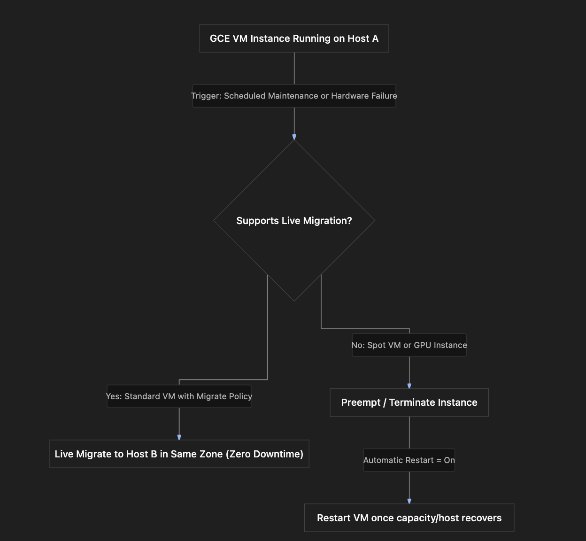

# Section Study Notes: GCE Live Migration, On-Host Maintenance, and Automatic Restart

---

### 1. Overview
This section covers how Google Compute Engine (GCE) maintains high availability and uptime during infrastructure maintenance events and unexpected hardware failures.
- **The Problem:** Physical hardware infrastructure requires periodic maintenance, firmware updates, and component replacements. Without safeguards, these maintenance events or underlying hardware failures would cause application downtime.
- **The Solution (Live Migration & Availability Policies):** GCE features built-in **Live Migration**, which transparently moves a running VM instance to a different physical host within the same zone without application interruption or attribute changes. This behavior is controlled via **Availability Policies** (`on-host maintenance` and `automatic restart`).

---

### 2. ACE Exam Focus & Common Exam Traps
- **Exam Importance:** **HIGH** (Live migration behavior, default availability settings, and exclusions like GPUs/Spot VMs are absolute staples of ACE certification questions).
- **High-Priority Topics:**
  - **Default Behavior:** By default, standard GCE VMs have live migration enabled (`migrate VM instance`) and automatic restart set to `on`.
  - **Trigger Events:** Infrastructure maintenance and hardware/software failures.
  - **Live Migration Exclusions (Crucial Traps):** Live migration is **not supported** for:
    1. VMs with **GPUs** attached.
    2. **Spot VMs** (or preemptible instances).
  - **Availability Policy Settings:**
    - `on-host maintenance`: Options are **Migrate VM instance** (default) or **Terminate**.
    - `automatic restart`: Options are **On** (default, restarts VM if terminated non-user-initiated) or **Off**.
- **Common Exam Traps:**
  - Assuming Spot VMs or GPU-accelerated VMs will live-migrate during maintenance. (Trap: They do *not* support live migration and will terminate).
  - Confusing what happens when a VM with `terminate` for on-host maintenance encounters a host event. (Trap: It stops rather than migrating).

---

### 3. Detailed Concept Explanation

#### A. Live Migration Mechanism
*   **What it does:** Shifts a running VM instance to another healthy physical host server inside the **same availability zone**.
*   **Impact:** Zero downtime, transparent to applications, and preserves all VM attributes (IP addresses, metadata, attached disks).
*   **Triggers:** 
    *   *Scheduled Infrastructure Maintenance:* Host updates performed by Google.
    *   *Unexpected Hardware/Software Failures:* Host anomalies that require moving the VM away from failing hardware.

#### B. Availability Policies Configuration
Availability policies dictate how Compute Engine responds to maintenance events and unexpected crashes. They consist of two primary configuration parameters:

1.  **On-Host Maintenance:** Defines what happens during periodic infrastructure maintenance.
    *   **Migrate VM instance (Default):** Automatically migrates the running VM to another physical host.
    *   **Terminate:** Shuts down/stops the VM instance during maintenance instead of migrating it.
2.  **Automatic Restart:** Defines recovery behavior after unexpected non-user-initiated terminations.
    *   **On (Default):** Automatically restarts the VM instance if it crashes or terminates due to hardware/software failure or maintenance (if configured to terminate).
    *   **Off:** Leaves the VM in a stopped state if it is terminated unexpectedly.

#### C. Restrictions on Live Migration
*   Live migration is powerful, but it cannot be used everywhere. It is **incompatible** with:
    *   **Spot VMs / Preemptible VMs:** These instances run on spare capacity and are terminated rather than migrated.
    *   **GPUs (Graphics Processing Units):** Hardware-accelerated workloads with attached GPUs cannot be live-migrated.

---

### 4. Visual Representations

#### Live Migration Request Flow & Triggers

---

### 5. Mental Models & Analogies

| Concept | Real-World Analogy | GCP / Technical Mapping |
| :--- | :--- | :--- |
| **Live Migration** | Moving a passenger from one seat to another on a flying commercial airplane mid-flight without the passenger ever noticing or the plane stopping. | Shifting a running GCE VM to a different physical host server in the same zone without dropping connections or altering attributes. |
| **On-Host Maintenance (Migrate vs. Terminate)** | A hotel manager telling you either, *"We will seamlessly move you to an identical luxury suite next door while we fix your room,"* versus, *"We must ask you to check out of your room entirely during repairs."* | Choosing whether to migrate the VM automatically or terminate it during host maintenance. |
| **Automatic Restart** | An automated home standby generator that kicks on and restarts your household appliances instantly if utility power blips off unexpectedly. | Compute Engine automatically powering a VM back up after a non-user-initiated failure or termination event. |

---

### 6. Step-by-Step Workflows / Comparison Tables

#### Comparison Table: Availability Policy Options

| Parameter | Setting Options | Default | Behavior Description |
| :--- | :--- | :--- | :--- |
| **On-Host Maintenance** | • Migrate VM instance • Terminate | **Migrate VM instance** | Decides if a VM should live-migrate to a new host or shut down during infrastructure maintenance. |
| **Automatic Restart** | • On • Off | **On** | Dictates whether Compute Engine automatically boots the VM back up after non-user-initiated termination. |

---

### 7. Common Mistakes & Exam Traps

- **Trap 1:** An architect assumes that Spot VMs will live-migrate during a host maintenance event to prevent job failure.
  - *Correction:* Spot VMs **do not support live migration**. They are terminated when infrastructure needs change or maintenance occurs.
- **Trap 2:** Believing that live migration shifts a VM to a completely different region or availability zone.
  - *Correction:* Live migration strictly occurs between physical hosts **within the exact same zone**.

---

### 8. Certification Practice Questions

#### Q1: What happens to a standard GCE virtual machine instance when Google Cloud performs scheduled infrastructure maintenance on its host server, assuming default configuration settings?
- A) The VM is permanently deleted from the project.
- B) The VM is live-migrated to another host server within the same zone with zero downtime.
- C) The VM is migrated across different global regions.
- D) The VM shuts down and never restarts automatically.
- **Correct Answer:** B
- **Explanation:** By default, standard GCE VMs have live migration enabled (`migrate VM instance`), meaning they transparently shift to another host in the same zone during maintenance.
- **Why others are incorrect:** VMs are not deleted, moved cross-region automatically during maintenance, or left permanently shut down by default.
- **Exam Takeaway:** Default standard GCE VMs live-migrate automatically during host maintenance.

#### Q2: Which two GCE configurations or instance types explicitly **do not** support live migration?
- A) Standard N2 instances and Debian Linux VMs
- B) VMs with attached GPUs and Spot VMs
- C) Custom machine types and Windows Server instances
- D) Regional instance templates and static IP instances
- **Correct Answer:** B
- **Explanation:** Live migration is unsupported for instances utilizing attached GPUs or Spot VMs (preemptible instances).
- **Why others are incorrect:** Standard N2, custom sizes, and Windows servers fully support live migration under normal conditions.
- **Exam Takeaway:** Remember that GPUs and Spot VMs cannot be live-migrated.

#### Q3: An administrator configures a VM's availability policy such that `on-host maintenance` is set to **Terminate**. What happens to the VM instance during a scheduled infrastructure maintenance event?
- A) The VM will live-migrate seamlessly to a new host.
- B) The VM instance will be stopped (shut down) for the duration of the maintenance.
- C) The VM will duplicate itself into two separate active instances.
- D) The VM will automatically convert into a container cluster.
- **Correct Answer:** B
- **Explanation:** Choosing `Terminate` instructs Compute Engine to stop/shutdown the VM instance during infrastructure maintenance rather than live-migrating it.
- **Why others are incorrect:** Migration is bypassed when `Terminate` is selected; duplication and container conversion do not occur.
- **Exam Takeaway:** Setting on-host maintenance to `Terminate` shuts down the VM during maintenance events instead of migrating it.

#### Q4: What is the primary function of the `automatic restart` setting when configured to **On** for a GCE virtual machine?
- A) It backs up all persistent storage disks to an on-premises tape drive every hour.
- B) It allows Compute Engine to automatically restart the VM instance if it terminates due to non-user-initiated reasons (like hardware failure or maintenance termination).
- C) It rotates internal DNS names every 60 seconds.
- D) It upgrades the operating system version automatically every night.
- **Correct Answer:** B
- **Explanation:** Automatic restart ensures that if a VM stops unexpectedly due to non-user-initiated events (like a crash or maintenance termination), Google Cloud will automatically boot it back up.
- **Why others are incorrect:** Backups, DNS rotation, and OS upgrades are handled by separate backup, DNS, and patching services.
- **Exam Takeaway:** Automatic restart handles recovery when a VM terminates unexpectedly.

#### Q5: Within what geographic or network boundary does a GCE live migration take place?
- A) Across two completely separate continents
- B) Between different projects within an enterprise organization
- C) To another host server inside the exact same availability zone
- D) From the cloud directly to an on-premises data center rack
- **Correct Answer:** C
- **Explanation:** Live migration shifts running instances across physical servers located inside the *same* availability zone.
- **Why others are incorrect:** Live migration cannot cross availability zone boundaries, regions, or cross-platform to on-prem data centers.
- **Exam Takeaway:** Live migration occurs strictly within the same availability zone.

#### Q6: True or False: Does live migration change the internal or external IP addresses, disk data, or metadata properties of a GCE virtual machine instance?
- A) True. All IP addresses change entirely during migration.
- B) False. Live migration preserves all attributes, properties, IPs, and disk data of the virtual machine.
- C) True, but only if external static IPs are attached.
- D) False, because the VM is completely wiped out and rebuilt from scratch.
- **Correct Answer:** B
- **Explanation:** Live migration is transparent; it shifts the running memory state and CPU execution to new hardware without altering any VM attributes or properties.
- **Why others are incorrect:** IPs and disk contents remain completely intact.
- **Exam Takeaway:** Live migration preserves all VM attributes and properties.

#### Q7: What are the two valid options available under the `on-host maintenance` availability policy setting?
- A) Migrate VM instance or Terminate
- B) Start or Pause
- C) Archive or Stream
- D) Encrypt or Decrypt
- **Correct Answer:** A
- **Explanation:** The two valid options for on-host maintenance are **Migrate VM instance** (the default) and **Terminate**.
- **Why others are incorrect:** Start, pause, archive, stream, encrypt, and decrypt are not on-host maintenance choices.
- **Exam Takeaway:** Memorize the two on-host maintenance options: Migrate VM instance and Terminate.

#### Q8: What happens if a Spot VM encounters a host maintenance event or infrastructure failure since live migration is unsupported for it?
- A) The Spot VM migrates to another zone instantly.
- B) The Spot VM is preempted (terminated), and whether it restarts depends on its automatic restart configuration and spare capacity availability.
- C) The VM pauses indefinitely until a human administrator clicks Resume.
- D) The VM converts into a standard paid on-demand instance automatically.
- **Correct Answer:** B
- **Explanation:** Since Spot VMs cannot live-migrate, they are terminated (preempted). If automatic restart is enabled and capacity allows, they may restart later, but they do not migrate.
- **Why others are incorrect:** They do not migrate cross-zone or auto-convert to paid on-demand instances without user reconfiguration.
- **Exam Takeaway:** Spot VMs terminate during host maintenance events because they do not support live migration.

#### Q9: True or False: By default, are standard GCE virtual machines created with live migration enabled (`migrate VM instance`) and automatic restart set to `on`?
- A) False. Both features are disabled by default for all VMs.
- B) True. Standard GCE VMs default to live migration enabled and automatic restart set to on.
- C) False, because automatic restart is only available for Windows servers.
- D) True, but only if Spot provisioning is selected.
- **Correct Answer:** B
- **Explanation:** Google Cloud configures standard GCE virtual machines with high availability out of the box by defaulting to live migration and automatic restart.
- **Why others are incorrect:** High availability features are enabled by default, not disabled.
- **Exam Takeaway:** Live migration and automatic restart are enabled by default on standard GCE VMs.

#### Q10: Which of the following trigger events can prompt Compute Engine to initiate a live migration or host action for a VM?
- A) Scheduled infrastructure maintenance or unexpected hardware/software host failures
- B) A user changing their GCP Console password
- C) A change in the project's billing credit card expiration date
- D) A VPC firewall rule modification
- **Correct Answer:** A
- **Explanation:** Live migration and host actions are triggered by platform-level infrastructure maintenance or underlying host hardware/software failures.
- **Why others are incorrect:** Console passwords, billing cards, and firewall rule modifications do not trigger GCE live migration events.
- **Exam Takeaway:** Infrastructure maintenance and hardware/software failures are the primary triggers for live migration.