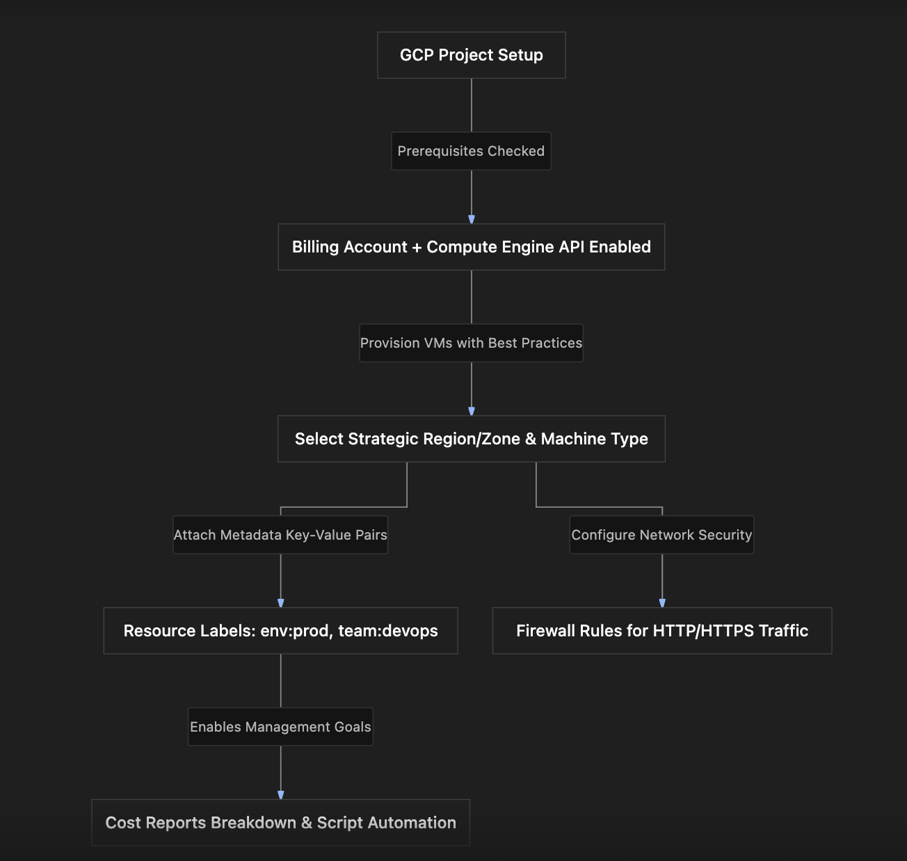

# Section Study Notes: GCE Best Practices, Labels, and Scenario Prerequisites

---

### 1. Overview
This section covers essential architectural **best practices**, the usage of **resource labels**, and the operational **prerequisites** required for managing virtual machine instances in Google Compute Engine (GCE).
- **The Problem:** Deploying and scaling cloud resources without consistent metadata tracking, thoughtful regional planning, cost alignment, or prerequisite verification leads to operational blind spots, compliance failures, and resource disorganization.
- **The Solution:** 
  - Using **labels** (key-value pairs) for resource organization, cost reporting allocation, and script automation.
  - Applying holistic **VM best practices** covering strategic region/zone selection, multi-zone high availability, machine type right-sizing, GPU utilization, and discount/Spot model selection.
  - Satisfying core **prerequisites** (active account, project, billing account, and Compute Engine API enablement) before provisioning resources.

---

### 2. ACE Exam Focus & Common Exam Traps
- **Exam Importance:** **HIGH** (Best practices, labels, and scenario prerequisites form the foundation of architectural design and troubleshooting questions on the ACE exam).
- **High-Priority Topics:**
  - **Labels:** Simple `key:value` pairs (e.g., `environment:production`, `team:devops`) applied at creation or edited later. Used for **cost management/reporting breakdown**, **resource organization**, and **automation**.
  - **VM Prerequisites:** To create a GCE VM, you need:
    1. A Google Cloud account with a **Project**.
    2. An active **Billing Account**.
    3. The **Compute Engine API** enabled.
  - **Firewall Rules for Traffic:** HTTP/HTTPS traffic access is controlled via explicit firewall rule checkboxes/tags during configuration.
  - **Custom Images & Hardening:** Creating a custom image with a preferred OS, pre-installed apps, and security settings is called **hardening an image**. Hardened images can be shared across projects.
  - **Region/Zone Strategy:** Consider cost variance, legal/compliance data residency regulations, user latency, and machine type availability across regions.
- **Common Exam Traps:**
  - Assuming labels are used for hard security access-control boundaries. (Trap: Labels are metadata for organization, automation, and billing reports; Identity and Access Management [IAM] tags or Resource Manager tags control security permissions).
  - Forgetting that Compute Engine APIs must be explicitly enabled if not using default setup projects.

---

### 3. Detailed Concept Explanation

#### A. Resource Labels
*   **Definition:** Metadata strings formatted as simple `key:value` pairs attached to Google Cloud resources (such as GCE VMs, disks, and snapshots).
*   **Key Use Cases:**
    1.  **Cost Management & Billing Breakdown:** Group expenses in billing exports to determine how much specific teams, projects, or environments cost.
    2.  **Resource Organization:** Group related resources logically for easier tracking and inventory management.
    3.  **Automation:** Query resources programmatically using label selectors to target scripts or operational tasks (e.g., automated backup or patching scripts).
*   **Lifecycle:** Can be applied during resource creation or added/modified later by editing the resource metadata.

#### B. Virtual Machine Best Practices
1.  **Careful Region and Zone Selection:**
    *   Evaluate cost differences between regions.
    *   Verify legal data residency compliance requirements.
    *   Minimize latency by placing VMs close to end users.
    *   Check machine type availability in target regions.
2.  **High Availability & Fault Tolerance:** Distribute workloads across multiple zones and regions so an outage in one zone does not disrupt application availability.
3.  **Right-Sizing & Performance Experimentation:** Experiment with different machine types to find the optimal cost-performance ratio.
4.  **Specialized Hardware:** Utilize GPUs for math-heavy, high-performance computing, AI, or machine learning workloads.
5.  **Cost Optimization Alignment:**
    *   Use **Committed Use Discounts (CUDs)** for predictable, long-running 1-year or 3-year steady workloads.
    *   Use **Spot VMs** for fault-tolerant, non-urgent, cost-sensitive batch jobs.

#### C. Compute Engine Scenarios & Prerequisites
*   **Prerequisites for VM Creation:**
    1.  Google Cloud account & Project.
    2.  Active Billing Account linked.
    3.  Compute Engine API enabled.
*   **Access & Connectivity:**
    *   Admin access to a VM's guest OS requires **SSH**.
    *   Inbound web traffic (HTTP/HTTPS) requires explicit configuration via **firewall rules**.
*   **Image Hardening:** Pre-configuring an OS with custom security baselines and applications creates a standardized custom image that can be shared across enterprise projects.

---

### 4. Visual Representations

#### Core VM Best Practices & Resource Governance Architecture

---

### 5. Mental Models & Analogies

| Concept | Real-World Analogy | GCP / Technical Mapping |
| :--- | :--- | :--- |
| **Resource Labels** | Placing colored sticky-notes or barcode tags on office equipment (e.g., "Department: Finance") to track inventory and utility expenses. | Attaching `key:value` pairs (`business:finance`, `environment:production`) to GCE resources for billing breakdowns and automation. |
| **Image Hardening** | Creating a master blueprint template for building identical, pre-inspected, safety-compliant homes. | Building a custom OS image with pre-installed enterprise security settings and applications that can be shared across projects. |
| **VM Prerequisites** | Setting up a utility account, verifying building zoning permissions, and getting a water/power meter installed before opening a business shop. | Ensuring a project, billing account, and Compute Engine API are enabled before spinning up VMs. |

---

### 6. Step-by-Step Workflows / Comparison Tables

#### Summary Table: VM Best Practices & Operational Scenarios

| Operational Goal | Recommended Best Practice / Feature | Purpose / Outcome |
| :--- | :--- | :--- |
| **Cost Allocation & Tracking** | **Resource Labels** (`key:value`) | Breaks down cloud bills by team, project, or environment. |
| **Network Security Control** | **VCFirewall Rules** | Explicitly permits or blocks incoming HTTP/HTTPS traffic to VMs. |
| **Standardized Deployments** | **Custom Hardened Images** | Embeds security configurations, OS settings, and apps into a reusable image. |
| **Workload Resiliency** | **Multi-Zone / Multi-Region Deployment** | Protects applications against isolated data center outages. |
| **Steady-State Savings** | **Committed Use Discounts (CUDs)** | Provides deep discounts for 1-year or 3-year predictable workloads. |

---

### 7. Common Mistakes & Exam Traps

- **Trap 1:** Assuming labels restrict user permissions or act as a substitute for Identity and Access Management (IAM) security policies.
  - *Correction:* Labels are purely descriptive metadata used for organization, billing aggregation, and script automation. They do not enforce access control rules.
- **Trap 2:** Forgetting the three mandatory prerequisites required to create a GCE instance in a fresh project environment.
  - *Correction:* You must have an active Project, a linked Billing Account, and the Compute Engine API enabled.

---

### 8. Certification Practice Questions

#### Q1: A finance manager wants to review a monthly cloud expenditure report broken down specifically by internal business units (e.g., `business:finance` versus `business:marketing`). What feature should administrators attach to resources to enable this reporting capability?
- A) VPC Flow Logs
- B) Resource labels (`key:value` pairs)
- C) IAM Service Account keys
- D) Cloud Storage bucket lifecycles
- **Correct Answer:** B
- **Explanation:** Resource labels (`key:value` pairs) allow organizations to tag resources, enabling granular cost reporting breakdowns and allocation tracking in Cloud Billing.
- **Why others are incorrect:** VPC flow logs analyze network traffic packets, IAM handles security credentials, and storage lifecycles manage object retention.
- **Exam Takeaway:** Use resource labels for cost management and reporting categorization.

#### Q2: Which of the following sets of requirements represents the exact core prerequisites needed before launching a virtual machine instance in Google Cloud?
- A) A USB installation drive, a local terminal cable, and a 10Gbps fiber line.
- B) A Google Cloud Project, an active Billing Account, and the Compute Engine API enabled.
- C) A Windows 95 installation disk and an active legacy domain controller.
- D) A Spot VM contract and a 5-year hardware lease agreement.
- **Correct Answer:** B
- **Explanation:** To create a VM instance, you must have an active GCP project, a linked billing account, and the Compute Engine API enabled.
- **Why others are incorrect:** Physical installation cables and legacy software disks are irrelevant to cloud provisioning.
- **Exam Takeaway:** Memorize the three core VM prerequisites: Project, Billing Account, and Compute Engine API enabled.

#### Q3: An administrator creates a custom virtual machine image that incorporates company-mandated security baselines, locked-down user permissions, and pre-installed enterprise monitoring software. What is this process commonly called?
- A) Hardening an image
- B) Ephemeral disk stripping
- C) Dynamic DNS flushing
- D) Subnet masking
- **Correct Answer:** A
- **Explanation:** Configuring an image with security controls, patches, and software configurations is known as hardening an image.
- **Why others are incorrect:** Disk stripping, DNS flushing, and subnet masking are network and storage maintenance tasks, not image security preparation.
- **Exam Takeaway:** Standardizing an OS image with security and software baselines is called image hardening.

#### Q4: How is incoming web traffic (such as HTTP or HTTPS) permitted to reach a newly created GCE virtual machine instance?
- A) By modifying the project's root billing password.
- B) By configuring and enabling matching inbound firewall rules during or after VM creation.
- C) By attaching an internal DNS routing suffix.
- D) By converting the VM into a sole-tenant node.
- **Correct Answer:** B
- **Explanation:** Inbound traffic into a VM is governed by VPC firewall rules; administrators must explicitly enable HTTP/HTTPS traffic rules to allow web packets through.
- **Why others are incorrect:** Billing passwords, internal DNS suffixes, and sole-tenant nodes do not open inbound network firewall ports.
- **Exam Takeaway:** Inbound traffic requires explicit VPC firewall rule configuration.

#### Q5: True or False: Can resource labels be attached to GCE virtual machines after the instance has already been created, or must they be defined strictly at creation time?
- A) False. Labels can never be added after initial creation.
- B) True. Labels can be attached during creation or added/modified later by editing the resource.
- C) False, because labels are immutable metadata objects.
- D) True, but only if running Linux operating systems.
- **Correct Answer:** B
- **Explanation:** Resource labels are flexible; administrators can apply them during initial resource creation or update them later via resource editing options.
- **Why others are incorrect:** Labels are mutable and can be modified or added at any time.
- **Exam Takeaway:** Labels can be added during creation or edited later.

#### Q6: Which best practice should an architect implement to protect business applications against localized data center outages in a single facility?
- A) Deploy VM instances across multiple zones and regions.
- B) Store all database files on a single local SSD inside one zone.
- C) Disable all automatic restart policies.
- D) Restrict project access to a single IAM user.
- **Correct Answer:** A
- **Explanation:** Distributing VM instances across multiple zones and regions ensures high availability and fault tolerance if an entire zone experiences an outage.
- **Why others are incorrect:** Consolidating workloads into a single zone or disabling restarts increases vulnerability to outages.
- **Exam Takeaway:** Distribute VMs across multiple zones and regions for high availability.

#### Q7: What is a primary operational benefit of using resource labels to execute automation tasks or maintenance scripts?
- A) Labels encrypt storage disks automatically using quantum keys.
- B) Labels allow scripts to programmatically query and target specific groups of resources (e.g., all instances labeled `environment:production`).
- C) Labels eliminate network latency across global regions.
- D) Labels automatically convert Spot VMs into standard instances during maintenance.
- **Correct Answer:** B
- **Explanation:** Automation scripts can query Google Cloud APIs using label filters to identify, target, and perform batch operations on specific resource groups.
- **Why others are incorrect:** Labels do not handle disk encryption, latency reduction, or VM preemption handling.
- **Exam Takeaway:** Labels enable automation by allowing scripts to easily identify and target specific resource groups.

#### Q8: An engineering team has a steady, predictable workload running 24/7 across 30 instances for the next three years. Which pricing recommendation best aligns with cloud cost optimization best practices?
- A) Run all instances exclusively as short-lived Spot VMs.
- B) Purchase 3-year Committed Use Discounts (CUDs).
- C) Delete all persistent disks every night.
- D) Use unassigned ephemeral external IP addresses only.
- **Correct Answer:** B
- **Explanation:** Predictable, steady, long-running workloads benefit most from Committed Use Discounts (CUDs), which yield maximum savings in exchange for a 1-year or 3-year commitment.
- **Why others are incorrect:** Spot VMs risk unannounced termination; deleting disks destroys data; ephemeral IPs offer no compute savings.
- **Exam Takeaway:** Use 3-year CUDs for predictable, long-running workloads.

#### Q9: True or False: Do resource labels enforce hard security access control boundaries or IAM permissions in Google Cloud?
- A) True. Labels are the primary mechanism for setting user password complexity.
- B) False. Labels are descriptive metadata tags used for organization, billing, and automation; they do not enforce IAM security permissions.
- C) True, but only for database instances.
- D) False, because labels are processed strictly by the billing engine only.
- **Correct Answer:** B
- **Explanation:** Labels are purely metadata markers. Security access control and permissions are managed by IAM policies, not resource labels.
- **Why others are incorrect:** Labels have no security enforcement role.
- **Exam Takeaway:** Remember that labels are for organization and billing breakdowns, not IAM security enforcement.

#### Q10: Which type of workload is recommended for Spot VMs based on GCE cost optimization best practices?
- A) Mission-critical, customer-facing financial banking APIs.
- B) Fault-tolerant, non-urgent, cost-sensitive batch processing jobs.
- C) High-security enterprise medical patient databases.
- D) Real-time live video broadcast transcoding servers with zero tolerance for interruption.
- **Correct Answer:** B
- **Explanation:** Spot VMs lack SLAs and can be preempted at any time, making them suitable exclusively for fault-tolerant, non-urgent batch jobs.
- **Why others are incorrect:** Banking APIs, medical databases, and live broadcasting require guaranteed uptime and high availability.
- **Exam Takeaway:** Spot VMs are reserved exclusively for fault-tolerant, non-urgent batch workloads.