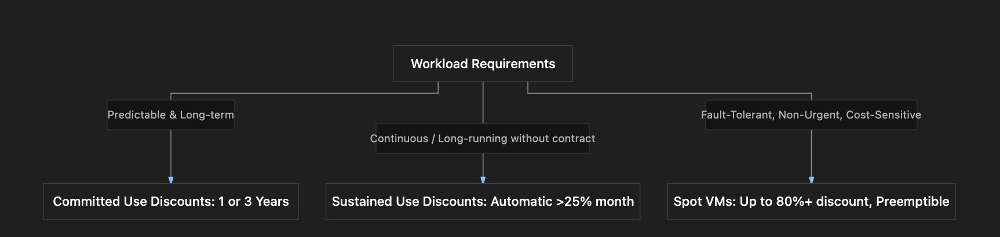

# Section Study Notes: GCE Pricing Models, Discounts, and Cost Optimization

---

### 1. Overview
This section covers cost-optimization strategies and pricing models for Google Compute Engine (GCE) virtual machine instances. Understanding these models is critical for designing cost-effective, budget-conscious cloud architectures.
- **The Problem:** Running standard virtual machines continuously without optimization can lead to excessive cloud spend.
- **The Solution (Pricing Optimization Models):** GCP provides three primary cost-reduction mechanisms depending on usage duration, predictability, and workload urgency:
  1. **Sustained Use Discounts (SUD):** Automatic discounts applied when VMs run for a significant portion of the billing month.
  2. **Committed Use Discounts (CUD):** Deep discounts granted in exchange for a 1-year or 3-year commitment (either by resource usage or minimum spend).
  3. **Spot VMs:** Extremely low-cost (up to 80%+ discount) temporary instances leveraging spare GCP capacity, subject to termination with a 30-second warning.

---

### 2. ACE Exam Focus & Common Exam Traps
- **Exam Importance:** **HIGH** (Cost optimization scenarios are frequently tested. Expect questions requiring you to choose the correct discount model or provisioning type based on workload constraints).
- **High-Priority Topics:**
  - **Sustained Use Discounts (SUD):** Automatic, no-upfront-commitment discounts that trigger when usage exceeds 25% of a billing month. They scale upward with more usage. Not stackable with other special discounts.
  - **Committed Use Discounts (CUD):** Require 1-year or 3-year contracts. Flexible CUDs can apply across multiple compute services (like GCE, GKE, and Cloud Run) based on spend.
  - **Spot VMs:** Ideal for batch jobs, rendering, and fault-tolerant, non-urgent workloads. No SLA, no live migration, subject to preemption with a 30-second warning, and *ineligible* for free trial credits.
- **Common Exam Traps:**
  - Assuming you must manually apply or request SUDs. (Trap: SUDs are applied *automatically* by Google Cloud if no other discounts are active).
  - Attempting to use free trial credits to run Spot VMs. (Trap: Free trial credits do not apply to Spot VMs).
  - Choosing Spot VMs for production, database, or latency-critical customer-facing workloads. (Trap: Spot VMs lack an SLA and can be preempted at any time).

---

### 3. Detailed Concept Explanation

#### A. Sustained Use Discounts (SUD)
*   **Definition:** Automatic percentage discounts applied to instances that run for a large portion of the billing month.
*   **Rules & Constraints:**
    *   Must run for **more than 25%** of the billing month.
    *   Applies automatically (no upfront action or contract required).
    *   **Mutually Exclusive:** Cannot be combined with other discounts like Committed Use Discounts or Spot pricing.
    *   Discounts increase gradually the longer the instance runs during that month.

#### B. Committed Use Discounts (CUD)
*   **Definition:** Deep discounts offered to customers who commit to purchasing a minimum level of compute resources for a fixed term.
*   **Terms:** 1-year or 3-year commitment periods. 3-year commitments yield higher discounts than 1-year commitments.
*   **Types of Commitments:**
    1.  **Resource-based commitments:** Commit to specific machine types and quantities (e.g., specific vCPUs and RAM in a region).
    2.  **Flexible (Spend-based) commitments:** Commit to spending a minimum hourly dollar amount across eligible compute products (GCE, Google Kubernetes Engine [GKE], Cloud Run).
*   **Use Case:** Predictable, steady-state workloads running continuously over long periods.

#### C. Spot VMs
*   **Definition:** Highly discounted virtual machine instances running on spare Google Cloud data center capacity.
*   **Key Characteristics:**
    *   **Deep Discounts:** Often savings exceeding 80% compared to standard pricing.
    *   **Preemption (Termination):** If Google Cloud needs the capacity back, the VM is shut down. Google provides a **30-second warning notice** before termination.
    *   **No SLA:** Google offers no Service Level Agreement or availability guarantees for Spot VMs.
    *   **No Live Migration:** Spot VMs cannot be live-migrated to another host during underlying physical maintenance; they are simply terminated.
*   **Ideal Use Case:** Fault-tolerant, non-urgent, highly cost-sensitive batch processing workloads, rendering farms, or CI/CD test runners that can recover or restart from checkpoints.

---

### 4. Visual Representations

#### GCP Cost Optimization Strategy Matrix

---

### 5. Mental Models & Analogies

| Concept | Real-World Analogy | GCP / Technical Mapping |
| :--- | :--- | :--- |
| **Sustained Use Discount** | A frequent buyer card at a coffee shop that automatically gives you a discount after buying a certain number of cups each month. | Automatic discounts applied by Google when a VM runs for over 25% of a billing month. |
| **Committed Use Discount** | Signing a 1-year or 3-year gym membership contract in exchange for a lower monthly rate. | Committing to a minimum spend or resource allocation for 1–3 years for deep compute savings. |
| **Spot VMs** | Buying standby airline tickets or last-minute empty cruise cabins at a fraction of the cost, with the risk of being bumped if a full-fare passenger shows up. | Running workloads on spare data center capacity at deep discounts, subject to termination with a 30-second warning. |

---

### 6. Step-by-Step Workflows / Comparison Tables

#### Comparison Table: GCE Cost Optimization Options

| Feature | Sustained Use Discounts (SUD) | Committed Use Discounts (CUD) | Spot VMs |
| :--- | :--- | :--- | :--- |
| **Upfront Commitment** | None | 1-year or 3-year contract | None |
| **Discount Scale** | Incremental based on monthly uptime (>25%) | High discount based on term length | Deepest discount (often >80%) |
| **Availability / SLA** | Standard VM SLA applies | Standard VM SLA applies | **No SLA** (spare capacity only) |
| **Preemption Risk** | None | None | **High** (terminates on 30-sec warning) |
| **Free Trial Eligibility** | Eligible | Eligible | **Ineligible** |

---

### 7. Common Mistakes & Exam Traps

- **Trap 1:** Trying to stack Sustained Use Discounts on top of a Committed Use Discount.
  - *Correction:* SUDs apply only when *no other* special discount (like CUD or Spot pricing) is active on that resource.
- **Trap 2:** Recommending Spot VMs for production databases or customer-facing web apps.
  - *Correction:* Spot VMs can be terminated by Google at any moment with only a 30-second warning; they are only suitable for fault-tolerant, batch processing tasks.

---

### 8. Certification Practice Questions

#### Q1: A company runs a data processing application continuously 24/7 throughout the entire month. They have made no upfront hardware purchase contracts. What type of discount will Google Cloud automatically apply to this workload?
- A) Spot VM pricing
- B) Sustained Use Discounts (SUD)
- C) Committed Use Discounts
- D) Free trial credit multipliers
- **Correct Answer:** B
- **Explanation:** When an instance runs for more than 25% of a billing month without other special discounts, Google Cloud automatically applies Sustained Use Discounts.
- **Why others are incorrect:** Spot pricing requires selecting the Spot provisioning model; CUDs require an upfront 1-year or 3-year contract.
- **Exam Takeaway:** SUDs are automatic rewards for long-running uncommitted VMs exceeding 25% monthly uptime.

#### Q2: An enterprise knows they will require a steady baseline of 20 vCPUs for database workloads over the next 3 years. Which pricing option will provide the maximum cost savings for this predictable, long-term requirement?
- A) Spot VMs
- B) Ephemeral external IPs
- C) 3-year Committed Use Discounts (CUD)
- D) Standard on-demand pricing without configuration
- **Correct Answer:** C
- **Explanation:** For predictable, steady-state long-term workloads, committing to a 3-year contract yields the deepest contractual compute discounts.
- **Why others are incorrect:** Spot VMs risk termination and are unsuitable for databases; standard pricing or ephemeral IPs provide no contractual savings.
- **Exam Takeaway:** Use 3-year CUDs for predictable, long-term, steady-state workloads.

#### Q3: Which of the following workloads is the most appropriate candidate for Google Cloud Spot VMs?
- A) A primary, customer-facing corporate e-commerce database handling live checkout transactions.
- B) A non-urgent, fault-tolerant batch analysis job that can save checkpoints and resume if interrupted.
- C) A core enterprise payroll system requiring 99.99% uptime SLAs.
- D) A real-time video streaming server for live medical broadcasts.
- **Correct Answer:** B
- **Explanation:** Spot VMs lack an SLA and can be terminated on a 30-second warning, making them ideal strictly for fault-tolerant, non-urgent batch jobs.
- **Why others are incorrect:** Databases, payroll, and live streaming require guaranteed availability and SLAs, which Spot VMs do not support.
- **Exam Takeaway:** Spot VMs are exclusively for fault-tolerant, non-urgent, cost-sensitive workloads.

#### Q4: What is the preemption warning window provided by Google Cloud before terminating a Spot VM instance due to capacity reclamation?
- A) 24 hours
- B) 1 hour
- C) 30 seconds
- D) 5 minutes
- **Correct Answer:** C
- **Explanation:** Google Cloud provides a brief 30-second warning notice before terminating a Spot VM when underlying data center capacity is reclaimed.
- **Why others are incorrect:** The other timeframes are incorrect; the notification window is 30 seconds.
- **Exam Takeaway:** Applications running on Spot VMs must be designed to handle sudden termination within 30 seconds.

#### Q5: Can Google Cloud free trial credits be applied to run Spot VM instances?
- A) Yes, free trial credits double when used with Spot VMs.
- B) No, free trial credits do not apply to Spot VMs.
- C) Yes, but only during the first 24 hours of trial activation.
- D) Only if a 3-year commitment is signed beforehand.
- **Correct Answer:** B
- **Explanation:** Google Cloud explicitly restricts free trial credits from being used to run Spot virtual machine instances.
- **Why others are incorrect:** Free trial credits cannot be applied to Spot VMs under any circumstance in standard billing policies.
- **Exam Takeaway:** Remember that Spot VMs are excluded from free trial credit usage.

#### Q6: A financial analyst wants flexibility to apply their cloud compute discounts not only across GCE virtual machines, but also across Google Kubernetes Engine (GKE) clusters and Cloud Run services. Which commitment option should they choose?
- A) Resource-based committed use discounts locked to a single zone.
- B) Flexible (spend-based) committed use discounts.
- C) Sustained use discounts only.
- D) Spot VM preemption contracts.
- **Correct Answer:** B
- **Explanation:** Flexible, spend-based CUDs allow customers to commit to a minimum hourly dollar spend that applies across multiple eligible compute products, including GCE, GKE, and Cloud Run.
- **Why others are incorrect:** Resource-based CUDs lock you to specific machine types in specific regions; SUDs and Spot VMs do not offer cross-product spend flexibility contracts.
- **Exam Takeaway:** Use flexible spend-based CUDs when discounts need to span multiple compute services like GCE, GKE, and Cloud Run.

#### Q7: True or False: Can Spot VMs be live-migrated to another physical host during routine Google Cloud infrastructure maintenance events?
- A) True. Spot VMs migrate seamlessly just like standard instances.
- B) False. Spot VMs cannot be live-migrated and are simply terminated when underlying host maintenance or capacity reclamation occurs.
- C) True, provided the user pays an extra hourly fee.
- D) False, unless a 1-year commitment is attached.
- **Correct Answer:** B
- **Explanation:** Spot VMs do not support live migration. When host maintenance or capacity constraints happen, they are terminated rather than migrated.
- **Why others are incorrect:** Live migration is a feature of standard instances, not Spot VMs.
- **Exam Takeaway:** Spot VMs do not support live migration and will terminate during underlying host maintenance.

#### Q8: What happens to a Sustained Use Discount if a workload is also covered by an active Committed Use Discount or Spot pricing model?
- A) The discounts stack, yielding triple savings.
- B) Sustained Use Discounts do not apply to resources already receiving other special discounts like CUDs or Spot pricing.
- C) The VM instance is automatically deleted for policy violations.
- D) The committed contract is cancelled instantly.
- **Correct Answer:** B
- **Explanation:** Sustained Use Discounts are mutually exclusive and do not apply to instances that are already benefiting from Committed Use Discounts or Spot VM pricing.
- **Why others are incorrect:** Discounts do not stack in this manner; instances are not deleted.
- **Exam Takeaway:** SUDs are mutually exclusive with CUDs and Spot VMs.

#### Q9: Between a 1-year and a 3-year Committed Use Discount contract for identical resource allocations, which option provides a higher percentage discount?
- A) 1-year commitment
- B) 3-year commitment
- C) Both provide identical percentage discounts.
- D) Neither provides any discount compared to standard on-demand.
- **Correct Answer:** B
- **Explanation:** Longer commitments reward Google with predictability, resulting in deeper percentage discounts for 3-year contracts compared to 1-year contracts.
- **Why others are incorrect:** 1-year commitments offer lower discounts than 3-year commitments.
- **Exam Takeaway:** Longer commitment terms (3 years) yield higher discount rates.

#### Q10: Which of the following features or guarantees is entirely absent when deploying Google Cloud Spot VMs?
- A) A 30-second preemption warning notice
- B) Deep cost savings exceeding 80%
- C) A Service Level Agreement (SLA) for uptime availability
- D) Access to standard machine family types
- **Correct Answer:** C
- **Explanation:** Spot VMs offer no Service Level Agreement (SLA) or availability guarantees because they rely entirely on variable spare data center capacity.
- **Why others are incorrect:** Spot VMs *do* provide a 30-second warning, deep discounts, and access to standard machine families.
- **Exam Takeaway:** Spot VMs carry no SLA and offer no uptime guarantees.