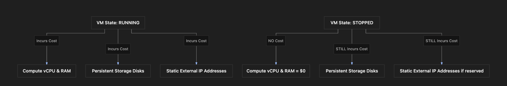

# Section Study Notes: GCE Billing Mechanics and Cost Optimization Scenarios

---

### 1. Overview
This section covers the granular billing mechanics of Google Compute Engine (GCE)—specifically how compute time, stopped states, and attached resources are billed—alongside practical scenarios for cost optimization and budget management.
- **The Problem:** Misunderstanding how GCE billing increments or paying for idle resources (such as disks and static IPs attached to stopped VMs) can result in unexpected cloud bills.
- **The Solution:** Adhering to GCE billing rules (per-second billing after a 1-minute minimum), practicing proper resource hygiene (releasing unused static IPs or deleting detached disks), setting up budget alerts, and mapping workloads to the correct pricing tiers.

---

### 2. ACE Exam Focus & Common Exam Traps
- **Exam Importance:** **HIGH** (Billing mechanics and cost optimization scenarios frequently appear in ACE certification questions, particularly regarding stopped VMs and resource states).
- **High-Priority Topics:**
  - **Per-Second Billing:** GCE bills compute instances per second *after* a mandatory 1-minute minimum charge.
  - **Stopped VM Billing Rules:** When a VM is **stopped**, compute (vCPU and RAM) charges stop, but **storage costs for persistent disks** and **charges for static external IP addresses** continue to accrue.
  - **Budget Alerts:** The primary proactive recommendation for avoiding cost surprises.
  - **Workload Mapping:** Matching predictable workloads to CUDs, long-running uncommitted workloads to SUDs, and fault-tolerant/batch workloads to Spot VMs.
- **Common Exam Traps:**
  - Assuming that stopping a VM stops all associated charges. (Trap: You still pay for persistent disks and static IPs).
  - Expecting billing to be purely per-second from the exact millisecond a VM starts. (Trap: There is a 1-minute minimum billing threshold).
  - Choosing Spot VMs for critical, time-sensitive backend APIs. (Trap: Spot VMs lack availability guarantees and can be preempted).

---

### 3. Detailed Concept Explanation

#### A. GCE Billing Increments
*   **1-Minute Minimum:** Every time a VM instance starts up, you are billed for a minimum of 1 minute of compute time.
*   **Per-Second Billing:** After that initial 1-minute threshold, compute usage is billed precisely on a *per-second* basis.

#### B. Stopped VM Cost Implications
*   When a VM state is changed from **RUNNING** to **STOPPED**:
    *   **Compute Charges (vCPU/RAM):** Pause completely ($0/hr).
    *   **Persistent Disk Charges:** Continue. The root boot disk and any attached secondary persistent disks remain provisioned and continue to incur storage costs.
    *   **Static IP Charges:** If the VM holds a reserved static external IP address, it continues to incur charges while stopped (note: *ephemeral* external IPs are released when a VM stops and do not incur charges).

#### C. Cost Management Best Practices
1.  **Budget Alerts:** Establish hard and soft budget limits with automated email notifications triggered at specific thresholds (e.g., 50%, 90%, 100% of budget) via Cloud Billing.
2.  **Right-Sizing:** Continuously monitor resource utilization (CPU/RAM metrics via Cloud Monitoring) to scale instances down if they are over-provisioned.
3.  **Discount Strategy Alignment:** Leverage SUDs, CUDs, and Spot VMs appropriately based on workload uptime and tolerance for interruption.

---

### 4. Visual Representations

#### GCE VM State vs. Billing Impact Matrix

---

### 5. Mental Models & Analogies

| Concept | Real-World Analogy | GCP / Technical Mapping |
| :--- | :--- | :--- |
| **Stopped VM Billing** | Parking a car in a rented garage. Even though the engine is turned off (no gas/compute consumed), you still have to pay rent for the parking space (persistent disk storage). | Stopping a GCE instance stops compute charges, but storage and static IP charges continue. |
| **Per-Second Billing (1-min min)** | A taxi ride that has a minimum flag drop fee for the first minute, followed by precise second-by-second meter ticking. | Minimum 1-minute billing charge for starting a VM, followed by per-second compute billing. |
| **Budget Alerts** | A bank account SMS notification setting that texts you when your balance drops or spending spikes past a threshold. | Setting up Cloud Billing budgets and programmatic alerts to prevent surprise cost overruns. |

---

### 6. Step-by-Step Workflows / Comparison Tables

#### Scenario-Based Cost Optimization Decision Matrix

| Scenario Requirement | Ideal GCP Feature / Action | Why? |
| :--- | :--- | :--- |
| Predictable steady-state needs for 1–3 years | **Committed Use Discounts (CUD)** | Yields maximum contractual savings for baseline steady-state capacity. |
| Continuous long-running workload without a contract | **Sustained Use Discounts (SUD)** | Automatically applied by Google when uptime exceeds 25% of the month. |
| Non-critical, restartable batch or CI/CD jobs | **Spot VMs** | Provides deep discounts (>80%) for fault-tolerant, short-lived tasks. |
| Time-sensitive or critical backend production APIs | **Standard Regular VMs** | Requires high availability and an SLA; Spot VMs are ineligible due to preemption risks. |
| Stopping a VM to save money temporarily | **Delete unused static IPs / review disk sizes** | Ensures you don't leak money on storage and reserved IPs while compute is turned off. |

---

### 7. Common Mistakes & Exam Traps

- **Trap 1:** Assuming that shutting down or stopping a GCE instance drops your cloud bill to absolute zero ($0).
  - *Correction:* Persistent disks and static external IP addresses remain active and continue billing until explicitly deleted or released.
- **Trap 2:** Recommending Spot VMs for a batch job that *cannot* tolerate sudden interruptions or save progress checkpoints.
  - *Correction:* Spot VMs can be abruptly terminated with a 30-second warning; workloads must be natively fault-tolerant to use them.

---

### 8. Certification Practice Questions

#### Q1: An administrator stops a Google Compute Engine virtual machine instance to reduce monthly project costs. Which of the following resource types will continue to incur charges while the VM is in the stopped state?
- A) vCPUs and memory (RAM) allocation
- B) Persistent storage disks attached to the VM
- C) Ephemeral external IP addresses automatically released upon stop
- D) Dynamic internal private IP addresses
- **Correct Answer:** B
- **Explanation:** When a VM is stopped, compute charges stop, but persistent disks remain provisioned and continue to incur storage fees. Ephemeral IPs are released, and internal private IPs do not incur active billing in a stopped state.
- **Why others are incorrect:** vCPUs and RAM charges halt entirely when a VM is stopped. Ephemeral IPs are released.
- **Exam Takeaway:** Remember that stopping a VM stops compute charges, but storage (disks) and static IPs continue to cost money.

#### Q2: What is the minimum billing duration applied by Google Cloud when starting a Compute Engine virtual machine instance before per-second billing takes effect?
- A) Exactly 1 hour
- B) 1 second
- C) 1 minute
- D) 24 hours
- **Correct Answer:** C
- **Explanation:** GCE bills compute instances for a minimum of 1 minute upon startup, after which billing transitions to a precise per-second increment.
- **Why others are incorrect:** 1 second ignores the minimum threshold rule; hours and days are far too long.
- **Exam Takeaway:** GCE uses a 1-minute minimum billing threshold, followed by per-second billing.

#### Q3: A cloud architect is designing a batch data processing pipeline that runs nightly. The tasks are short-lived, highly fault-tolerant, and capable of saving state to resume if interrupted. What is the most cost-effective compute option?
- A) Standard regular VMs with 3-year CUDs
- B) Spot VMs
- C) Solo Tenancy nodes
- D) Premium tier micro-instances
- **Correct Answer:** B
- **Explanation:** Spot VMs offer deep discounts (often >80%) and are ideal for fault-tolerant, short-lived batch jobs that can handle interruptions.
- **Why others are incorrect:** Standard regular VMs or Solo Tenancy nodes are significantly more expensive and unnecessary for fault-tolerant batch workloads.
- **Exam Takeaway:** Fault-tolerant, short-lived batch jobs are prime candidates for Spot VMs.

#### Q4: A company wants to prevent unexpected financial spikes and receive proactive notifications when their GCP spending crosses 80% of their monthly limit. What tool should they configure?
- A) Cloud Billing Budgets and Alerts
- B) VPC Network Flow Logs
- C) GCE Instance Template version tags
- D) Cloud Monitoring uptime checks
- **Correct Answer:** A
- **Explanation:** Cloud Billing Budgets and Alerts allow administrators to define budget caps and trigger automated email notifications at specified percentage thresholds.
- **Why others are incorrect:** Flow logs analyze network traffic, templates define VM structures, and uptime checks test web endpoints—none manage financial alerts.
- **Exam Takeaway:** Use Cloud Billing Budgets and Alerts for cost visibility and notifications.

#### Q5: An administrator stops a virtual machine that was configured with a reserved static external IP address. What happens regarding the billing of that IP address?
- A) Charges for the static IP stop immediately.
- B) The static IP continues to incur hourly charges while reserved, even though the VM is stopped.
- C) The static IP address is automatically deleted by Google Cloud.
- D) The billing rate for the static IP doubles as a penalty.
- **Correct Answer:** B
- **Explanation:** Reserved static external IP addresses incur hourly charges while they are reserved in a project, regardless of whether the attached VM is running or stopped.
- **Why others are incorrect:** Charges do not stop unless the static IP address is explicitly released back to the pool.
- **Exam Takeaway:** Reserved static IPs cost money even when the target VM is stopped; release them if unused.

#### Q6: Which of the following workloads is unsuited for deployment on Spot VMs due to availability and operational constraints?
- A) A distributed machine learning training model with checkpoint saves.
- B) A nightly database backup compression script.
- C) A time-sensitive, customer-facing real-time financial trading API backend.
- D) A CI/CD code compilation test runner container.
- **Correct Answer:** C
- **Explanation:** Real-time customer-facing financial APIs require strict uptime guarantees and SLAs. Spot VMs have no SLA and can be preempted at any time, making them dangerous for critical APIs.
- **Why others are incorrect:** ML training, backups, and CI/CD runners can easily tolerate interruptions or restart from checkpoints.
- **Exam Takeaway:** Never use Spot VMs for time-sensitive, critical production APIs that lack fault tolerance.

#### Q7: True or False: If a VM instance runs for 10 minutes, is the customer billed for 10 minutes of compute time down to the exact second after the initial threshold?
- A) False. Google Cloud bills exclusively in strict 1-hour blocks.
- B) True. After the initial 1-minute minimum, billing is calculated on a per-second basis.
- C) False. The minimum billing duration is 24 hours.
- D) True, but only if running Windows Server operating systems.
- **Correct Answer:** B
- **Explanation:** GCE enforces a 1-minute minimum, then bills exact usage on a per-second basis (e.g., 10 minutes = 600 seconds of compute calculation).
- **Why others are incorrect:** Hourly or daily billing minimums do not apply to modern GCE billing structures.
- **Exam Takeaway:** GCE billing is per-second after a 1-minute minimum.

#### Q8: What happens to ephemeral external IP addresses when a GCE virtual machine instance is stopped?
- A) They are permanently locked to the project and billed monthly.
- B) They are automatically released back to the pool and stop incurring costs.
- C) They convert automatically into static reserved IP addresses.
- D) They migrate to a secondary region.
- **Correct Answer:** B
- **Explanation:** Ephemeral external IP addresses are attached dynamically and are automatically released back to Google's public pool when a VM stops or terminates.
- **Why others are incorrect:** Ephemeral IPs do not convert to static paid reservations or persist on stopped VMs.
- **Exam Takeaway:** Ephemeral IPs release automatically on stop; static IPs do not.

#### Q9: A company has steady, predictable resource consumption patterns across 50 virtual machines running 24/7. They want to minimize costs without locking themselves into fixed single-instance machine types. Which cost optimization approach is best?
- A) Flexible spend-based Committed Use Discounts (CUDs)
- B) Running all instances exclusively as Spot VMs
- C) Deleting persistent storage disks nightly
- D) Relying entirely on free trial credits
- **Correct Answer:** A
- **Explanation:** Flexible spend-based CUDs allow companies to commit to a minimum hourly dollar spend across compute services, providing deep predictability discounts without tying commitments to rigid, immutable single-machine types.
- **Why others are incorrect:** Spot VMs risk business-critical uptime failure; deleting disks nightly destroys data; free trial credits expire quickly.
- **Exam Takeaway:** Flexible spend-based CUDs provide deep discounts for steady workloads without requiring rigid machine-type locks.

#### Q10: Which metric or telemetry source should an administrator review in Cloud Monitoring to determine if a GCE instance is over-provisioned and ready for right-sizing?
- A) CPU utilization and memory utilization trends over time
- B) VPC firewall rule hit counts
- C) Cloud Storage bucket object version counts
- D) Cloud DNS query latency rates
- **Correct Answer:** A
- **Explanation:** To right-size a VM, administrators evaluate CPU and memory utilization metrics in Cloud Monitoring to see if a smaller machine type can satisfy workload requirements.
- **Why others are incorrect:** Firewall logs, bucket counts, and DNS queries do not measure VM CPU/memory sizing efficiency.
- **Exam Takeaway:** Use CPU and memory utilization metrics in Cloud Monitoring for VM right-sizing decisions.