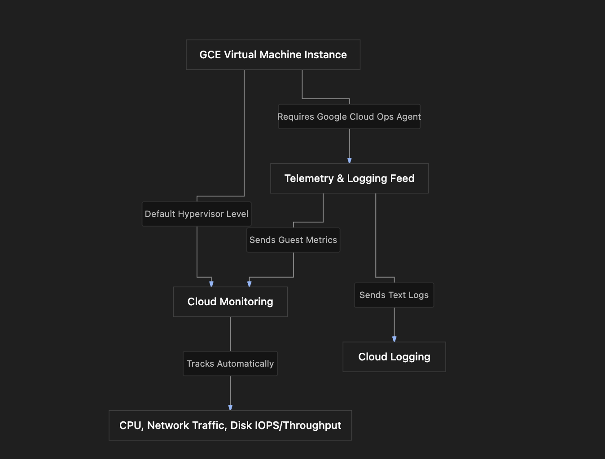

# Section Study Notes: GCE Observability, Metrics, Logs, and the Ops Agent

---

### 1. Overview
This section covers **Observability** for Google Compute Engine (GCE) virtual machines. Observability provides insight into the internal state of a system based on its external outputs: **metrics**, **logs**, and **traces**.
- **The Problem:** When applications running on VMs slow down or return errors, troubleshooting without centralized telemetry is difficult.
- **The Solution:** GCP provides native observability tools (`Cloud Monitoring` and `Cloud Logging`) alongside the **Google Cloud Ops Agent** to capture infrastructure and application-level performance data automatically or via a lightweight agent installation.

---

### 2. ACE Exam Focus & Common Exam Traps
- **Exam Importance:** **HIGH** (Monitoring, logging, and agent requirements are frequently tested in ACE troubleshooting and configuration scenarios).
- **High-Priority Topics:**
  - **Default Metrics:** Basic infrastructure metrics (CPU utilization, network traffic, disk throughput, and disk IOPS) are **automatically enabled by default** for all GCE VMs. No agent is required for these.
  - **Advanced Metrics & Logging:** Guest-level metrics (such as memory utilization and disk space utilization) and custom/system logs **require the Google Cloud Ops Agent** to be installed on the VM.
  - **Primary Services:** 
    - **Cloud Monitoring:** Tracks numeric metrics over time.
    - **Cloud Logging:** Captures text records and event logs.
    - **Cloud Trace:** Tracks distributed requests across multiple applications (out of scope for standalone single-VM GCE setups).
- **Common Exam Traps:**
  - Assuming memory utilization and disk space utilization are available by default on a fresh GCE VM. (Trap: Basic metrics cover CPU, network, and disk throughput/IOPS *only*. Memory and disk space utilization require the **Ops Agent**).
  - Believing that VM text logs flow into Cloud Logging automatically without any configuration. (Trap: OS and application-level log shipping to Cloud Logging requires the **Ops Agent**).

---

### 3. Detailed Concept Explanation

#### A. The Three Pillars of Observability
1. **Metrics:** Numeric values tracked over time (e.g., CPU utilization). Handled by **Cloud Monitoring**.
2. **Logs:** Text records of system or application events, warnings, and errors. Handled by **Cloud Logging**.
3. **Traces:** Requests tracked across multiple microservices and systems. Handled by **Cloud Trace** (typically applied to distributed systems rather than single isolated GCE instances).

#### B. Default Monitoring vs. Ops Agent Capabilities
*   **Without Ops Agent (Out-of-the-box):**
    *   **CPU Utilization**
    *   **Network Traffic** (incoming/outgoing bytes, packets)
    *   **Disk Throughput & IOPS** (Input/Output Operations Per Second)
*   **With Google Cloud Ops Agent Installed:**
    *   **Memory Utilization** (% of RAM used/free)
    *   **Disk Space Utilization** (% of local storage capacity used/free)
    *   **Application & System Logs** (shipping text logs from guest OS to Cloud Logging)

#### C. Google Cloud Ops Agent
*   **Definition:** A unified, single agent provided by Google for Linux and Windows virtual machines to collect both telemetry metrics and logs.
*   **Installation:** Can be checked and enabled via a simple toggle directly in the GCP Console during VM creation under the **Observability** tab (recommended by Google).

---

### 4. Visual Representations

#### GCE Observability Architecture

---

### 5. Mental Models & Analogies

| Concept | Real-World Analogy | GCP / Technical Mapping |
| :--- | :--- | :--- |
| **Default Basic Monitoring** | A car's dashboard speedometer and fuel gauge that come built into the vehicle dashboard by the factory. | Built-in hypervisor-level metrics (CPU, network, disk IOPS) available on every GCE VM out of the box. |
| **Google Cloud Ops Agent** | Installing an OBD-II scanner diagnostic tool or performance tracker plugged into a car to monitor internal engine oil temperature and tire pressure. | An agent installed inside the guest OS to track internal metrics like RAM memory and local disk space utilization, plus stream logs. |
| **Cloud Monitoring vs. Logging** | Video security camera footage (metrics tracking data over time) versus a written incident report log book (text records of events). | Cloud Monitoring tracks numeric trends over time; Cloud Logging stores text records of events and errors. |

---

### 6. Step-by-Step Workflows / Comparison Tables

#### Comparison Table: Default Monitoring vs. Ops Agent Features

| Telemetry Type | Default Monitoring (No Agent Needed) | With Google Cloud Ops Agent Installed |
| :--- | :--- | :--- |
| **CPU Utilization** | Available out-of-the-box | Available |
| **Network Traffic** | Available out-of-the-box | Available |
| **Disk Throughput & IOPS** | Available out-of-the-box | Available |
| **Memory (RAM) Utilization** | **Not Available** | **Available** |
| **Disk Space Utilization** | **Not Available** | **Available** |
| **Guest OS / App Logs Shipping** | **Not Available** | **Available** (sent to Cloud Logging) |

---

### 7. Common Mistakes & Exam Traps

- **Trap 1:** An engineer launches a standard Debian VM and looks at Cloud Monitoring, wondering why memory utilization graphs are blank. They assume the dashboard is broken.
  - *Correction:* Memory and disk space utilization metrics are guest-level metrics that require the **Google Cloud Ops Agent** to be installed.
- **Trap 2:** Assuming that enabling Cloud Logging requires a complex multi-step custom script configuration file on modern GCP workflows.
  - *Correction:* The Ops Agent can be easily enabled right from the GCP Console creation wizard under the **Observability** tab with a single recommendation toggle.

---

### 8. Certification Practice Questions

#### Q1: An administrator creates a brand-new Google Compute Engine VM instance using default settings without installing any additional software. Which of the following metrics can they immediately view in Cloud Monitoring without any extra configuration?
- A) RAM memory utilization percentage
- B) Local hard disk space consumption percentage
- C) CPU utilization and network traffic
- D) Custom application response time traces
- **Correct Answer:** C
- **Explanation:** Basic infrastructure metrics like CPU utilization, network traffic, and disk throughput/IOPS are enabled by default for all GCE instances.
- **Why others are incorrect:** Memory and disk space metrics require the Ops Agent; traces require Cloud Trace setups.
- **Exam Takeaway:** CPU, network, and disk IOPS metrics are available out-of-the-box without an agent.

#### Q2: A systems engineer needs to track memory (RAM) utilization and local disk space consumption for a fleet of Linux virtual machines running in Compute Engine. What action must be taken to collect these specific metrics?
- A) Upgrade the machine type to a memory-optimized tier only.
- B) Install the Google Cloud Ops Agent on the virtual machines.
- C) Enable VPC Flow Logs on the subnetwork.
- D) Restart the instances daily to flush the memory caches.
- **Correct Answer:** B
- **Explanation:** Guest-level metrics such as memory utilization and disk space usage require the installation of the Google Cloud Ops Agent inside the virtual machine.
- **Why others are incorrect:** Upgrading machine types does not automatically grant memory tracking metrics; VPC Flow Logs track network metadata, not VM memory.
- **Exam Takeaway:** Memory and disk space metrics require the Ops Agent.

#### Q3: Which Google Cloud service is primarily responsible for storing, searching, and analyzing text-based event records and application error logs streamed from virtual machines?
- A) Cloud Monitoring
- B) Cloud Logging
- C) Cloud Trace
- D) Cloud Storage
- **Correct Answer:** B
- **Explanation:** Cloud Logging is the dedicated Google Cloud service used to ingest, store, search, and analyze text logs and event records.
- **Why others are incorrect:** Cloud Monitoring tracks numeric metrics over time; Cloud Trace tracks request paths; Cloud Storage is a file object store.
- **Exam Takeaway:** Use Cloud Logging for text logs and Cloud Monitoring for numeric metrics.

#### Q4: True or False: Can text-based application logs be streamed from a GCE virtual machine instance into Cloud Logging without having the Google Cloud Ops Agent installed?
- A) True. All internal OS text logs stream automatically by default.
- B) False. Shipping guest-level logs to Cloud Logging requires the Google Cloud Ops Agent.
- C) True, but only if the VM is running Windows Server.
- D) False, because text logging is permanently disabled on Compute Engine.
- **Correct Answer:** B
- **Explanation:** Streaming logs from the guest OS or applications to Cloud Logging requires the installation of the Google Cloud Ops Agent.
- **Why others are incorrect:** Out-of-the-box monitoring covers hypervisor-level metrics only; guest logs require the agent.
- **Exam Takeaway:** Log shipping from a VM to Cloud Logging requires the Ops Agent.

#### Q5: Where can an administrator view basic out-of-the-box metrics like CPU utilization and disk throughput for a specific running virtual machine instance inside the Google Cloud Console?
- A) By navigating to the specific VM instance details page and checking the **Observability** tab.
- B) By opening Cloud Storage and reviewing the VM bucket folder.
- C) By looking at the project IAM policy JSON file.
- D) By checking the VPC firewall rule descriptions list.
- **Correct Answer:** A
- **Explanation:** Clicking on a VM instance in the Console and navigating to its **Observability** tab displays its built-in metrics and log feeds directly.
- **Why others are incorrect:** Storage buckets, IAM files, and firewall rules do not display VM runtime performance metrics.
- **Exam Takeaway:** VM performance metrics and logs can be reviewed directly under the VM's **Observability** tab in the Console.

#### Q6: What is the primary function of Google Cloud Trace in the context of observability?
- A) Tracking numeric CPU and memory consumption over time.
- B) Tracing and analyzing request latencies across complex distributed applications and microservices.
- C) Storing compressed database backup files.
- D) Monitoring physical data center room temperatures.
- **Correct Answer:** B
- **Explanation:** Cloud Trace is designed for distributed tracing, helping developers track requests as they travel across multiple microservices and backend systems.
- **Why others are incorrect:** CPU/memory metrics belong to Cloud Monitoring; backups and facility management are unrelated.
- **Exam Takeaway:** Cloud Trace measures request latency across distributed application architectures.

#### Q7: During VM creation in the GCP Console, where is the option located to enable the Google Cloud Ops Agent for performance monitoring and logging?
- A) Under the Security and TCP port forwarding menu
- B) Under the Observability tab configuration section
- C) Inside the Billing account assignment dropdown
- D) Within the static external IP address manager
- **Correct Answer:** B
- **Explanation:** The GCP Console provides a dedicated **Observability** tab during VM creation where users can toggle and configure the installation of the Ops Agent.
- **Why others are incorrect:** Security, billing, and IP address tabs serve completely different administrative functions.
- **Exam Takeaway:** The Ops Agent can be enabled easily via the **Observability** tab during VM creation.

#### Q8: Which of the following metrics is automatically gathered by default *without* installing any external agents on a standard GCE virtual machine?
- A) RAM memory usage percentage
- B) Local hard drive free space percentage
- C) Network traffic (incoming and outgoing bytes/packets)
- D) Internal application container error rates
- **Correct Answer:** C
- **Explanation:** Network traffic, CPU utilization, and disk IOPS/throughput are basic infrastructure metrics tracked automatically by default.
- **Why others are incorrect:** RAM usage, hard drive space, and custom application error tracking require guest configuration or the Ops Agent.
- **Exam Takeaway:** Default monitoring covers CPU, network, and disk throughput/IOPS out-of-the-box.

#### Q9: What are the three primary pillars of Observability discussed in system monitoring?
- A) IAM roles, VPC subnets, and Firewall rules
- B) Metrics, Logs, and Traces
- C) Machine types, Persistent disks, and Instance templates
- D) Regions, Zones, and Edge locations
- **Correct Answer:** B
- **Explanation:** Observability is achieved by analyzing three main types of external outputs: metrics, logs, and traces.
- **Why others are incorrect:** IAM, VPCs, machine types, and regions are infrastructure and security components, not observability telemetry pillars.
- **Exam Takeaway:** The three pillars of observability are metrics, logs, and traces.

#### Q10: Why is distributed tracing (Cloud Trace) typically considered out-of-scope for a basic, standalone Compute Engine virtual machine running a single isolated application?
- A) Because single standalone VMs do not generate any network traffic.
- B) Because tracing is designed to follow requests across multiple distributed services, whereas a single standalone VM usually runs an isolated single-tier application.
- C) Because Cloud Trace charges excessive fees for single VM instances.
- D) Because the Ops Agent explicitly blocks trace data from leaving the local host.
- **Correct Answer:** B
- **Explanation:** Distributed tracing is meant for tracking requests across complex multi-service architectures; a single standalone VM running one app typically does not require distributed trace analysis.
- **Why others are incorrect:** Standalone VMs generate network traffic, and tracing does not block data; the architectural scope simply fits multi-service environments better.
- **Exam Takeaway:** Tracing is tailored for distributed multi-service architectures rather than isolated single-VM apps.