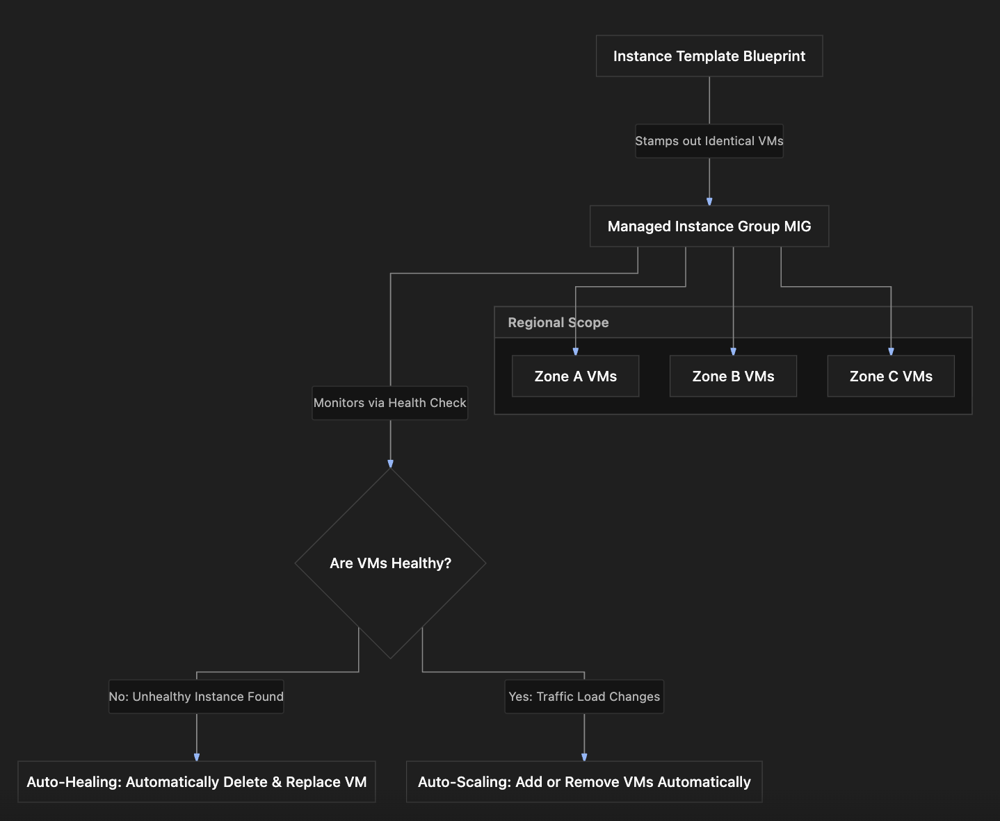

# Section Study Notes: GCE Instance Groups (Managed vs. Unmanaged & Zonal vs. Regional)

---

### 1. Overview
This section introduces **Instance Groups** in Google Compute Engine (GCE), which allow administrators to manage multiple virtual machine instances as a single logical entity.
- **The Problem:** Managing, scaling, and maintaining high availability for individual, standalone virtual machines manually is inefficient and difficult for production-grade web applications.
- **The Solution (Instance Groups):** Grouping multiple VMs together. There are two primary types: **Managed Instance Groups (MIGs)** for identical, template-based, scalable fleets with automated health checking, and **Unmanaged Instance Groups** for arbitrary, heterogeneous collections of pre-existing VMs.

---

### 2. ACE Exam Focus & Common Exam Traps
- **Exam Importance:** **VERY HIGH** (Instance groups, auto-scaling, auto-healing, and regional redundancy are core architecture components heavily tested on the ACE exam).
- **High-Priority Topics:**
  - **Managed Instance Groups (MIGs):**
    - Built using an **Instance Template**.
    - All instances are **identical**.
    - Features **auto-scaling** (dynamically growing/shrinking based on load) and **auto-healing** (automatically replacing unhealthy VMs detected via health checks).
  - **Unmanaged Instance Groups:**
    - Composed of heterogeneous, independent VMs with **different configurations/machine types**.
    - Does **not** support native auto-scaling or automated health-check healing.
  - **Zonal vs. Regional Scope:**
    - *Zonal:* All VMs reside in a single zone.
    - *Regional:* VMs are distributed across multiple zones within the same region, providing **higher availability** and fault tolerance against single-zone outages. Regional MIGs are strongly preferred for production environments.
- **Common Exam Traps:**
  - Expecting auto-scaling or auto-healing features to work on an Unmanaged Instance Group. (Trap: These advanced automation features are exclusive to Managed Instance Groups).
  - Assuming regional instance groups span multiple *regions*. (Trap: Regional instance groups span multiple *zones* within a *single region*).

---

### 3. Detailed Concept Explanation

#### A. Managed Instance Groups (MIGs)
*   **Definition:** Collections of identical GCE virtual machine instances created and managed using a single **Instance Template**.
*   **Core Capabilities:**
    *   **Auto-scaling:** Automatically increases or decreases the number of VM instances in the group based on observed metrics (like CPU utilization or load balancing capacity).
    *   **Auto-healing:** Relies on application or health checks. If a VM fails its health check response, the MIG automatically recreates/replaces the unhealthy instance with a brand-new, healthy one.
    *   **Uniformity:** Every VM in the group has identical specs (disk image, machine type, startup script) because they are stamped out from the same instance template.

#### B. Unmanaged Instance Groups
*   **Definition:** Collections of arbitrary, pre-existing individual virtual machine instances grouped together.
*   **Characteristics:**
    *   VMs can have **different configurations**, varying machine types, and custom OS setups.
    *   Lacks automated orchestration features like auto-scaling and auto-healing.
    *   Typically used for legacy migration or wrapping mismatched standalone servers into a legacy load-balancing backend.

#### C. Zonal vs. Regional Instance Groups
*   **Zonal Instance Group:** All virtual machines reside in a single zone. If that specific data center zone fails, the entire group goes offline.
*   **Regional Instance Group:** Virtual machines are automatically distributed across multiple zones within the same region. This is the **preferred architectural best practice** because it provides high availability and fault tolerance against individual zonal outages.

---

### 4. Visual Representations

#### Managed Instance Group (MIG) Architecture & Automation Flow

---

### 5. Mental Models & Analogies

| Concept | Real-World Analogy | GCP / Technical Mapping |
| :--- | :--- | :--- |
| **Managed Instance Group (MIG)** | A franchise restaurant chain where every location is built using the exact same master architectural blueprint, equipped with automated quality control inspectors (health checks) that replace broken equipment automatically. | A fleet of identical VMs created from an instance template, featuring auto-scaling and auto-healing. |
| **Unmanaged Instance Group** | A collection of mismatched classic cars parked in a garage together, each with a completely different engine size and transmission model. | A group of independent VMs with varying configurations and machine types managed as a single pool without auto-scaling. |
| **Regional Instance Group** | Spreading your retail store inventory across three different shopping malls in the same state so that if one mall floods, customers can still shop at the other two. | Distributing a regional instance group's VMs across multiple zones within a single region for high availability. |

---

### 6. Step-by-Step Workflows / Comparison Tables

#### Comparison Table: Managed vs. Unmanaged Instance Groups

| Feature | Managed Instance Group (MIG) | Unmanaged Instance Group |
| :--- | :--- | :--- |
| **VM Configuration** | Identical (created from an **Instance Template**). | Heterogeneous (can have different machine types and setups). |
| **Auto-scaling** | **Supported** (scales up/down based on load). | **Not Supported**. |
| **Auto-healing** | **Supported** (replaces unhealthy VMs via health checks). | **Not Supported**. |
| **Primary Use Case** | Scalable production microservices, web apps, and stateless workloads. | Grouping legacy or custom mismatched VMs together. |

---

### 7. Common Mistakes & Exam Traps

- **Trap 1:** A question asks how to automatically scale a fleet of virtual machines that have completely different machine types and custom software configurations. An engineer chooses a Managed Instance Group.
  - *Correction:* Managed Instance Groups require an instance template, meaning all VMs inside a MIG must be **identical**. You cannot put mismatched VMs into a standard MIG.
- **Trap 2:** Assuming a regional instance group deploys virtual machines across multiple different geographic countries or regions.
  - *Correction:* A regional resource spans multiple **zones** within a **single region**.

---

### 8. Certification Practice Questions

#### Q1: An architect needs to deploy a scalable web application where virtual machines must be automatically added during traffic spikes and unhealthy instances must be automatically replaced. Which GCE feature should be implemented?
- A) An unmanaged zonal instance group
- B) A Managed Instance Group (MIG) configured with a template and health check
- C) A single standalone virtual machine with an ephemeral IP
- D) A sole-tenant node group with anti-affinity tags
- **Correct Answer:** B
- **Explanation:** Managed Instance Groups (MIGs) provide built-in auto-scaling (adding instances under load) and auto-healing (replacing unhealthy instances via health checks).
- **Why others are incorrect:** Unmanaged groups lack auto-scaling and auto-healing; standalone VMs cannot auto-scale as a fleet; sole-tenant nodes handle physical hardware isolation.
- **Exam Takeaway:** Managed Instance Groups are required for auto-scaling and auto-healing features.

#### Q2: What is the primary foundational difference between a Managed Instance Group (MIG) and an Unmanaged Instance Group?
- A) MIGs are free of charge, while unmanaged groups bill hourly.
- B) MIGs contain identical virtual machines created from an instance template, whereas unmanaged groups can contain virtual machines with different configurations.
- C) Unmanaged groups support cross-region auto-scaling, while MIGs are restricted to single zones.
- D) MIGs can only run Windows Server, while unmanaged groups run Linux only.
- **Correct Answer:** B
- **Explanation:** MIGs use an instance template to ensure all VMs are identical, whereas unmanaged groups aggregate custom, pre-existing VMs that can have completely different configurations.
- **Why others are incorrect:** Instance groups themselves don't change compute billing rules; unmanaged groups do not support auto-scaling.
- **Exam Takeaway:** MIGs = identical instances via templates; Unmanaged groups = independent, custom instances.

#### Q3: A company wants to achieve maximum high availability for their web application workload against single data center facility failures. When creating a Managed Instance Group, which scope should they select?
- A) Zonal instance group restricted to `us-central1-a`
- B) Regional instance group spread across multiple zones in `us-central1`
- C) Local on-premises physical scope
- D) Global container cluster scope
- **Correct Answer:** B
- **Explanation:** Regional instance groups distribute virtual machines across multiple zones within a single region, providing high availability against single-zone failures.
- **Why others are incorrect:** Zonal instance groups fail entirely if that single zone goes down.
- **Exam Takeaway:** Choose regional instance groups for high availability across zones.

#### Q4: What action does a Managed Instance Group automatically take when a virtual machine fails its configured health check inspection?
- A) It shuts down the entire project billing account.
- B) It automatically deletes and replaces the unhealthy instance with a new, healthy instance.
- C) It converts the VM into a static sole-tenant node.
- D) It emails the Google Cloud legal department.
- **Correct Answer:** B
- **Explanation:** Auto-healing allows a MIG to monitor health checks and automatically recreate or replace unhealthy instances.
- **Why others are incorrect:** Billing, sole-tenant conversion, and legal notifications do not occur during auto-healing.
- **Exam Takeaway:** Auto-healing automatically replaces unhealthy VMs detected by health checks.

#### Q5: True or False: Can an unmanaged instance group be configured to automatically scale the number of virtual machine instances up or down based on CPU load metrics?
- A) True. Unmanaged groups support fully automated auto-scaling.
- B) False. Auto-scaling and auto-healing are exclusive features of Managed Instance Groups (MIGs).
- C) True, provided that a global instance template is attached first.
- D) False, unless the project is running Windows 95.
- **Correct Answer:** B
- **Explanation:** Unmanaged instance groups do not support auto-scaling or auto-healing; those orchestration features require a Managed Instance Group.
- **Why others are incorrect:** Unmanaged groups cannot attach instance templates to enable auto-scaling.
- **Exam Takeaway:** Unmanaged instance groups lack auto-scaling and auto-healing capabilities.

#### Q6: What is required as a prerequisite before you can create a Managed Instance Group?
- A) A physical USB recovery key
- B) An instance template
- C) A Cloud Storage coldline bucket root
- D) A public DNS registrar subscription
- **Correct Answer:** B
- **Explanation:** Managed Instance Groups require an instance template to define the uniform configuration of the virtual machines instantiated within the group.
- **Why others are incorrect:** USB keys, coldline buckets, and DNS registrars are unrelated to MIG creation.
- **Exam Takeaway:** An instance template is required to create a Managed Instance Group.

#### Q7: True or False: Does a regional instance group span across multiple distinct geographic regions (e.g., spanning from North America to Europe)?
- A) True. Regional groups always span multiple continents.
- B) False. A regional instance group distributes virtual machines across multiple zones within a *single* region.
- C) True, but only if spot provisioning is active.
- D) False, because regional groups are restricted to single data center server racks.
- **Correct Answer:** B
- **Explanation:** A GCP "region" contains multiple zones. A regional instance group distributes VMs across those zones *within that single region*, not across multiple continents/regions.
- **Why others are incorrect:** Multi-region deployments require multi-region architectures or global load balancers, not a single regional instance group.
- **Exam Takeaway:** Regional instance groups span multiple zones *within one region*.

#### Q8: Why might an enterprise choose to utilize an unmanaged instance group instead of a managed instance group?
- A) To gain access to advanced AI-driven auto-scaling.
- B) To group existing, heterogeneous virtual machines with different configurations into a single backend service pool (e.g., for a load balancer).
- C) To qualify for free compute credits.
- D) To bypass VPC firewall rules automatically.
- **Correct Answer:** B
- **Explanation:** Unmanaged instance groups are useful when you need to group pre-existing, custom, or mismatched virtual machines together as a single backend target.
- **Why others are incorrect:** Unmanaged groups do not offer auto-scaling, free credits, or firewall bypasses.
- **Exam Takeaway:** Use unmanaged groups to group existing heterogeneous VMs.

#### Q9: Which metric or mechanism does a Managed Instance Group use to determine if a virtual machine instance is malfunctioning and needs auto-healing?
- A) A health check configuration
- B) The physical color of the host server rack
- C) The project owner's personal credit score
- D) The number of labels attached to the VPC subnetwork
- **Correct Answer:** A
- **Explanation:** MIGs utilize health checks to periodically probe instances and trigger auto-healing replacement if checks fail.
- **Why others are incorrect:** Hardware colors, credit scores, and label counts have no impact on application health checking.
- **Exam Takeaway:** MIG auto-healing relies on configured health checks.

#### Q10: Between a zonal instance group and a regional instance group, which option provides superior architectural resilience against infrastructure failures?
- A) Zonal instance group, because it isolates all traffic to one physical room.
- B) Regional instance group, because VMs are distributed across multiple zones, preventing a single zonal outage from taking down the application.
- C) Neither offers any resilience compared to a single standalone VM.
- D) Zonal instance groups are preferred for high availability.
- **Correct Answer:** B
- **Explanation:** Regional instance groups provide greater fault tolerance by spreading instances across multiple zones, ensuring high availability even if an entire zone goes down.
- **Why others are incorrect:** Zonal groups have a single point of failure (the zone itself).
- **Exam Takeaway:** Regional instance groups offer superior fault tolerance and high availability.