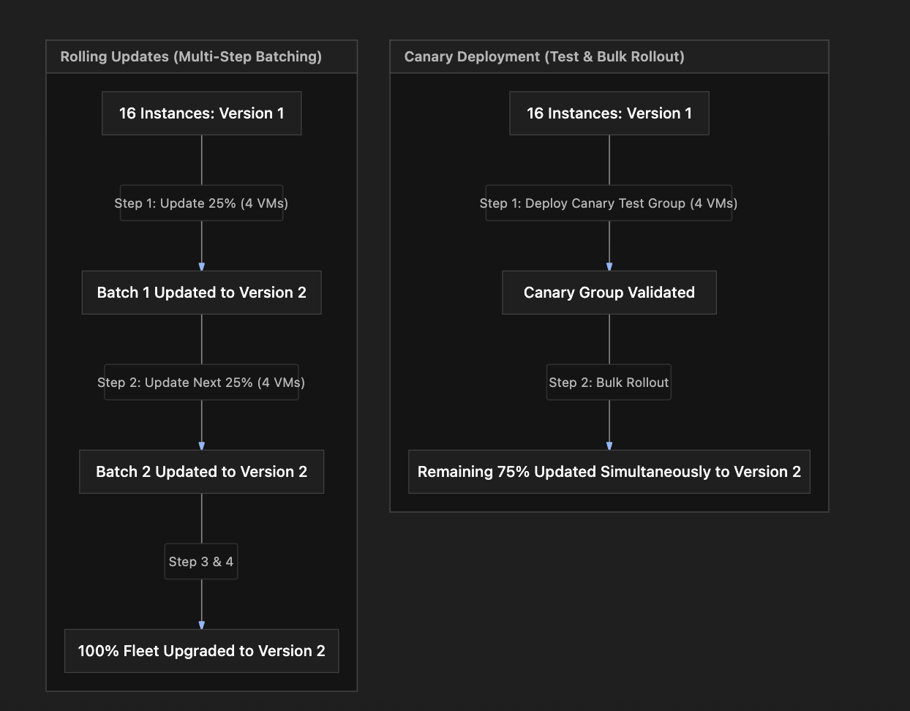

# Section Study Notes: Managed Instance Groups (MIGs) Deep Dive & Advanced Features

---

### 1. Overview
This section covers **Managed Instance Groups (MIGs)** in Google Compute Engine (GCE), expanding on their core architecture, automated lifecycle mechanisms, high availability structures, and advanced software release strategies.
- **The Problem:** Deploying updates or maintaining reliable uptime for multiple virtual machine instances manually risks user-facing downtime and administrative overhead.
- **The Solution (Managed Instance Groups & Update Strategies):** Utilizing MIGs to manage identical VM fleets automatically via instance templates, featuring instance count maintenance, **self-healing** via health checks, **auto-scaling**, **regional distribution**, and zero-downtime deployment strategies like **rolling updates** and **canary deployments**.

---

### 2. ACE Exam Focus & Common Exam Traps
- **Exam Importance:** **VERY HIGH** (MIG release strategies, self-healing mechanics, and high-availability structures are core concepts frequently tested on the ACE exam).
- **High-Priority Topics:**
  - **Identical Instances:** All VMs inside a MIG are stamped out from a single **Instance Template**.
  - **Self-Healing:** Utilizes health checks to detect unhealthy VMs and automatically delete and replace them with fresh instances.
  - **Instance Count Maintenance:** Keeps a constant target number of VMs running continuously.
  - **Release Strategies:**
    - **Rolling Updates:** Gradually updates instances step-by-step in batches (e.g., 25% at a time) until the entire fleet runs the new version.
    - **Canary Deployments:** Tests a new version on a small subset of instances first, and upon success, rolls it out to the remaining fleet in a single subsequent step.
  - **Regional MIGs:** Spreads instances across multiple zones in a single region to deliver high availability.
- **Common Exam Traps:**
  - Confusing the definition of a canary deployment with a rolling update. (Trap: Canary uses a single test group followed by a bulk rollout of the remainder; rolling updates happen continuously in sequential multi-step batches).
  - Assuming MIGs allow individual, non-template-based customized modifications to single VMs within the group. (Trap: MIG VMs are uniform; configuration changes require updating the template and performing a rolling/canary update).

---

### 3. Detailed Concept Explanation

#### A. Core Managed Instance Group (MIG) Features
*   **Instance Count Maintenance & Self-Healing:** 
    *   MIGs maintain a target number of active instances. 
    *   By coupling a health check to the group, the MIG constantly monitors service health. If an instance fails, the self-healing mechanism automatically terminates it and provisions a brand-new healthy replacement instance.
*   **Auto-Scaling:** Automatically expands or shrinks the size of the instance fleet based on incoming traffic volume or resource telemetry metrics (like CPU utilization).
*   **Load Balancing Integration:** Works with Google Cloud Load Balancers to distribute incoming user traffic evenly across all healthy instances in the MIG backend.
*   **Regional High Availability:** Spreads instances across multiple zones in a single region to survive single-zone hardware outages.

#### B. Advanced Release Strategies (Zero-Downtime Updates)
When updating an existing fleet of instances to a new template version, MIGs support automated deployment patterns to eliminate application downtime:
1.  **Rolling Updates:**
    *   Updates instances progressively in incremental batches or percentages (e.g., 25% of a 16-instance fleet = 4 instances per step).
    *   *Mechanism:* Update batch 1 $\rightarrow$ verify health $\rightarrow$ update batch 2 $\rightarrow$ repeat continuously until 100% of the fleet is upgraded.
2.  **Canary Deployments:**
    *   Deploys the new version to a small subset of instances first (the "canary" group, e.g., 4 out of 16 instances) to validate stability.
    *   *Mechanism:* Update canary group $\rightarrow$ test/validate $\rightarrow$ if successful, update *all remaining instances* in a single subsequent step.

---

### 4. Visual Representations

#### Rolling Updates vs. Canary Deployment Workflows

---

### 5. Mental Models & Analogies

| Concept | Real-World Analogy | GCP / Technical Mapping |
| :--- | :--- | :--- |
| **Self-Healing** | An automated assembly line quality control sensor that detects a defective product, instantly discards it, and builds a replacement unit. | A MIG health check detecting an unhealthy VM and automatically deleting and replacing it with a healthy instance. |
| **Rolling Update** | Renovating a large 16-story hotel by closing down and remodeling 4 floors at a time until the entire building is upgraded. | Incrementally updating a MIG in sequential batches (e.g., 25% at a time) to ensure zero downtime. |
| **Canary Deployment** | Miners taking a canary bird down into a coal mine to test air safety before sending the entire crew underground. | Deploying a new app version to a small test subset of VMs first to validate stability before rolling it out to the rest of the fleet. |

---

### 6. Step-by-Step Workflows / Comparison Tables

#### Comparison Table: MIG Release Strategies

| Feature | Rolling Updates | Canary Deployment |
| :--- | :--- | :--- |
| **Intermediate Steps** | Multiple steps (continuous sequential batches). | Single test step followed by a bulk rollout. |
| **Primary Goal** | Gradual, risk-managed upgrades across fractional batches of the fleet. | Quick validation of a new build on a small subset before full release. |
| **Fleet Impact** | Upgrades fraction by fraction until complete. | Tests a canary group, then updates all remaining instances together. |

---

### 7. Common Mistakes & Exam Traps

- **Trap 1:** An engineer believes a canary deployment involves continuous multi-step batching similar to a rolling update.
  - *Correction:* A canary deployment uses a single test group followed by a single bulk update of the remainder, whereas rolling updates use continuous multi-step sequential batches.
- **Trap 2:** Assuming self-healing triggers automatically without any configuration.
  - *Correction:* Self-healing requires a **health check** to be explicitly configured and attached to the Managed Instance Group.

---

### 8. Certification Practice Questions

#### Q1: A company is upgrading a Managed Instance Group containing 20 virtual machine instances to a new software version. They want to update the fleet gradually in continuous incremental steps of 25% at a time to prevent downtime. Which release strategy should they select?
- A) Canary deployment
- B) Rolling update
- C) Manual project deletion
- D) Static sole-tenant migration
- **Correct Answer:** B
- **Explanation:** Rolling updates progress continuously through fractional batches (e.g., 25% increments) until the entire fleet is upgraded.
- **Why others are incorrect:** Canary deployments use a single test group followed by a bulk update; deletion and sole-tenant migrations are unrelated.
- **Exam Takeaway:** Use rolling updates for continuous, multi-step incremental fleet upgrades.

#### Q2: What is the primary role of a canary deployment release strategy in a Managed Instance Group?
- A) To test a new version on a small subset of instances first, and upon success, roll it out to the remaining fleet.
- B) To permanently delete all instances during high traffic spikes.
- C) To route traffic exclusively to on-premises servers.
- D) To convert regional MIGs into unmanaged groups.
- **Correct Answer:** A
- **Explanation:** Canary deployments validate a new software version on a small sample group first before rolling it out to the rest of the instances.
- **Why others are incorrect:** Deletion, on-premises routing, and group conversion do not describe canary deployments.
- **Exam Takeaway:** Canary deployments test new code on a small subset before rolling it out globally.

#### Q3: Which feature allows a Managed Instance Group to automatically detect a malfunctioning virtual machine and replace it with a fresh instance?
- A) VPC Flow Logs
- B) Self-healing via health checks
- C) Cloud Storage bucket lifecycles
- D) Static external IP reservations
- **Correct Answer:** B
- **Explanation:** Self-healing uses health checks to monitor instances and automatically replace unhealthy nodes.
- **Why others are incorrect:** Flow logs, storage lifecycles, and IP reservations do not handle instance self-healing.
- **Exam Takeaway:** Self-healing combined with health checks handles automatic VM failure recovery.

#### Q4: True or False: Can a Managed Instance Group maintain a constant target number of running virtual machine instances automatically?
- A) False. MIGs only run instances manually on demand.
- B) True. MIGs maintain instance counts, replacing failed nodes and scaling as needed.
- C) False, because MIGs are limited to a maximum lifespan of 1 hour.
- D) True, but only for unmanaged groups.
- **Correct Answer:** B
- **Explanation:** One of the core features of a MIG is maintaining a target instance count and ensuring failed instances are replaced.
- **Why others are incorrect:** MIGs maintain continuous availability and do not time out after 1 hour.
- **Exam Takeaway:** MIGs maintain target instance counts and ensure high availability.

#### Q5: How many intermediate upgrade steps typically occur during a standard canary deployment in a Managed Instance Group?
- A) Zero intermediate steps
- B) Exactly one intermediate step (testing the canary group before updating the rest)
- C) Exactly 50 intermediate steps
- D) An infinite continuous loop
- **Correct Answer:** B
- **Explanation:** Canary deployments feature a single intermediate step (deploying to the canary test group), whereas rolling updates feature multiple sequential batch steps.
- **Why others are incorrect:** Zero steps means no deployment, and 50 steps describes rolling updates.
- **Exam Takeaway:** Canary deployments feature a single test step prior to bulk rollout.

#### Q6: Why would an architect choose a regional Managed Instance Group instead of a zonal Managed Instance Group for production workloads?
- A) To reduce billing costs to zero.
- B) To distribute virtual machines across multiple zones within a region, providing high availability against zonal outages.
- C) To bypass all VPC firewall rules.
- D) To force instances to run on physical desktop machines.
- **Correct Answer:** B
- **Explanation:** Regional MIGs provide high availability by spreading instances across multiple zones within a single region.
- **Why others are incorrect:** Regional MIGs do not make workloads free, bypass firewalls, or convert VMs to desktops.
- **Exam Takeaway:** Regional MIGs provide high availability across zones.

#### Q7: What triggers a Managed Instance Group's auto-scaling feature to increase the number of virtual machine instances?
- A) Changes in observed metrics or load (e.g., increased CPU utilization or load balancing capacity).
- B) The phase of the moon.
- C) A manual command typed into a billing credit card form.
- D) The expiration of a static external IP address.
- **Correct Answer:** A
- **Explanation:** Auto-scaling dynamically adds or removes instances based on workload metrics like CPU utilization or load balancer capacity.
- **Why others are incorrect:** Moon phases, billing forms, and IP expirations do not trigger auto-scaling.
- **Exam Takeaway:** MIG auto-scaling is driven by performance and load metrics.

#### Q8: True or False: Are all virtual machines inside a Managed Instance Group guaranteed to be identical?
- A) False. MIGs contain completely mismatched, heterogeneous machine types.
- B) True. All VMs in a MIG are created from a single shared instance template and are identical.
- C) True, but only for Linux operating systems.
- D) False, unless an unmanaged group is attached.
- **Correct Answer:** B
- **Explanation:** MIGs use a single instance template, ensuring all instantiated virtual machines are identical.
- **Why others are incorrect:** Heterogeneous VMs are a characteristic of unmanaged instance groups, not MIGs.
- **Exam Takeaway:** MIGs ensure complete configuration uniformity via instance templates.

#### Q9: What happens to user traffic when a Managed Instance Group performs a rolling update or canary deployment?
- A) Traffic is dropped entirely, causing a complete system outage.
- B) Traffic is managed seamlessly through load balancing and health checking so that healthy instances handle requests without user-facing downtime.
- C) Traffic is redirected to external websites.
- D) Traffic is encrypted using quantum keys.
- **Correct Answer:** B
- **Explanation:** Release strategies are designed for zero downtime, leveraging load balancers and health checks to route traffic away from updating instances to healthy ones.
- **Why others are incorrect:** Zero-downtime updates prevent outages and traffic drops.
- **Exam Takeaway:** MIG release strategies maintain uptime during updates.

#### Q10: Which of the following components is required to configure self-healing in a Managed Instance Group?
- A) An attached health check
- B) A physical tape backup drive
- C) A global DNS registrar account
- D) A Spot VM preemption contract
- **Correct Answer:** A
- **Explanation:** Self-healing relies on a configured health check to evaluate instance responsiveness and trigger automatic replacement if checks fail.
- **Why others are incorrect:** Tape drives, DNS registrars, and Spot contracts are unrelated to MIG self-healing.
- **Exam Takeaway:** Configure health checks to enable MIG self-healing.