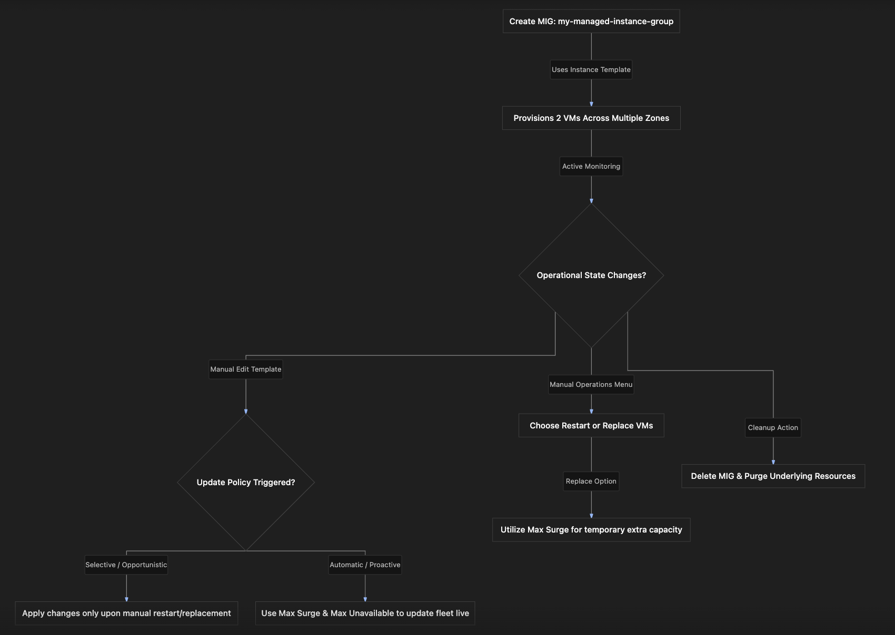

# Chapter Study Notes: Practical Implementation of GCE Managed Instance Groups (MIGs)

---

### 1. Overview
This section covers a practical, hands-on demonstration of configuring, operating, and deleting a **Managed Instance Group (MIG)** inside Google Compute Engine (GCE). 
- **The Problem:** Manually spinning up, balancing, and scaling stateless and stateful workloads across different zones without automation leads to configuration drift and availability risks.
- **The Solution:** Creating a stateless Managed Instance Group (`my-managed-instance-group`) using a previously defined Instance Template (`my-first-instance-template`), configuring auto-scaling parameters, setting up update policies, and executing operations like restarts, replacements, and clean deletion.

---

### 2. ACE Exam Focus & Common Exam Traps
- **Exam Importance:** **VERY HIGH** (Hands-on MIG configuration parameters, auto-scaling thresholds, max surge rules, and update policies are foundational topics for scenario-based ACE questions).
- **High-Priority Topics:**
  - **MIG Categories:** **Stateless** (for web servers, microservices, and apps where state is not stored locally) vs. **Stateful** (for databases or persistent data applications).
  - **Auto-Scaling Metrics:** CPU utilization is the default metric, but scaling can also utilize HTTP load balancing, Pub/Sub queue message counts, or Cloud Monitoring metrics.
  - **Update Policies:**
    - *Selective (Opportunistic):* Existing VMs are *not* automatically updated when a template changes; updates apply only when instances are manually restarted or replaced.
    - *Automatic (Proactive):* Changes are applied immediately to the fleet.
  - **Max Surge vs. Max Unavailable:**
    - *Max Surge:* The maximum number of *temporary* extra instances that can be created above the target size during an update or replacement process.
    - *Max Unavailable:* The maximum number of instances that can be offline/unavailable simultaneously during updates or restarts.
- **Common Exam Traps:**
  - Assuming an unmanaged instance group supports auto-scaling and automatic template rollouts. (Trap: Unmanaged groups lack automation features entirely).
  - Confusing Selective and Automatic update behaviors. (Trap: Selective waits for restarts/replacements; Automatic applies updates proactively).

---

### 3. Detailed Concept Explanation

#### A. Managed Instance Group Creation Parameters
When initiating the creation of a MIG in the GCP Console, administrators must configure several structural elements:
1.  **Group Type Selection:** Stateless vs. Stateful. (Stateless is used for standard web servers and scale-out application pools).
2.  **Instance Template Binding:** Referencing an existing blueprint (e.g., `my-first-instance-template`) to guarantee configuration uniformity across all instances.
3.  **Initial Size:** Declaring the starting number of virtual machine instances (e.g., 2 instances).
4.  **Location Scope:** 
    *   *Single Zone:* All VMs land in the exact same zone.
    *   *Multiple Zones (Regional MIG):* VMs are distributed across multiple zones within a single region, providing high availability.

#### B. Auto-Scaling Configuration Options
Auto-scaling allows a MIG to adapt dynamically to incoming traffic:
*   **Modes:** 
    *   *Off:* No scaling adjustments.
    *   *On:* Full scaling support (both scale-out [adding VMs] and scale-in [removing VMs]).
    *   *Scale Out Only:* Restricts adjustments exclusively to adding instances; never removes them automatically.
*   **Min/Max Limits:** Setting lower and upper boundaries on the fleet size.
*   **Autoscaling Metrics:** Default metric is **CPU utilization**, but extensible to HTTP load balancing capacity, Pub/Sub queue depth, or custom Cloud Monitoring metrics.
*   **Scale-In Controls:** Protects applications from sudden capacity drops by limiting the rate of reduction (e.g., restricting scale-in to a maximum of 10% reduction over a 10-minute window).

#### C. Operational Management: Restart, Replace, and Update Policies
1.  **Restart vs. Replace Operations:**
    *   *Restart:* Reboots existing instances in place, governed by `max unavailable` thresholds and `minimum wait time`.
    *   *Replace:* Destroys existing instances and provisions brand-new ones using the instance template. Supports **Max Surge** (temporary extra instances to maintain capacity during replacement).
2.  **Update Policies (Template Version Changes):**
    *   *Selective (Opportunistic):* Template changes do not apply immediately; they wait until instances are restarted or replaced.
    *   *Automatic (Proactive):* Forces immediate updates across the fleet using `max unavailable` and `max surge` controls to manage zero-downtime rollouts.

---

### 4. Practical Setup & Implementation Guide

#### Prerequisites & Permissions
*   An active Google Cloud project with an attached billing account.
*   The Compute Engine API enabled.
*   An existing Instance Template (e.g., `my-first-instance-template`).
*   IAM permissions: Compute Instance Admin (`roles/compute.instanceAdmin.v1`) or Project Editor/Owner.

#### Step-by-Step Console Implementation Walkthrough
1.  **Navigate to Instance Groups:**
    *   In the GCP Console navigation menu, expand **Compute Engine** and select **Instance groups**.
2.  **Create Instance Group:**
    *   Click **Create instance group**.
    *   Select **New managed instance group (MIG)**.
3.  **Configure Basic Settings:**
    *   **Name:** Enter `my-managed-instance-group`.
    *   **Group type:** Choose **Stateless** (default).
    *   **Instance template:** Select `my-first-instance-template`.
    *   **Number of instances:** Set to `2`.
    *   **Location:** Choose **Multiple zones** (Regional MIG) to spread VMs across zones within the region.
4.  **Configure Autoscaling:**
    *   Click to expand **Autoscaling** options.
    *   Set **Autoscaling mode** to **On**.
    *   Configure **Minimum number of instances** to `2` and **Maximum number of instances** to `2` (note: this triggers a warning that scaling is bounded, but is acceptable for a fixed-size demo).
    *   Keep **Metric** set to the default **CPU utilization**. Click **Done**.
5.  **Review & Provision:**
    *   Leave advanced health checks and scale-in controls at default values for this exercise.
    *   Click **Create**. (Provisioning takes approximately 5 minutes).
6.  **Verification:**
    *   Once ready, navigate to **VM instances** to confirm two instances have been successfully created across different zones. Test their external IP addresses in a web browser to verify web server responses.
7.  **Cleanup & Deletion:**
    *   Return to **Instance groups**, select `my-managed-instance-group`, click **Delete**, confirm by typing the deletion prompt, and wait for cleanup to complete.

---

### 5. Visual Representations

#### Managed Instance Group Operational Lifecycle

---

### 6. Mental Models & Analogies

| Concept | Real-World Analogy | GCP / Technical Mapping |
| :--- | :--- | :--- |
| **Stateless MIG** | A row of identical automated coffee vending machines. If one breaks down, it is thrown out and replaced instantly because no customer data is saved inside it. | A Managed Instance Group running stateless web servers where instances can be destroyed and recreated freely without data loss. |
| **Max Surge** | Opening temporary checkout lanes at a grocery store during peak holiday rushes before closing down the old registers. | Spun-up temporary extra instances created during a replacement or update operation to maintain total application capacity. |
| **Selective vs. Automatic Updates** | Upgrading software on a smartphone: *Selective* means it only updates when you reboot the phone; *Automatic* means it pushes and applies the patch immediately over the air. | *Selective (Opportunistic)* updates wait for restarts/replacements, while *Automatic (Proactive)* applies changes immediately. |

---

### 7. Step-by-Step Workflows / Comparison Tables

#### Comparison Table: Update Policy Modes in MIGs

| Update Policy Mode | Behavior on Template Change | When Instances are Upgraded | Risk / Impact Profile |
| :--- | :--- | :--- | :--- |
| **Selective (Opportunistic)** | Does not update existing VMs immediately. | Only when instances are manually restarted or replaced. | Lowest immediate disruption; old and new versions may temporarily coexist. |
| **Automatic (Proactive)** | Immediately triggers a fleet-wide update. | Proactively governed by **Max Surge** and **Max Unavailable** settings. | Active rollout; manages zero-downtime execution automatically. |

---

### 8. Common Mistakes & Exam Traps

- **Trap 1:** Setting the minimum and maximum autoscaling instances to the exact same number and wondering why traffic spikes do not trigger scaling actions.
  - *Correction:* When min and max are identical, the autoscaler has no room to expand or shrink capacity (yielding the console warning observed in the demo).
- **Trap 2:** Confusing **Max Surge** with **Max Unavailable** during a VM replacement or update.
  - *Correction:* *Max Surge* dictates how many *extra* temporary instances can be spun up above the target size; *Max Unavailable* dictates how many instances can be offline simultaneously.

---

### 9. Certification Practice Questions

#### Q1: An administrator modifies an instance template bound to a Managed Instance Group. However, the existing running virtual machine instances are not updated with the new configuration changes immediately. What update policy mode is most likely configured on this MIG?
- A) Automatic (Proactive) update mode
- B) Selective (Opportunistic) update mode
- C) Spot preemptible mode
- D) Stateful multi-region mode
- **Correct Answer:** B
- **Explanation:** In Selective (Opportunistic) update mode, existing virtual machines are not updated automatically when the underlying template changes; updates apply only when instances are restarted or replaced.
- **Why others are incorrect:** Automatic mode applies updates proactively right away; Spot and stateful modes do not govern template rollout behavior.
- **Exam Takeaway:** Selective update mode delays applying template modifications until instances restart or replace.

#### Q2: What is the specific function of the **Max Surge** parameter during a Managed Instance Group update or replacement operation?
- A) It defines the maximum hourly financial dollar budget allowed for the project.
- B) It dictates the maximum number of temporary extra instances that can be created above the target size during an update.
- C) It limits the maximum number of VPC subnets a project can hold.
- D) It specifies the maximum network bandwidth allowed across external IP addresses.
- **Correct Answer:** B
- **Explanation:** Max Surge controls temporary extra capacity, allowing additional instances to spin up during rolling updates or replacements so application capacity does not drop.
- **Why others are incorrect:** Budgets, subnets, and bandwidth limits are managed by Cloud Billing, VPCs, and network tiers respectively.
- **Exam Takeaway:** Max Surge controls temporary extra instance capacity during updates.

#### Q3: A database cluster running with persistent storage requirements across a group of virtual machines needs to preserve local state. Which type of Managed Instance Group should an administrator create?
- A) Stateless Managed Instance Group
- B) Stateful Managed Instance Group
- C) Unmanaged ephemeral group
- D) Public edge cache group
- **Correct Answer:** B
- **Explanation:** Stateful Managed Instance Groups are designed for workloads that require preserving persistent data, state, or configuration across instance lifecycles (like databases).
- **Why others are incorrect:** Stateless MIGs are intended for disposable, non-persistent application pools.
- **Exam Takeaway:** Use stateful MIGs for persistent workloads and databases.

#### Q4: If an administrator configures a Managed Instance Group's autoscaling metric to use the default setting, what telemetry data drives scaling decisions?
- A) Disk storage free space percentage
- B) CPU utilization
- C) VPC firewall rule block counts
- D) Cloud DNS query error rates
- **Correct Answer:** B
- **Explanation:** CPU utilization is the default metric used by the Google Cloud autoscaler to determine when to scale a MIG out or in.
- **Why others are incorrect:** Disk space, firewall blocks, and DNS errors are not default autoscaling triggers.
- **Exam Takeaway:** CPU utilization is the default metric for MIG autoscaling.

#### Q5: True or False: Can a Managed Instance Group be configured with **Scale Out Only** autoscaling mode to prevent the autoscaler from automatically removing instances during low load?
- A) False. Autoscalers must always remove instances.
- B) True. Scale Out Only mode adds instances during high load but never removes them automatically.
- C) False, because autoscaling only supports turning off entirely.
- D) True, but only if the project runs Windows Server.
- **Correct Answer:** B
- **Explanation:** Scale Out Only autoscaling mode allows the group to grow when demand increases, but prevents scale-in actions from reducing instance counts.
- **Why others are incorrect:** Autoscaling supports multiple modes including On, Off, and Scale Out Only.
- **Exam Takeaway:** Scale Out Only autoscaling prevents automatic instance removal during low load periods.

#### Q6: What does the **Max Unavailable** parameter control during a Managed Instance Group restart or update operation?
- A) The maximum number of instances that can be offline or unavailable simultaneously.
- B) The maximum number of days a persistent disk can remain unattached.
- C) The maximum number of static external IP addresses allowed in a region.
- D) The maximum downtime allowed for the project billing console.
- **Correct Answer:** A
- **Explanation:** Max Unavailable limits how many instances can be down at the same time during maintenance, updates, or restarts to ensure service availability.
- **Why others are incorrect:** Disk ages, IP quotas, and billing consoles are completely unrelated.
- **Exam Takeaway:** Max Unavailable limits simultaneous instance downtime during updates.

#### Q7: Why might an administrator choose to create a **Regional** Managed Instance Group instead of a **Zonal** Managed Instance Group?
- A) To distribute virtual machines across multiple zones within a region, ensuring high availability if an entire zone experiences an outage.
- B) To reduce compute billing costs to zero dollars.
- C) To bypass all virtual private cloud network boundaries.
- D) To convert instances into physical desktop workstations.
- **Correct Answer:** A
- **Explanation:** Regional MIGs spread workloads across multiple zones in a region, providing high availability and resilience against single-zone failures.
- **Why others are incorrect:** Regional placement does not make compute free or bypass VPC boundaries.
- **Exam Takeaway:** Regional MIGs provide multi-zone high availability.

#### Q8: What occurs when a Managed Instance Group is deleted via the Google Cloud Console?
- A) The instance template is permanently deleted alongside the MIG.
- B) The MIG resource is removed and its managed virtual machine instances are deleted, while standalone instance templates remain intact.
- C) The entire Google Cloud project is wiped out automatically.
- D) The VPC network and all subnets are permanently destroyed.
- **Correct Answer:** B
- **Explanation:** Deleting a MIG terminates and deletes its managed instances and group configuration, but leaves independent assets like instance templates intact unless explicitly deleted.
- **Why others are incorrect:** Templates, projects, and VPC networks are not automatically destroyed simply by deleting a MIG.
- **Exam Takeaway:** Deleting a MIG removes the group and its instances, leaving independent templates intact.

#### Q9: True or False: Can Google Cloud autoscaling rely on custom metrics from Cloud Monitoring in addition to CPU utilization?
- A) False. CPU utilization is the only allowed metric.
- B) True. Autoscaling can be driven by CPU utilization, HTTP load balancing capacity, Pub/Sub queue depth, or custom Cloud Monitoring metrics.
- C) False, because Cloud Monitoring cannot integrate with Compute Engine.
- D) True, but only during free trial periods.
- **Correct Answer:** B
- **Explanation:** GCP autoscaling is extensible and supports multiple metrics, including custom Cloud Monitoring metrics, queue depths, and load balancing capacity.
- **Why others are incorrect:** CPU is the default, but not the exclusive metric.
- **Exam Takeaway:** MIG autoscaling supports CPU, load balancing, Pub/Sub queues, and Cloud Monitoring metrics.

#### Q10: What is the primary purpose of configuring scale-in controls on a Managed Instance Group?
- A) To prevent applications from losing capacity too quickly by limiting the rate and percentage of instances that can be removed during scale-in events.
- B) To force all instances to migrate to another continent instantly.
- C) To encrypt incoming HTTP traffic using SSL certificates.
- D) To double the processing speed of every virtual CPU.
- **Correct Answer:** A
- **Explanation:** Scale-in controls protect workloads from abrupt capacity drops by capping the maximum percentage or number of instances that can be removed over a given time window.
- **Why others are incorrect:** Cross-continent migration, SSL encryption, and CPU speed doubling are unrelated features.
- **Exam Takeaway:** Scale-in controls protect workloads by limiting how fast instances can be removed during scale-in.