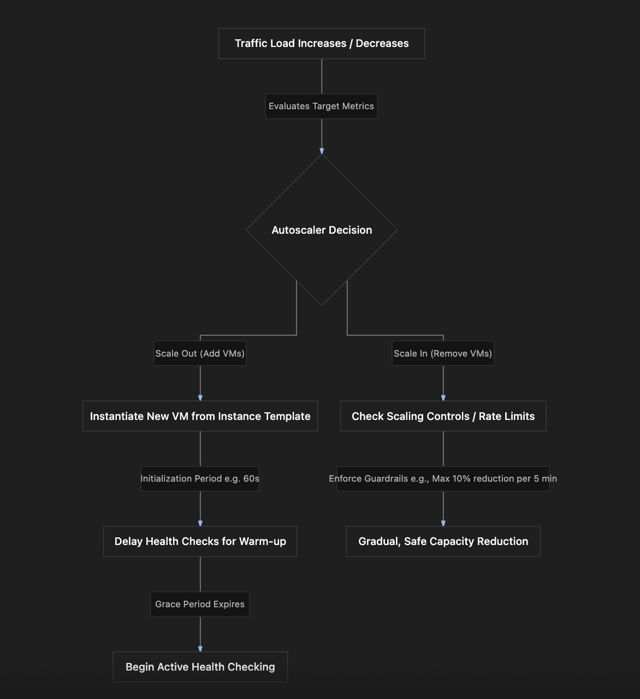

# Section Study Notes: MIG Advanced Configuration (Auto-scaling, Initialization Periods, and Scaling Controls)

---

### 1. Overview
This section covers advanced configuration options for **Google Compute Engine (GCE) Managed Instance Groups (MIGs)**, focusing specifically on instance template dependencies and granular auto-scaling parameters.
- **The Problem:** Scaling a fleet of virtual machines too aggressively, failing to account for application startup time, or dropping capacity too rapidly during sudden traffic dips can lead to application failure, dropped requests, or premature terminations.
- **The Solution:** Configuring advanced MIG auto-scaling controls—including minimum/maximum instance boundaries, custom metrics (CPU, load balancing, or Cloud Monitoring), **initialization periods** (cool-down/warm-up grace periods), and **scaling controls** (rate-limited scale-in protection).

---

### 2. ACE Exam Focus & Common Exam Traps
- **Exam Importance:** **VERY HIGH** (Advanced MIG configuration parameters, initialization cooldown periods, and scale-in controls are frequent subjects for scenario-based ACE questions).
- **High-Priority Topics:**
  - **Instance Template Dependency:** Every MIG requires a valid instance template as its base blueprint; all VMs inside a MIG are identical.
  - **Min/Max Instance Boundaries:** Setting minimum and maximum instance limits. If min and max are set to the exact same value (e.g., 3 and 3), the MIG maintains a fixed, static fleet size.
  - **Autoscaling Metrics:** CPU utilization (default), HTTP load balancing utilization, or any custom metric from **Cloud Monitoring**.
  - **Initialization Period:** A grace period (e.g., 60–120 seconds) that prevents health checks from executing immediately upon VM startup, giving applications time to initialize.
  - **Scaling Controls (Scale-In Protection):** Limits the rate at which instances can be removed during scale-in events (e.g., limiting reductions to a maximum of 10% every 5 minutes) to prevent dropping capacity too quickly.
- **Common Exam Traps:**
  - Assuming health checks execute the millisecond a newly auto-scaled VM boots up. (Trap: The initialization period delays health checks to prevent premature failure detection on starting apps).
  - Believing that setting min and max instances to the same number disables the MIG entirely. (Trap: It locks the MIG to a fixed size, acting like a static static-size group).

---

### 3. Detailed Concept Explanation

#### A. Instance Template Blueprint Rule
*   An instance template is mandatory when creating a MIG.
*   Guarantees that all virtual machines in the group are uniform, identical copies.

#### B. Autoscaling Parameters & Metrics
*   **Min and Max Instances:** Defines the bounds of the auto-scaler. 
    *   *Edge Case:* If `min = 3` and `max = 3`, the MIG acts as a fixed-size group of 3 instances regardless of load changes.
*   **Autoscaling Metrics:** The target driver for scaling up or down:
    *   **CPU Utilization:** Default standard metric.
    *   **Load Balancing Capacity Utilization:** Scales based on traffic load handled by an attached HTTP(S) load balancer.
    *   **Cloud Monitoring Metrics:** Custom metrics from Cloud Monitoring (e.g., memory usage, request queues).

#### C. Initialization Period (Warm-Up Grace Period)
*   **Purpose:** Newly booted VMs require time to initialize dependencies, load caches, and start application servers.
*   **Behavior:** The initialization period delays health check execution for a specified duration (e.g., 60 seconds). This prevents the MIG from misinterpreting a slow-starting application as "unhealthy" and prematurely deleting/replacing it.

#### D. Scaling Controls (Scale-In Rate Limiting)
*   **Purpose:** Protects applications from sudden drops in compute capacity caused by abrupt traffic changes or false monitoring signals.
*   **Behavior:** Restricts how fast the autoscaler can remove instances during scale-in events. For example, restricting reductions to a maximum of **10% every 5 minutes** ensures capacity steps down gradually rather than dropping from 100 instances to 10 instances instantaneously.

---

### 4. Visual Representations

#### MIG Auto-scaling Workflow & Advanced Controls

---

### 5. Mental Models & Analogies

| Concept | Real-World Analogy | GCP / Technical Mapping |
| :--- | :--- | :--- |
| **Initialization Period** | Allowing a new chef 10 minutes to prep their station and preheat the oven before health inspectors walk in to evaluate their performance. | A grace period that delays health check execution on newly launched VMs so booting applications have time to start up. |
| **Scaling Controls (Scale-In Protection)** | A parachute or a controlled brake system on an elevator, preventing it from dropping too fast if tension snaps. | Guardrails that limit the rate of instance removal during scale-in events (e.g., max 10% reduction per 5 minutes) to protect against sudden drops in capacity. |
| **Min = Max Instances** | Setting a thermostat to a fixed locked temperature of 72 degrees so it never fluctuates up or down. | Setting minimum and max instances to the same number, locking the MIG fleet to a fixed size. |

---

### 6. Step-by-Step Workflows / Comparison Tables

#### Comparison Table: Auto-scaling Metrics in GCE MIGs

| Metric Option | Source / Mechanism | Typical Use Case |
| :--- | :--- | :--- |
| **CPU Utilization** | Built-in hypervisor/agent telemetry. | Standard web applications and general microservice workloads. |
| **Load Balancing Capacity** | HTTP(S) load balancer backend metrics. | Applications fronted by external or internal load balancers. |
| **Cloud Monitoring Metrics** | Custom metrics ingested into Cloud Monitoring. | Advanced applications relying on custom telemetry (e.g., memory, custom queues). |

---

### 7. Common Mistakes & Exam Traps

- **Trap 1:** An application crashes upon startup during auto-scaling because health checks inspect the container or app too early before it finishes booting.
  - *Correction:* The **initialization period** needs to be configured to provide a proper grace window before health checks start.
- **Trap 2:** During a brief traffic dip, a MIG drops 90% of its instances instantly, causing user timeouts when traffic spikes back up a minute later.
  - *Correction:* **Scaling controls** should have been configured to limit the scale-in rate (e.g., capping reductions to 10% per interval).

---

### 8. Certification Practice Questions

#### Q1: An administrator notices that newly provisioned instances in a Managed Instance Group are being prematurely deleted by auto-healing health checks before their web applications finish starting up. What configuration parameter should be adjusted to fix this?
- A) Increase the maximum instance count limit.
- B) Configure an initialization period grace window.
- C) Switch from a regional to a zonal scope.
- D) Delete the instance template.
- **Correct Answer:** B
- **Explanation:** Configuring an initialization period delays health check execution on newly booted VMs, giving applications sufficient time to start up without triggering false-positive auto-healing deletions.
- **Why others are incorrect:** Maximum limits, regional scopes, and template deletions do not address startup race conditions.
- **Exam Takeaway:** Use initialization periods to give starting VMs time to warm up before health checks begin.

#### Q2: What happens if an administrator sets both the minimum number of instances and the maximum number of instances to the exact same number (e.g., 4 and 4) on a Managed Instance Group?
- A) The MIG becomes entirely disabled and deletes all instances.
- B) The MIG maintains a fixed fleet size of exactly 4 instances, preventing auto-scaling expansion or contraction.
- C) The MIG converts into an unmanaged instance group.
- D) GCP doubles the billing charge as a penalty.
- **Correct Answer:** B
- **Explanation:** When minimum and maximum bounds are identical, the autoscaler cannot scale up or down, locking the MIG to a static, fixed fleet size.
- **Why others are incorrect:** The MIG is not disabled or converted; billing remains standard.
- **Exam Takeaway:** Setting min and max instances to the same value creates a fixed-size fleet.

#### Q3: Which of the following metric sources can be used to drive auto-scaling behavior in a Google Cloud Managed Instance Group?
- A) CPU utilization, load balancing capacity utilization, or custom Cloud Monitoring metrics.
- B) The project owner's age and credit rating.
- C) The physical serial numbers of data center storage racks.
- D) The number of historical firewall rules in the VPC.
- **Correct Answer:** A
- **Explanation:** MIG auto-scaling supports standard CPU utilization, load balancing metrics, and any custom metric available via Cloud Monitoring.
- **Why others are incorrect:** Personal data, rack serial numbers, and firewall counts are unrelated to compute scaling.
- **Exam Takeaway:** MIG auto-scaling supports CPU, load balancing, and Cloud Monitoring metrics.

#### Q4: Why would an administrator configure scaling controls (scale-in rate limits) on a Managed Instance Group?
- A) To prevent the application from losing compute capacity too abruptly during sudden traffic drops or false monitoring signals.
- B) To double network packet encryption speed.
- C) To permanently block all incoming HTTP traffic.
- D) To force instances to migrate across global continents.
- **Correct Answer:** A
- **Explanation:** Scaling controls protect workloads by limiting the percentage or number of instances that can be removed during scale-in events, preventing capacity starvation if traffic spikes right back up.
- **Why others are incorrect:** Encryption, traffic blocking, and cross-continent migrations are unrelated features.
- **Exam Takeaway:** Scaling controls prevent capacity drops by limiting the rate of instance removal during scale-in.

#### Q5: True or False: Is an instance template optional when creating a Managed Instance Group?
- A) True. Instance templates are never required.
- B) False. An instance template is mandatory because it serves as the uniform blueprint for all VMs in the MIG.
- C) True, but only for unmanaged groups.
- D) False, unless using Spot VMs.
- **Correct Answer:** B
- **Explanation:** An instance template is a mandatory prerequisite for creating a Managed Instance Group, ensuring complete configuration uniformity across all instances.
- **Why others are incorrect:** You cannot create a MIG without referencing an instance template.
- **Exam Takeaway:** Instance templates are mandatory for Managed Instance Groups.

#### Q6: If an application is fronted by an HTTP(S) load balancer, what specialized autoscaling metric can a MIG utilize to scale instances based on backend load?
- A) Load balancing utilization metrics
- B) Local hard drive temperature
- C) Cloud Storage bucket object counts
- D) VPC subnetwork mask lengths
- **Correct Answer:** A
- **Explanation:** MIGs can utilize load balancing utilization metrics to scale instances according to actual traffic handled by the load balancer backend.
- **Why others are incorrect:** Disk temperature, bucket counts, and subnet masks do not measure load balancing traffic.
- **Exam Takeaway:** MIGs can scale based on HTTP load balancing utilization metrics.

#### Q7: What is the primary operational effect of an initialization period set to 90 seconds on a newly scaled-up GCE virtual machine?
- A) The VM is kept powered off for 90 seconds.
- B) Health checks are delayed for 90 seconds after boot, allowing the application time to initialize.
- C) The VM's IP address changes every 90 seconds.
- D) The VM billing rate is discounted by 90%.
- **Correct Answer:** B
- **Explanation:** An initialization period delays health check probes for the specified duration, giving the application time to warm up.
- **Why others are incorrect:** VMs are powered on during this period; IPs and billing rates do not change.
- **Exam Takeaway:** Initialization periods delay health checks to allow app warm-up.

#### Q8: True or False: Can custom metrics ingested into Cloud Monitoring be used as triggers for MIG auto-scaling?
- A) False. Only CPU utilization is permitted.
- B) True. MIG auto-scaling can ingest and act upon custom metrics from Cloud Monitoring.
- C) True, but only for Windows Server instances.
- D) False, because Cloud Monitoring cannot interface with Compute Engine.
- **Correct Answer:** B
- **Explanation:** Cloud Monitoring integration allows administrators to trigger auto-scaling based on custom application metrics (e.g., custom queue depths).
- **Why others are incorrect:** CPU is the default, but custom monitoring metrics are fully supported.
- **Exam Takeaway:** Custom metrics from Cloud Monitoring can drive MIG auto-scaling.

#### Q9: What happens during a scale-in event if a MIG has scaling controls configured to restrict reductions to a maximum of 10% every 5 minutes?
- A) The MIG ignores traffic drops entirely.
- B) The MIG reduces its instance count gradually, removing at most 10% of its instances per 5-minute interval.
- C) The MIG deletes all instances immediately.
- D) The MIG automatically pauses all auto-scaling forever.
- **Correct Answer:** B
- **Explanation:** The scaling control acts as a rate limiter, ensuring instance reduction happens progressively in controlled steps.
- **Why others are incorrect:** It does not ignore drops, wipe out instances instantly, or permanently disable scaling.
- **Exam Takeaway:** Scale-in rate limits ensure gradual, controlled instance reductions.

#### Q10: Which of the following core components is mandatory to define when setting up a Managed Instance Group autoscaling policy?
- A) Minimum and maximum number of instances
- B) A physical tape backup schedule
- C) A public DNS registrar domain name
- D) A physical hardware rack ID
- **Correct Answer:** A
- **Explanation:** Defining an autoscaling policy requires establishing minimum and maximum instance boundaries to govern scaling behavior.
- **Why others are incorrect:** Tape backups, domain names, and rack IDs are unrelated to autoscaling policies.
- **Exam Takeaway:** Minimum and maximum instance limits are mandatory parameters for autoscaling policies.