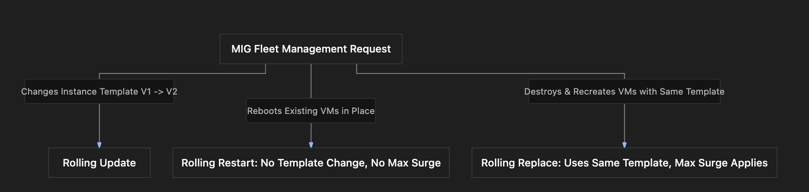

# Section Study Notes: MIG Advanced Operations (Rolling Update, Rolling Restart, and Rolling Replace)

---

### 1. Overview
This section covers advanced operations for managing Google Compute Engine (GCE) Managed Instance Groups (MIGs): **Rolling Update**, **Rolling Restart**, and **Rolling Replace**.
- **The Problem:** Performing infrastructure maintenance, applying configuration patches, or updating application code across a fleet of virtual machines manually can result in service disruptions, downtime, or configuration drift.
- **The Solution:** Utilizing automated, batch-driven MIG operations to systematically update templates, restart groups of instances, or replace aging instances sequentially without dropping availability.

---

### 2. ACE Exam Focus & Common Exam Traps
- **Exam Importance:** **VERY HIGH** (Distinguishing between rolling updates, restarts, and replaces, alongside parameters like Max Surge and Max Unavailable, is frequently tested on the ACE exam).
- **High-Priority Topics:**
  - **Rolling Update:** Changes the underlying **Instance Template** (e.g., from V1 to V2) and rolls it out across the fleet in batches.
  - **Rolling Restart:** Restarts existing VMs group by group. **No change** to the instance template; **Max Surge does not apply** (since no new VMs are created).
  - **Rolling Replace:** Replaces existing VMs with fresh new VMs using the **same** underlying instance template. **Max Surge applies** (because temporary new instances are spun up).
  - **Update Proactivity Modes:**
    - *Automatic (Proactive):* Updates happen immediately.
    - *Selective (Opportunistic):* Updates happen later when instances are resized, restarted, or replaced.
  - **Max Surge vs. Max Unavailable:**
    - *Max Surge:* Extra temporary instances created above target capacity during updates or replacements. (Not applicable to rolling restarts).
    - *Max Unavailable:* Maximum number of instances permitted to be offline simultaneously during the operation.
- **Common Exam Traps:**
  - Assuming a rolling restart or rolling replace changes the instance template version. (Trap: Neither changes the template; they work with the existing template to restart or rebuild VMs).
  - Applying Max Surge to a rolling restart. (Trap: Max Surge only applies when *new* instances are created, such as in updates or replacements).

---

### 3. Detailed Concept Explanation

#### A. Core Operations Comparison
1.  **Rolling Update:**
    *   **Goal:** Update the MIG to a **new Instance Template version** (e.g., V1 $\rightarrow$ V2).
    *   **Template Change:** Yes.
2.  **Rolling Restart:**
    *   **Goal:** Reboot existing VMs in place (e.g., to clear memory leaks or apply OS kernel updates).
    *   **Template Change:** No (uses the exact same template).
    *   **Max Surge Applicability:** **No** (no new instances are created).
3.  **Rolling Replace:**
    *   **Goal:** Destroy and recreate existing VMs with fresh instances to clear underlying hardware issues or corruption.
    *   **Template Change:** No (instances are built using the existing template).
    *   **Max Surge Applicability:** **Yes** (temporary extra instances are spun up to maintain capacity).

#### B. Rolling Update Configuration Controls
When executing a rolling update, administrators configure several behavioral parameters:
*   **New Target Template:** Specifies the destination template version (e.g., V2).
*   **Update Proactivity:**
    *   *Automatic (Proactive):* Triggers the update process immediately.
    *   *Selective (Opportunistic):* Defers application of the new template until instances are resized, manually restarted, or replaced later.
*   **Max Surge:** Limits how many *extra* temporary instances can be provisioned above the target size during the rollout. Can be absolute or a percentage.
*   **Max Unavailable:** Limits how many instances can be offline simultaneously during the update batch steps.

---

### 4. Visual Representations

#### MIG Operational Matrix: Update vs. Restart vs. Replace

---

### 5. Mental Models & Analogies

| Concept | Real-World Analogy | GCP / Technical Mapping |
| :--- | :--- | :--- |
| **Rolling Update** | Upgrading an entire vehicle fleet from Model Year 2024 to Model Year 2026 by swapping out cars batch by batch. | Gradually updating a MIG from Instance Template V1 to V2. |
| **Rolling Restart** | Rebooting a row of server blades sequentially to clear cache without buying new equipment. | Restarting existing VMs group by group using the same instance template. |
| **Rolling Replace** | Trading in old company laptops for brand-new identical laptops off the same factory model line. | Rebuilding existing VMs into fresh new instances using the exact same instance template. |
| **Max Surge in Replace vs. Restart** | Renting extra temporary chairs *while* replacing old chairs (Surge), versus just standing up and sitting back down in your own chair (No Surge). | Max Surge applies during rolling replacements (new instances created), but does not apply during rolling restarts (existing VMs rebooted). |

---

### 6. Step-by-Step Workflows / Comparison Tables

#### Comparison Table: MIG Management Operations

| Operation | Changes Template? | Creates New VMs? | Max Surge Applies? | Primary Purpose |
| :--- | :--- | :--- | :--- | :--- |
| **Rolling Update** | **Yes** (e.g., V1 $\rightarrow$ V2) | Yes | Yes | Upgrading application code, OS, or configurations via a new template. |
| **Rolling Restart** | No | **No** (reboots in place) | **No** | Clearing memory leaks or applying kernel updates without changing templates. |
| **Rolling Replace** | No | Yes (recreates fresh instances) | Yes | Refreshing instances to clear underlying host corruption or wear. |

---

### 7. Common Mistakes & Exam Traps

- **Trap 1:** An architect configures a Max Surge parameter for a rolling restart operation on a MIG.
  - *Correction:* Rolling restarts only reboot existing VMs in place; no new instances are created, so **Max Surge does not apply**.
- **Trap 2:** Assuming a rolling replace upgrades the fleet to a newer instance template version.
  - *Correction:* Rolling replaces recreate instances using the **exact same** current template. To change templates, a **rolling update** must be used.

---

### 8. Certification Practice Questions

#### Q1: An administrator needs to upgrade a Managed Instance Group from Instance Template version V1 to version V2 without causing application downtime. Which MIG management operation should be used?
- A) Rolling restart
- B) Rolling replace
- C) Rolling update
- D) Project deletion
- **Correct Answer:** C
- **Explanation:** A rolling update is specifically designed to shift a Managed Instance Group to a new instance template version progressively in batches.
- **Why others are incorrect:** Rolling restart and replace do not change instance templates; project deletion destroys everything.
- **Exam Takeaway:** Use rolling updates to migrate a MIG to a new instance template.

#### Q2: What is the primary operational distinction between a rolling restart and a rolling replace in a Managed Instance Group?
- A) Rolling restart changes the instance template, while rolling replace does not.
- B) Rolling restart reboots existing VMs in place using the same template, whereas rolling replace destroys and recreates fresh instances using the same template.
- C) Rolling replace is free, while rolling restart costs extra.
- D) Rolling restart deletes all persistent storage permanently.
- **Correct Answer:** B
- **Explanation:** Rolling restart reboots instances in place without changing templates or recreating hardware, while rolling replace provisions fresh new instances using the existing template.
- **Why others are incorrect:** Neither operation changes the instance template, and storage deletion does not occur automatically.
- **Exam Takeaway:** Rolling restart reboots VMs in place; rolling replace recreates fresh VMs.

#### Q3: True or False: Does the **Max Surge** parameter apply during a rolling restart operation on a Managed Instance Group?
- A) True. Max Surge is mandatory for rolling restarts.
- B) False. Max Surge does not apply to rolling restarts because no new instances are created; VMs are simply rebooted in place.
- C) True, but only if Windows Server is running.
- D) False, because rolling restarts are illegal in GCP.
- **Correct Answer:** B
- **Explanation:** Max Surge controls temporary *extra new instances*. Since rolling restarts only reboot existing VMs without creating new ones, Max Surge does not apply.
- **Why others are incorrect:** Max Surge applies to updates and replacements where new instances are spun up.
- **Exam Takeaway:** Max Surge does not apply to rolling restarts because no new instances are created.

#### Q4: When configuring a rolling update in a MIG, what is the difference between **Automatic (Proactive)** and **Selective (Opportunistic)** update proactivity modes?
- A) Automatic triggers the update immediately across the fleet, while Selective defers updates until instances are restarted, replaced, or resized later.
- B) Automatic is free, while Selective incurs double billing charges.
- C) Automatic deletes the MIG, while Selective preserves it.
- D) Automatic applies only to Windows, while Selective applies only to Linux.
- **Correct Answer:** A
- **Explanation:** Automatic (proactive) pushes template updates immediately, while Selective (opportunistic) waits until instances undergo other lifecycle events (like restarts or resizes) to apply the new template.
- **Why others are incorrect:** Billing and OS limitations do not dictate proactivity modes.
- **Exam Takeaway:** Automatic updates happen immediately; Selective updates happen opportunistically during other lifecycle events.

#### Q5: If an administrator executes a rolling replace on a MIG containing 10 instances, and configures a Max Surge of 2, how many total instances may be active concurrently during peak transition steps?
- A) Exactly 10 instances
- B) Up to 12 instances (10 target + 2 surge)
- C) Exactly 2 instances
- D) Exactly 20 instances
- **Correct Answer:** B
- **Explanation:** Max Surge allows temporary extra instances above the target size. With a target of 10 and a surge of 2, up to 12 instances can run concurrently during the replacement rollout.
- **Why others are incorrect:** The surge count adds to the target size rather than replacing it entirely.
- **Exam Takeaway:** Target capacity plus Max Surge equals maximum concurrent instances during rollouts.

#### Q6: Which MIG management operation should an administrator choose if they want to clear memory leaks on existing instances without altering the instance template or provisioning new hardware?
- A) Rolling update to V3
- B) Rolling restart
- C) Rolling replace
- D) Network subnetwork deletion
- **Correct Answer:** B
- **Explanation:** A rolling restart reboots existing instances in place, clearing memory caches and temporary states without changing templates or replacing instances.
- **Why others are incorrect:** Rolling updates change templates; rolling replace provisions new instances; subnet deletion breaks networking.
- **Exam Takeaway:** Use rolling restarts to reboot existing instances in place.

#### Q7: True or False: Do rolling replacements use a new, modified instance template during the recreation of virtual machines?
- A) True. Rolling replacements always require a new template version.
- B) False. Rolling replacements recreate fresh virtual machines using the *existing* current instance template.
- C) True, but only if the project uses free trial credits.
- D) False, because replacements cannot be performed on MIGs.
- **Correct Answer:** B
- **Explanation:** Rolling replacements recreate instances using the *same* active template. To change templates, a rolling update must be performed.
- **Why others are incorrect:** Changing templates is the exclusive function of rolling updates.
- **Exam Takeaway:** Rolling replacements use the existing template to recreate fresh instances.

#### Q8: What parameter limits the number of instances that can be offline simultaneously during a rolling update batch step?
- A) Max Unavailable
- B) Max Surge
- C) Minimum Instance Count
- D) Initialization Period
- **Correct Answer:** A
- **Explanation:** Max Unavailable caps how many instances can be down at the same time during updates or restarts to protect service capacity.
- **Why others are incorrect:** Max Surge controls extra instances; min count and initialization periods serve different scaling/boot functions.
- **Exam Takeaway:** Max Unavailable limits simultaneous downtime during rollouts.

#### Q9: Which of the following operations supports the application of the **Max Surge** parameter?
- A) Rolling restart only
- B) Rolling update and rolling replace
- C) Deleting a VPC subnetwork
- D) Creating a Cloud Storage bucket
- **Correct Answer:** B
- **Explanation:** Both rolling updates and rolling replacements provision new instances during their execution, making Max Surge fully applicable to both operations.
- **Why others are incorrect:** Rolling restarts do not create new instances, so Max Surge does not apply there.
- **Exam Takeaway:** Max Surge applies to rolling updates and rolling replacements.

#### Q10: What is the primary risk mitigated by configuring Max Surge and Max Unavailable during a MIG rolling update?
- A) Eliminating all project billing costs.
- B) Preventing application capacity drops and service downtime during fleet updates.
- C) Bypassing VPC firewall rules automatically.
- D) Converting zonal MIGs into global load balancers.
- **Correct Answer:** B
- **Explanation:** Max Surge and Max Unavailable work together to manage concurrency, ensuring sufficient capacity remains online to prevent downtime during updates.
- **Why others are incorrect:** They do not affect billing, firewalls, or load balancer routing architectures.
- **Exam Takeaway:** Max Surge and Max Unavailable prevent capacity drops and downtime during updates.