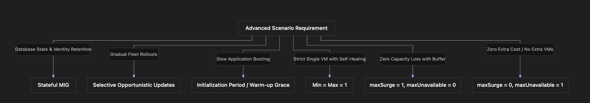

# Section Study Notes: MIG Advanced Scenarios & Real-World Troubleshooting

---

### 1. Overview
This section covers advanced, scenario-based real-world problem-solving for **Google Compute Engine (GCE) Managed Instance Groups (MIGs)**. 
- **The Problem:** Production systems face complex operational requirements—such as preserving database states, updating fleets gradually without capacity dips, handling slow application startups, preventing sudden traffic drop timeouts, and enforcing strict fixed-size operational footprints.
- **The Solution:** Applying specific configuration combinations within MIGs, including **Stateful MIGs**, **Selective (Opportunistic) updates**, **initialization grace periods**, **fixed-size scaling bounds (Min = Max)**, **Max Surge / Max Unavailable fine-tuning**, and **lowered CPU autoscaling targets**.

---

### 2. ACE Exam Focus & Common Exam Traps
- **Exam Importance:** **VERY HIGH** (Scenario-based questions frequently test your ability to map architectural requirements to specific MIG settings like stateful configurations, update proactivity modes, and surge parameters).
- **High-Priority Topics:**
  - **Stateful MIGs:** Used when databases or stateful applications require retaining instance names and persistent storage disks.
  - **Selective (Opportunistic) Updates:** Defers template changes until instances are manually resized, restarted, or replaced, preventing immediate mass-disruption.
  - **Initialization Period:** Solves the race condition where health checks probe a newly booted VM before the application has finished starting up.
  - **Fixed Fleet Footprint:** Setting `min = max` instances locks a MIG to a static size (e.g., exactly 1 VM) while still providing self-healing via health checks.
  - **Max Surge vs. Max Unavailable Scenarios:**
    - *Zero capacity reduction, maintaining extra buffer:* `maxSurge = 1`, `maxUnavailable = 0`.
    - *Strict zero-extra-capacity constraint (in-place rolling updates):* `maxSurge = 0`, `maxUnavailable = 1`.
- **Common Exam Traps:**
  - Confusing how to prevent capacity drops during updates. (Trap: To ensure no reduction in capacity while deploying a new version, `maxUnavailable` must be set to `0` paired with a `maxSurge` of at least `1`).
  - Assuming a standard stateless MIG can retain stateful disk data across instance recreation. (Trap: Stateless MIGs destroy local disks upon recreation; stateful MIGs are required to preserve disk and identity).

---

### 3. Detailed Concept Explanation

#### A. Scenario Breakdown & Solution Mapping
1.  **Retaining Disk and Identity (Databases):**
    *   *Scenario:* Running a database that requires keeping persistent disks and instance names across reboots/replacements.
    *   *Solution:* **Stateful Managed Instance Group**. Preserves instance names and persistent data.
2.  **Gradual Rollout Without Immediate Fleet Disruption:**
    *   *Scenario:* Wanting to roll out a new version without updating all running VMs simultaneously.
    *   *Solution:* **Selective (Opportunistic) Update type**. Defers updates until instances are resized, restarted, or replaced later.
3.  **Preventing False-Positive Health Check Failures During Startup:**
    *   *Scenario:* An application takes a long time to boot, causing health checks to mark it as unhealthy immediately upon launch.
    *   *Solution:* **Initialization Period / Cool-Down Period**. Delays health check execution to give the application time to warm up.
4.  **Running a Strict, Unscaled Single Instance with Auto-Healing:**
    *   *Scenario:* Needing exactly one VM running continuously without scaling up or down, but wanting automated recovery if it crashes.
    *   *Solution:* Setting **Minimum and Maximum instances to 1**. Combined with a health check, the MIG replaces the instance automatically if it fails.
5.  **Responding Quickly to Sudden Traffic Spikes:**
    *   *Scenario:* Requiring faster autoscaling response times during traffic surges.
    *   *Solution:* Reducing the initialization period and **lowering the autoscaling CPU target** (e.g., dropping from 80% to 50%) so scaling triggers earlier under lower load.
6.  **Zero Reduction in Capacity with Extra Buffer During Updates:**
    *   *Scenario:* Deploying a new version with a 5-instance fleet while ensuring capacity never drops below 5 at any time.
    *   *Solution:* Rolling update with **`maxSurge = 1`** and **`maxUnavailable = 0`**. The extra instance is spun up and verified first before old instances are updated.
7.  **Zero Extra Capacity / No Extra Resource Cost During Updates:**
    *   *Scenario:* Upgrading a fleet version without creating any temporary extra instances due to resource or budget limits.
    *   *Solution:* Rolling update with **`maxSurge = 0`** and **`maxUnavailable = 1`**. No extra VMs are provisioned; existing instances are updated one at a time.

---

### 4. Visual Representations

#### Advanced MIG Scenario Configuration Matrix

---

### 5. Mental Models & Analogies

| Concept | Real-World Analogy | GCP / Technical Mapping |
| :--- | :--- | :--- |
| **Stateful MIG** | Renting a customized permanent office space where your desk, filing cabinets, and office sign remain assigned strictly to you even if you take a vacation. | A stateful MIG preserving instance names and persistent storage disks across reboots. |
| **maxSurge = 1, maxUnavailable = 0** | Bringing in a temporary backup worker to shadow a primary worker *before* sending the primary worker home for retraining, ensuring total shift coverage never dips. | Provisioning 1 extra temporary instance (`maxSurge=1`) and keeping zero offline (`maxUnavailable=0`) during updates to prevent capacity drops. |
| **maxSurge = 0, maxUnavailable = 1** | A restaurant line cook taking a quick 5-minute break one at a time while the other cooks cover the station, without hiring an extra temporary chef. | Updating instances one at a time with zero extra capacity (`maxSurge=0`, `maxUnavailable=1`). |

---

### 6. Step-by-Step Workflows / Comparison Tables

#### Comparison Table: Advanced Update Scenarios (`maxSurge` & `maxUnavailable`)

| Scenario Requirement | `maxSurge` Value | `maxUnavailable` Value | Operational Behavior |
| :--- | :--- | :--- | :--- |
| **Zero capacity reduction + 1 buffer instance** | `1` | `0` | Spins up 1 extra instance first, waits for it to become ready, then updates old instances sequentially. |
| **Zero extra capacity / Strict budget limit** | `0` | `1` | Creates no extra instances; takes down and updates existing instances one at a time. |

---

### 7. Common Mistakes & Exam Traps

- **Trap 1:** An administrator configures `maxSurge = 0` and `maxUnavailable = 0` for a rolling update.
  - *Correction:* This combination is invalid because it leaves no room for any instances to be updated or created (locking the update process). One of them must be greater than zero.
- **Trap 2:** Assuming a stateless MIG will retain database files when an instance is auto-healed.
  - *Correction:* Stateless MIGs wipe out local ephemeral states; you must use a **Stateful MIG** with persistent storage configurations to retain data.

---

### 8. Certification Practice Questions

#### Q1: A company runs a relational database inside a Managed Instance Group and requires that instance names and persistent storage disks are preserved across reboots and failures. What type of MIG should be created?
- A) Stateless Managed Instance Group
- B) Stateful Managed Instance Group
- C) Unmanaged ephemeral group
- D) Public load-balanced edge group
- **Correct Answer:** B
- **Explanation:** Stateful Managed Instance Groups preserve instance names, metadata, and persistent storage disks across instance recreation and reboots.
- **Why others are incorrect:** Stateless MIGs drop local ephemeral data upon recreation.
- **Exam Takeaway:** Use stateful MIGs when databases require persistent disks and identity retention.

#### Q2: An administrator wants to deploy a rolling update across a MIG version. They have strict budget limits and cannot afford any extra temporary virtual machine instances during the rollout, but they are willing to allow one instance to be updated at a time. What parameter values should they set?
- A) `maxSurge = 1`, `maxUnavailable = 1`
- B) `maxSurge = 0`, `maxUnavailable = 1`
- C) `maxSurge = 5`, `maxUnavailable = 5`
- D) `maxSurge = 0`, `maxUnavailable = 0`
- **Correct Answer:** B
- **Explanation:** Setting `maxSurge = 0` ensures no extra temporary instances are created, while `maxUnavailable = 1` allows existing instances to be updated one at a time.
- **Why others are incorrect:** `maxSurge=1` creates extra instances; `maxUnavailable=0` with `maxSurge=0` is an invalid configuration.
- **Exam Takeaway:** Use `maxSurge=0` and `maxUnavailable=1` for zero extra resource capacity during updates.

#### Q3: An application deployed on a MIG takes 90 seconds to initialize its internal web server upon booting, causing health checks to falsely flag it as unhealthy immediately. What configuration change resolves this issue?
- A) Enable VPC Flow Logs on the subnetwork.
- B) Configure an initialization period (cool-down period) to delay health checks.
- C) Upgrade the project billing tier.
- D) Switch to an unmanaged instance group.
- **Correct Answer:** B
- **Explanation:** Configuring an initialization period delays health check execution, giving booting applications a grace window to finish starting up.
- **Why others are incorrect:** Flow logs, billing tiers, and unmanaged groups do not solve application startup timing issues.
- **Exam Takeaway:** Use initialization periods to prevent premature health check failures on slow-starting apps.

#### Q4: A system architect wants to ensure that a rolling update maintains full application capacity without any reduction at any time, utilizing exactly one extra temporary instance during the transition. What parameters should be configured?
- A) `maxSurge = 1`, `maxUnavailable = 0`
- B) `maxSurge = 0`, `maxUnavailable = 1`
- C) `maxSurge = 10`, `maxUnavailable = 10`
- D) `maxSurge = 0`, `maxUnavailable = 0`
- **Correct Answer:** A
- **Explanation:** Setting `maxSurge = 1` provisions 1 extra temporary instance first, and setting `maxUnavailable = 0` ensures no existing instances go offline until the new one is ready, preventing capacity drops.
- **Why others are incorrect:** `maxUnavailable=1` allows capacity to dip, while `maxSurge=0` prevents extra buffer instances.
- **Exam Takeaway:** Use `maxSurge=1` and `maxUnavailable=0` to guarantee zero capacity reduction with a 1-instance buffer.

#### Q5: An administrator wants a MIG to run a fixed fleet of exactly one virtual machine at all times without scaling up or down, while still benefiting from automated self-healing if the instance crashes. How should the MIG be configured?
- A) Set minimum instances to 0 and maximum to 100.
- B) Set both minimum and maximum instances to 1, and attach a health check.
- C) Convert the MIG into an unmanaged group.
- D) Delete the instance template.
- **Correct Answer:** B
- **Explanation:** Setting min and max instances to 1 locks the fleet size to 1, while attaching a health check enables self-healing replacement if that single instance fails.
- **Why others are incorrect:** 0 to 100 allows autoscaling; unmanaged groups lack auto-healing; deleting templates breaks the MIG.
- **Exam Takeaway:** Set min = max = 1 with a health check for a fixed single-VM footprint with auto-healing.

#### Q6: During a traffic surge, an application takes too long to trigger autoscaling. What adjustments can an administrator make to improve autoscaling responsiveness?
- A) Lower the autoscaling CPU target percentage and reduce initialization wait times.
- B) Increase the CPU target to 100%.
- C) Delete all VPC firewall rules.
- D) Convert the MIG into a zonal static instance.
- **Correct Answer:** A
- **Explanation:** Lowering the autoscaling target (e.g., from 80% to 50%) causes scaling to trigger earlier under lower load, speeding up response time during traffic spikes.
- **Why others are incorrect:** Increasing CPU targets to 100% delays scaling; firewalls and static conversions are unrelated.
- **Exam Takeaway:** Lowering autoscaling CPU targets triggers scaling faster during traffic spikes.

#### Q7: True or False: Do Selective (Opportunistic) updates apply template changes immediately to all running virtual machines in a MIG?
- A) True. Selective updates force immediate fleet-wide restarts.
- B) False. Selective updates defer template application until instances are manually restarted, resized, or replaced later.
- C) True, but only for Windows Server instances.
- D) False, because Selective updates are illegal in GCP.
- **Correct Answer:** B
- **Explanation:** Selective (opportunistic) update proactivity defers template rollouts, applying changes only when instances undergo other lifecycle events like restarts or replacements.
- **Why others are incorrect:** Immediate fleet-wide updates describe Automatic (proactive) mode.
- **Exam Takeaway:** Selective updates defer template rollouts until instances undergo other lifecycle events.

#### Q8: What happens when a Managed Instance Group uses a Stateful configuration for instance names?
- A) Instance names are randomized on every reboot.
- B) Instance names are preserved across reboots and instance recreation.
- C) Instance names convert into public IP addresses.
- D) Instance names are deleted permanently.
- **Correct Answer:** B
- **Explanation:** Stateful MIGs preserve specific instance names and persistent storage disks across reboots and instance recreation lifecycles.
- **Why others are incorrect:** Randomization defeats the purpose of stateful naming; conversions and deletions do not occur.
- **Exam Takeaway:** Stateful MIGs preserve instance names and disk data.

#### Q9: Which configuration combination represents an invalid setting for MIG rolling updates regarding surge and unavailability?
- A) `maxSurge = 1`, `maxUnavailable = 0`
- B) `maxSurge = 0`, `maxUnavailable = 1`
- C) `maxSurge = 0`, `maxUnavailable = 0`
- D) `maxSurge = 2`, `maxUnavailable = 1`
- **Correct Answer:** C
- **Explanation:** Setting both `maxSurge = 0` and `maxUnavailable = 0` is invalid because it prevents any instances from being created or taken offline, deadlocking the update process.
- **Why others are incorrect:** The other options are valid, working parameter combinations.
- **Exam Takeaway:** Setting both maxSurge and maxUnavailable to zero is invalid and deadlocks updates.

#### Q10: Why might an administrator choose a Selective update proactivity mode instead of Automatic during a minor code patch deployment?
- A) To avoid immediate disruptions across the entire fleet, allowing updates to happen naturally as instances are restarted or replaced over time.
- B) To double the processing speed of every virtual CPU.
- C) To bypass VPC network subnets.
- D) To convert the MIG into a static storage bucket.
- **Correct Answer:** A
- **Explanation:** Selective updates prevent mass simultaneous reboots, letting updates apply opportunistically during regular maintenance or instance lifecycle events.
- **Why others are incorrect:** CPU speed, subnets, and storage buckets are unaffected by update proactivity modes.
- **Exam Takeaway:** Selective updates prevent mass disruptions by applying changes opportunistically during regular lifecycle events.